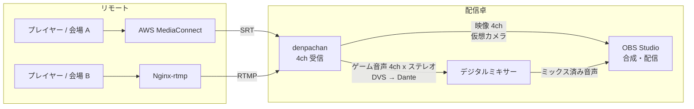
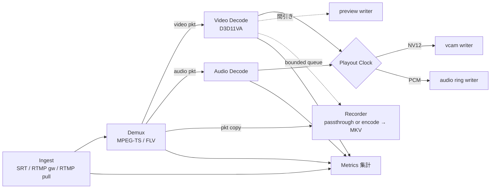
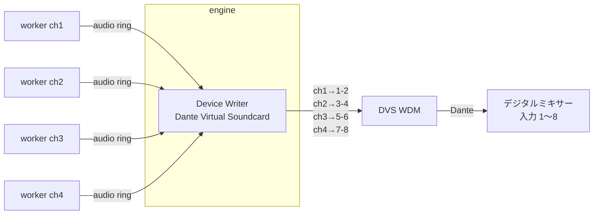
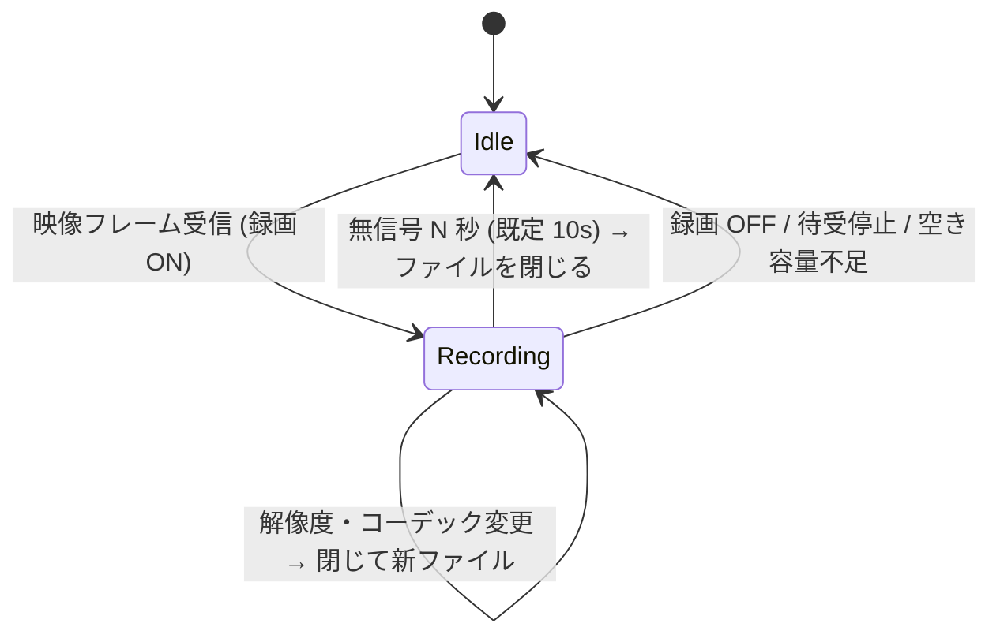

# denpachan 設計書 (v0.3 ドラフト)

SRT / RTMP で受けた映像・音声を、Windows 上の仮想カメラと任意の音声デバイス (Dante Virtual Soundcard 含む) に流し込む受信アプリケーション。ゲーム配信イベントでの運用を前提とし、**止まらないこと**を最優先の設計方針とする。

---

## 0. 位置づけと運用イメージ

vMix の「SRT / RTMP 入力を受けて外部出力する」部分だけを切り出したもの。スイッチングや合成はせず、**リモートの配信を受けて、ローカルの映像デバイスと音声デバイスに出すこと**だけに機能を絞る。合成は OBS、音声のミックスはデジタルミキサーが担う。



この使い方から、設計上次のことを重視する。

- **映像と音声は別経路で OBS に戻る**。映像は仮想カメラで直接、音声はミキサーを経由して戻るので、両者のずれは OBS 側のオフセットやミキサーのディレイで一度合わせることになる。**一度合わせたずれが、再接続や長時間運用で変わらないこと** が重要 (§3.5)。
- **音声はミキサーへの素材送り**。アプリは余計なことをせず、各チャンネルのゲーム音声を決まった Dante チャンネルへ生データのまま低遅延で流すことに徹する。音量や EQ はミキサーで扱う (§6)。
- **RTA イベントで使うので、遅延はとにかく小さくする**。アプリ内で足す遅延は既定 0 に近づけ、揺れの吸収は SRT 自身の latency に任せる (§3.5)。
- **映像が少し途切れただけで NO SIGNAL を出さない**。途絶中・worker の再起動中は最後に受信したフレームを出し続け、NO SIGNAL は「起動後一度も受信していない」か「ユーザーが明示的に表示をリセットした」ときだけ出す (§5.2)。
- 機能は最小限に絞り、そのぶん安定性と低負荷に振る。

---

## 1. 要件の整理

| # | 要件 | 設計上の扱い |
|---|------|-------------|
| R1 | 配信元: AWS Elemental MediaConnect, Nginx (nginx-rtmp) | MediaConnect → SRT (listener / caller 両対応)、Nginx → RTMP (1935 番への push 受け / pull) |
| R2 | 映像ソースを 4 つ登録、最大 4ch 同時受信 | チャンネルスロット固定 4 本。各スロットが独立したワーカープロセス |
| R3 | 内蔵の仮想映像デバイスに出力し OBS から参照 | DirectShow ソースフィルタを 4 台分登録 (`denpachan Cam 1..4`) |
| R4 | ソース → 仮想映像デバイスのルーティングをプルダウンで | チャンネル設定に `vcam: 1..4 / なし`。同一デバイスの重複割当は不可 |
| R5 | 音声を任意の音声デバイスへ。最低限 Dante Virtual Soundcard | WASAPI 出力 (DVS の WDM モード)。デバイス + 開始チャンネルを指定。ASIO は第 2 段階 |
| R6 | プレビュー、オンオフ切替 | 縮小フレームを共有メモリ経由で UI に渡す。オフ時はワーカー側で生成自体を止める |
| R7 | 受信状況・ビットレート・latency・jitter 等の計測、グラフ + 現在値、1 秒更新 | ワーカーが 1 秒ごとにメトリクスを集計 → エンジン → UI。直近 10 分をリングバッファで保持 |
| R8 | 待ち受け開始 / 停止をユーザーが操作 | チャンネル単位の Start / Stop。前回状態の自動復帰オプション |
| R9 | Windows のみ、高効率 | C++20 / FFmpeg / D3D11 ハードウェアデコード / GPU エンコーダ |
| R10 | なるべく止まらない | プロセス分離 + ウォッチドッグ + ライブ経路のノンブロッキング化 (§4) |
| R11 | 受信映像・音声のファイル保存 (設定でオンオフ) | ワーカー内の録画ブランチ。ライブ経路とは独立したキューで駆動 |
| R12 | 一定時間映像が来なければ区切り、次の受信で新ファイル | 無信号タイムアウト (既定 10 秒) でセグメントを閉じる |
| R13 | ファイル名テンプレート (`{ch}`, `{YYYY}` など) | テンプレートエンジン (§8.3)。`/` はサブフォルダとして扱う |
| R14 | ファイナライズ不要なコンテナを既定 (mkv 等) | 既定 MKV (クラスタ単位で書き出し、途中で落ちても再生可能)。MPEG-TS も選択可 |
| R15 | コーデック指定可、既定 H.264。ビットレート・量子化も変更可 | 既定は**パススルー** (再エンコードなし)。再エンコードを選ぶと既定 H.264、エンコーダ NVENC / QSV / AMF、CBR / VBR / CQP を設定可 |

### 1.1 決定事項 (v0.1 の未決事項への回答)

| 項目 | 決定 |
|------|------|
| 録画の既定モード | パススルー。再エンコードは設定で選択 |
| x264 の同梱 | しない。**FFmpeg 自体も同梱しない** (利用者が FFmpeg 9.x の shared 版を用意する。docs/dependencies.md)。CPU エンコードは利用者の ffmpeg.exe を使う (§8.4、M6 で追加) |
| 入力の上限 | 4K60 まで。ただし 1080p60 を受けるときに 4K 対応ぶんの負荷が増えない作りにする (§5.3)。実機はハイスペック PC 想定 |
| 音声チャンネル | 各ソースはステレオのみ |
| RTMP の待受 | 1935 番 1 本 + ストリームキーでチャンネル振り分け。初期から対応 (§3.3) |
| 仮想カメラの取り込み先 | OBS (DirectShow) で十分。Media Foundation 仮想カメラは作らない |
| UI | C# / WPF |
| ASIO 出力 | 第 2 段階 |

---

## 2. 全体アーキテクチャ

### 2.1 プロセス構成


| プロセス | 言語 | 役割 | 落ちたときの影響 |
|---------|------|------|----------------|
| `denpachan-engine.exe` | C++ | 常駐の本体。設定保持、子プロセスの起動・監視・再起動、共有メモリ (vcam / audio) の所有、音声デバイスへの出力・ミキシング、IPC サーバ | 全チャンネル停止。ただしコードを小さく保ち、ネットワークから来たデータを解析する処理は一切持たない |
| `denpachan-worker.exe --ch N` | C++ | 1 チャンネル分の受信 (SRT / RTMP pull) またはゲートウェイからの FLV 受け取り → デマックス → デコード → 各出力 (vcam / audio / preview / 録画 / メトリクス) | そのチャンネルのみ停止。エンジンが即座に再起動 (OBS 側は最後のフレームを表示し続ける) |
| `denpachan-rtmpd.exe` | C++ | RTMP サーバ (1935 番)。ハンドシェイク・チャンク層・publish 処理を行い、ストリームキーに対応するチャンネルへ FLV タグを渡す。メディアのデコードはしない | RTMP の全チャンネルが一時切断。即再起動し、Nginx 側の自動再 push (`push_reconnect`) で数秒以内に復帰。SRT チャンネルには影響なし |
| `denpachan-ui.exe` | C# | 操作画面、プレビュー、グラフ | 何も止まらない。再起動すれば現状を再取得 |
| `denpachan-vcam.dll` | C++ | DirectShow ソースフィルタ。OBS のプロセス内にロードされ、共有メモリからフレームを読む | 読み取り専用なので受信側には影響なし |

**なぜプロセス分離するか**: 壊れたストリームによる FFmpeg のクラッシュ、GPU ドライバのハング、エンコーダの暴走といった「受信データやドライバ起因の障害」を 1 チャンネルに閉じ込めるため。イベント中に 1ch が落ちても他 3ch と音声出力は無傷で、落ちた ch も 1〜2 秒で自動復帰する。UI を分けるのは、操作画面の不具合や描画負荷が配信経路に一切影響しないようにするため。UI を C# にしても、エンジンとは IPC と共有メモリでしかつながらないので、ライブ経路に GC 停止の影響は出ない。

### 2.2 技術スタック

| 領域 | 採用 | 理由 |
|------|------|------|
| エンジン / ワーカー / RTMP / vcam | C++20 | FFmpeg / libsrt / D3D11 / DirectShow / WASAPI をすべて素のまま扱える。GC 停止がない |
| ビルド (C++) | CMake + vcpkg (manifest mode) | 依存管理の再現性 |
| SRT | libsrt を直接使用 | FFmpeg の `srt://` プロトコルでは `srt_bstats` (RTT, ロス, 再送, 受信バッファ量) が取れないため。受信データは独自 AVIOContext で libavformat に渡す |
| RTMP サーバ | 自前実装 (§3.3) | 1 ポートでキー振り分けをするため。FFmpeg の listen モードは 1 接続 1 ポートでこれができない |
| デマックス / デコード / エンコード / Mux / RTMP pull | FFmpeg 9.x (libav*)。**同梱せず、利用者の shared 版の DLL を遅延ロード**。ビルドには同じ配布物 (gyan.dev の 9.0.2 shared 版) のヘッダと .def だけを使う (docs/dependencies.md §3.1) | 実績。Enhanced RTMP (HEVC/AV1) も対応 |
| HW デコード | D3D11VA (FFmpeg hwaccel)、失敗時はソフトウェアに自動フォールバック | GPU ベンダ非依存。4K HEVC も GPU で処理 |
| 映像変換 | D3D11 Video Processor (GPU 上でスケーリング / NV12 化してから CPU へ転送)、フォールバックで libswscale | CPU 負荷と GPU→CPU 転送量の削減 |
| 録画エンコード | NVENC / QSV (FFmpeg 経由)。CPU は外部 ffmpeg.exe (x264 / x265 / SVT-AV1) | x264 は同梱しない (GPL 回避) |
| 音声出力 | WASAPI (イベント駆動)。第 2 段階で ASIO | DVS の WDM モードは通常の多チャンネルエンドポイントとして見える |
| リサンプル | libswresample (ドリフト補正付き) | 長時間運用でのクロックずれ吸収 |
| UI | .NET 10 (LTS) / WPF (Fluent ダークテーマ)。外部ライブラリなし (MVVM の補助とグラフは自前の小さな実装) | 依存を増やさない。グラフは 1 秒ごとの折れ線だけなので自前で十分軽い |
| IPC | 名前付きパイプ + 改行区切り JSON (制御) / 共有メモリ (大容量データ) | C++ と C# の両方で依存なしに扱える。UI 側は `System.IO.Pipes` + `System.Text.Json`、共有メモリは `MemoryMappedFile` |
| ログ | spdlog (C++) / Microsoft.Extensions.Logging (UI)、いずれもローテーション付き | |
| クラッシュ解析 | `MiniDumpWriteDump` による自動ダンプ | 本番で落ちた原因を後から追える |
| 配布 | zip (展開すればすぐ使える。`tools/package.ps1`、CI で作る) | 仮想カメラは画面が自動でユーザー単位に登録。必要なランタイム (.NET 10、VC++、FFmpeg 9.x shared) は README に書く。インストーラは作らない (必要になったら検討) |

---

## 3. チャンネルワーカーのパイプライン



### 3.1 スレッド構成 (1 ワーカー内)

| スレッド | 処理 | ブロックしてよいか |
|---------|------|------------------|
| ingest | ソケット / FLV リングからの受信、トランスポート統計の取得 | 入力待ちのみ |
| demux | AVIO 経由でパケット化、タイムスタンプ補正 | ingest キュー待ちのみ |
| video-decode | デコード、GPU 上でスケーリング、CPU への転送 | |
| audio-decode | デコード、float32 / 48kHz / ステレオへの変換 | |
| output | Playout Clock に従い vcam / audio ring へ書き込み | **絶対にブロックしない** |
| recorder | (パススルー) Mux / (再エンコード) エンコード + Mux、ファイル I/O | ライブ系とは別キュー。詰まったら録画側で捨てる |
| metrics | 1 秒ごとの集計、ハートビート更新 | |

**原則: ライブ経路 (ingest → decode → vcam / audio) は、プレビュー・録画・メトリクス・UI のどれが詰まっても止まらない。** 副次ブランチへはすべて容量固定のキューで渡し、溢れたら古いものから捨ててカウンタに記録する。

### 3.2 Ingest: SRT (MediaConnect 向け)

共通インターフェース `IIngest` を定義し、プロトコル追加 (RIST, UDP/RTP-TS など) を差し替えで行えるようにする。

| 項目 | 内容 |
|------|------|
| モード | Listener (MediaConnect の SRT caller 出力を受ける) / Caller (MediaConnect の SRT listener 出力に接続) |
| 設定 | ポート (チャンネルごと)、待受 IP、latency (ms)、passphrase + 鍵長 (AES-128/192/256)、streamid、MTU 等 |
| ペイロード | MPEG-TS (MediaConnect 出力の標準) |
| 再接続 | 切断検知 → Listener は即再待受、Caller は指数バックオフ (0.5s → 最大 5s) で再接続 |
| latency の推奨値 | 受信状況から推奨値を出し、画面 (詳細、タイル、設定画面の latency 欄の横。「推奨値にする」ボタン付き) に表示する (下記) |

**latency の推奨値** (`src/worker/srt_advisor.h`): 目安は Haivision の SRT Deployment Guide の「latency ≥ RTT × 倍率」で、倍率はパケットロス率で決める (〜1%: 3、〜3%: 4、〜7%: 6、〜10%: 8、それ以上: 10)。

- 1 秒ごとの区間の統計 (`srt_bstats`) を直近 60 秒分溜め、RTT は窓の最大値、ロス率は「ロス ÷ (受信 + ロス)」で求める。接続直後の 5 秒は使わない (MediaConnect では接続の 1 秒目にロスがまとめて数えられた)。10 秒分溜まるまでは「計測中」。
- 窓の中で取りこぼし (再送が間に合わずに捨てたパケット) があれば、今の latency では足りないので、今の 1.5 倍以上を勧める。
- 下限 20 ms、10 ms 単位に切り上げ。
- 画面では、今の latency との比較を添える (下げられる / 足りない可能性がある / 足りていない)。実際に使われる latency は送出側との大きい方なので、相手側の値の方が大きいときは「下げるには相手側も下げる」と出す。

**実測 (AWS MediaConnect の SRT listener 出力に caller で接続、1080p60 H.264 約 3.3 Mbps)**: RTT 4〜5 ms (18 秒ほどおきに 9〜10 ms に跳ねる)、ロス率 2〜3% (再送ですべて回復、取りこぼし 0)、推奨値 30〜60 ms。こちらを 40 ms にしても MediaConnect 側の出力が 100 ms だったため、実際の latency は 100 ms だった。

### 3.3 Ingest: RTMP (Nginx 向け)

**3.3.1 Push 受け: 内蔵 RTMP サーバ `denpachan-rtmpd`**

1935 番を 1 本だけ開き、`rtmp://<host>:1935/<app>/<key>` の `<app>/<key>` でチャンネルに振り分ける。Nginx 側の設定例:

```nginx
application live {
    live on;
    push rtmp://192.168.1.50:1935/denpa/ch1-xxxxxxxx;   # ch1 のキー
    push_reconnect 1s;
}
```

| 項目 | 内容 |
|------|------|
| 対応範囲 | RTMP ハンドシェイク (単純ハンドシェイク。S1 の版数欄を 0 にすると、complex ハンドシェイクを送ってくる FFmpeg / nginx-rtmp / OBS も受け入れる)、チャンク層 (拡張タイムスタンプ、Set Chunk Size、Abort、Ack、Ping)、AMF0 コマンド (`connect` / `releaseStream` / `FCPublish` / `createStream` / `publish` / `FCUnpublish` / `deleteStream`)、FLV タグはそのまま通す (Enhanced RTMP の HEVC / AV1 も FFmpeg 側が対応) |
| 振り分け | チャンネルごとに `app` とストリームキーを設定。一致しないキーの publish は `NetStream.Publish.BadName` で拒否 (キーが合言葉の役割を兼ねる。キーはログに出さない)。振り分け表は engine が共有メモリ `Local\denpachan_rtmp_routes` に書き、rtmpd は publish のたびと 1 秒ごとに読む (チャンネルの追加・停止で rtmpd を再起動しない) |
| 同一キーの二重 publish | **後から来た接続を優先し、古い接続を切る**。ネットワーク瞬断で古い TCP 接続が半開きのまま残っても、送出側の再接続ですぐ復帰できるようにするため |
| チャンネルの Start / Stop | Stop 中のチャンネルのキーは拒否し、publish 中なら切る。rtmpd は RTMP push のチャンネルが 1 つでも Start していれば engine が起動する |
| ワーカーへの受け渡し | publish が確立したら、FLV ヘッダ + FLV タグを `Local\denpachan_flv_{ch}` のリング (8 MB) に書く (`@setDataFrame` は外して onMetaData から始まるスクリプトタグにする)。ワーカーはそれを libavformat の FLV デマクサに AVIO で渡す (SRT の TS と同じ形で扱える) |
| worker の再起動・追い越し | worker は publish の途中から読み始めるとき (再起動、追い越された) リングに再同期を頼む。rtmpd は最新のメタデータと音声・映像のコーデック設定を保持しておき、次のキーフレームで新しいセッションを始めてそれらを先に書く。**送出側の再接続を待たずに、キーフレーム間隔程度で復帰する** (SRT と違い、受信のソケットが worker の外にあるため) |
| 統計 | 受信バイト数、接続元、`SIO_TCP_INFO` による TCP の RTT / 再送量 |
| 堅牢性 | メディアは解析しない。チャンク層・AMF パーサは長さ・入れ子の深さを確かめ、壊れていればそこで読むのをやめる (メッセージ 16 MB、接続 16 本、無通信 5 秒で切断)。ファジング (libFuzzer) は M7 で行う |

> 代替案として、rtmpd が publish を確認した時点でソケットを `WSADuplicateSocket` でワーカーに渡す方式もある (データコピーがなくなる)。ただしチャンク層の状態の引き継ぎが必要で複雑になり、worker 再起動時の再同期もできなくなるため採用しない。

**3.3.2 Pull: Nginx から取りに行く**

`rtmp://nginx/live/key` をワーカーが FFmpeg の RTMP クライアントで再生する (`--input url`)。5 秒届かなければ切って、0.5 秒から最大 5 秒の間隔で繋ぎ直す。ログやメトリクスでは URL の最後の部分 (キー) を伏せる。

- nginx-rtmp は音声をすぐ送るが、映像は次のキーフレームから送る。FLV は最初のパケットが来たときにストリームを作るので、ストリームの解析 (2 秒) の間に音声しか来ないことがある。そのときは切らずに読み続け、映像のストリームが現れた時点でデコーダを開く (10 秒来なければ「映像なし」で切る)。同じコンテキストで `avformat_find_stream_info` を 2 回呼ぶと落ちる (FFmpeg 9.0.2) ので、解析はやり直さない。
- 実測 (ESC 上の nginx-rtmp から pull、1080p60): 修正前は開始直後に約 20 秒「映像なし」で繋ぎ直しを繰り返していた。修正後は 2〜4 秒で受信を始める。nginx がキャッシュした GOP をまとめて送ってくるので、開始直後は古いフレームを捨てて追いつく。TCP の届き方の揺れで、音声が 40 秒に数回途切れる (再生バッファ 0 ms で 6 回、60 ms で 2 回)。同じ配信を MediaConnect の SRT で受けると途切れは 0 だった。

**実測 (ローカル、FFmpeg を送出側に使用)**: push 受信、違うキーの拒否、二重 publish の切り替え (映像は途切れない)、worker の強制終了から約 5 秒で復帰 (送出側は繋いだまま)、rtmpd の強制終了から engine による再起動と送出側の繋ぎ直しで復帰、pull 受信、をすべて確認。Nginx-rtmp からの push は実機で要確認。

### 3.4 デコード

- 映像: D3D11VA でハードウェアデコード。初期化に失敗したとき、または**キーフレームのデコードが 3 回続けて失敗したとき** (本当に HW で読めないとき) はソフトウェアデコードへ切り替える (メトリクスに表示)。
- 受信開始時とデコードエラーのあとは、**次のキーフレームまで映像をデコーダに渡さない** (10 秒来なければそのまま渡す)。SRT は GOP の途中から届くので、キーフレームまでのフレームは参照が欠けていて読めない。以前はこれをデコードエラーとして数え、エラーが続いたことで HW デコードをやめていた (MediaConnect からの受信で、1 回の接続ごとにソフトウェアに落ちていた)。映るまでの時間は送出側のキーフレーム間隔で決まるので、送出側は 1〜2 秒にしておくとよい。
- 解像度・フォーマット変更 (送出側のエンコーダ設定変更など) を検知したらデコーダを作り直す。仮想カメラ側の出力フォーマットは別に決まっているので、そこで吸収する (§5.3)。
- タイムスタンプの不連続 (送出側の再起動、PTS のラップアラウンド) を検知したら Playout Clock を再アンカーする。

### 3.5 Playout Clock (A/V 同期とジッタ吸収)

映像は仮想カメラ、音声は別の音声デバイスへ出るため、両者を同じ時間軸で送り出す仕組みがチャンネルごとに必要になる。

- 最初のフレーム到着時に `media PTS ↔ ローカル単調時刻 (QPC)` を対応付け、設定した **再生バッファ** の分だけ遅らせて送出する。
  - SRT の既定は **0 ms** (デコードしたら即出す)。SRT は自身の latency (TSBPD) でパケットを一定の間隔に揃えてから渡すので、ここで重ねて待つ必要はない。実際の配信元でカクつきが出るときだけ 1 フレーム分 (16 ms) 程度に上げる。
  - RTMP (TCP) は揺れを吸収する仕組みがないので、既定値を別に決める (M4 で実測して決める)。
  - 実測 (ローカル、1080p60): 再生バッファ 100 ms → 出力までの遅延 105〜127 ms / 10 ms → 16〜32 ms / 0 ms → 0〜31 ms。いずれもコマ落ちなし。
- 映像: 送出時刻が来たフレームを vcam リングへ書く。遅れたフレームは捨てる。
- 音声: **既定は A/V 同期**。映像を仮想カメラに出す瞬間に、同じ時刻の音がデバイスから鳴るようにする (vMix と同様、運用で A/V を合わせる必要がないように)。engine は自分の出力遅延 (デバイスのバッファ + 余裕 + 音声オフセット) を共有メモリに書き、worker はそれを差し引いた時刻に音声を engine へ渡す (§6.3)。
  - 音声が映像より遅れて届く送出元では、届く前に鳴らせないので時計が遅らされ、その分映像が待つ。どれだけ待っているかはメトリクスに出る。
  - 実測 (ローカル、共有モード、音声出力遅延 32 ms): 送出側が音声をまとめずに多重化 (`-pes_payload_size 0`) → 映像の待ちは約 20 ms。ffmpeg 既定の多重化 (音声を数フレームまとめるので約 125 ms 遅れて届く) → 約 173 ms。送出側の多重化設定が遅延を大きく左右するので、運用の手引きに書く。
  - 低遅延モード (`--no-av-sync`): 映像・音声をそれぞれ最小遅延で出す。両者のずれは送出側の多重化で決まる値になり、メトリクスに出る。
- 時間軸の調整は映像・音声の両方の到着を見て行う: 1 秒ごとに、余裕の最も小さかった側が目標 (映像: 再生バッファ、音声: 0) になるよう動かす (3 フレームを超えるずれは一度に、それ以下は 1 ms ずつ)。音声が遅れて届いたら即座に遅らせる。接続直後 0.5 秒のまとめ届きは無視し、音声は時計の最初の調整が済んでから鳴らし始める (鳴り始めてから時間軸が大きく動かないように)。
- **チャンネルごとの音声オフセット (±ms)** を設定でき、OBS 側の映像処理遅延などに音を合わせられる。

**遅延を一定に保つ (再接続しても A/V のずれが変わらない)**

映像は仮想カメラ経由、音声はミキサー経由で OBS に戻るので、ずれはイベント前に一度合わせたら変わってほしくない。そのため遅延は「なるべく小さく」ではなく **「設定した値で一定」** を目標にする。

- 受信してから仮想カメラ / 音声デバイスに出すまでの遅延を `再生バッファ + 音声オフセット` で決まる固定値に保つ。ネットワークの揺れはこのバッファの中で吸収し、遅延のほうは動かさない。
- 再接続やタイムスタンプの不連続で Playout Clock を再アンカーするときも、同じ目標バッファ量で再開する。切断前と後で遅延が同じになる。
- 音声出力側 (WASAPI のバッファ + Device Writer のリング) の遅延も固定値として扱い、リングの残量を目標値に保つ制御をする。
- 長時間運用で遅延がじわじわ伸びる / 縮むことはドリフト補正で防ぐ。実際の遅延と目標値の差をメトリクスに出し、ずれが閾値 (例: 20 ms) を超えたら警告する。

### 3.6 遅延の内訳 (SRT 受信時)

| 区間 | 目安 | 備考 |
|------|------|------|
| SRT latency | 実効値 = **送信側と受信側の設定の大きい方** | 受信側 (denpachan) の既定は 120 ms (libsrt の既定と同じ)。送信側 (MediaConnect の出力など) が大きければそちらが使われる。確定した値はメトリクスに表示する。最も大きな区間なので、回線に合わせて両側で詰める (目安: RTT の 3〜4 倍以上) |
| TS デマックス | 約 1 フレーム | 映像の PES は長さ未指定のことが多く、FFmpeg は次のフレームの先頭が来た時点で前のフレームを確定させる。今後の削減候補 (アクセスユニットの終わりを自前で検出する) |
| デコード | 数 ms | D3D11VA。B フレームのない低遅延設定の送出を前提とする |
| 再生バッファ | 既定 0 ms | §3.5 |
| GPU→CPU 転送・スケーリング | 数 ms | 今後 D3D11 Video Processor で GPU 側に移す (§5.3) |
| 仮想カメラ → OBS | 1 フレーム以内 | 読み手は書き込み通知 (イベント) で即座に起きる。OBS の映像キャプチャデバイスは「バッファリング: 無効」にする運用とする |

---

## 4. 止まらないための設計

| 障害 | 対策 |
|------|------|
| ワーカーのクラッシュ (FFmpeg, ドライバ) | エンジンが子プロセスとして起動・監視し、終了を検知したら再起動する。連続で落ちるときは間隔を 0.5 → 1 → 2 → 5 秒と延ばす (60 秒動けばリセット)。落ちたときはミニダンプを `%LOCALAPPDATA%\denpachan\dumps` に保存する。worker は 0.5 秒で待ち受けを再開するが、映像が戻るまでの時間は送出側 (SRT caller) が切断に気づくまでの時間 (SRT の既定で最大 5 秒、送出側の peer idle timeout) に左右される |
| RTMP ゲートウェイ (rtmpd) のクラッシュ | worker と同じ仕組みで engine が再起動する。RTMP の publish はすべて切れるが、送出側 (Nginx の `push_reconnect`、OBS の自動再接続) で再 push される。SRT のチャンネルには影響しない |
| ワーカーのハング | 受信・出力スレッドが共有メモリ上のハートビートを更新し、デコーダはデコード処理に入った時刻を置く (ネットワーク待ちと区別するため)。どれかが 5 秒止まったらエンジンが強制終了 → 再起動 (起動直後 5 秒は猶予)。長い待ち (再接続の間隔など) は 0.5 秒ごとに区切ってハートビートを出す |
| ストリーム途絶・再接続 | ワーカー内で自動再接続。途絶中は仮想カメラに最後のフレームを出し続ける (時間で NO SIGNAL に切り替えない)。worker が落ちて再起動する間も同じ |
| RTMP の半開き接続 | 同一キーの新しい publish が来たら古い接続を切る。無通信 N 秒 (既定 5s) でも切断 |
| 不正データ | デマックス / デコードエラーはカウントして読み飛ばす。連続エラーが閾値を超えたらデコーダ再生成 → それでもダメならワーカー再起動 |
| 音声デバイスの消失 (DVS の再起動、デバイス変更) | `IMMNotificationClient` でデバイスの増減を監視し、復活したら自動で再オープン。その間は該当デバイスの出力だけ止まり、映像は継続 |
| 録画のディスク遅延・容量不足 | 録画キューが溢れたら録画側のみフレームを捨てる。空き容量が閾値 (既定 5 GB) を切ったら録画を停止して警告。ライブ経路には影響させない |
| UI のクラッシュ | 配信には影響なし。再起動後に現状をエンジンから取り直す |
| エンジンのクラッシュ | **worker はエンジンが落ちても動き続ける** (映像は止まらない。音声出力はエンジン内なので止まる)。エンジンは起動時、同じコマンドライン (= 同じ設定) で動いている worker がいればそのまま引き継ぎ (worker の pid と引数のハッシュを共有メモリに置く)、設定の違う worker が残っていれば止めてから起動し直す。前回の待ち受け状態は設定ファイルから復元する。ログオン時の自動起動は M7 で用意する。設定ファイルは一時ファイルに書いてから差し替える (原子的保存) |
| OS 起因 | スリープ抑止 (`SetThreadExecutionState`)、EcoQoS / 電力スロットリングの無効化、音声スレッドを MMCSS "Pro Audio" に登録、プロセス優先度 `ABOVE_NORMAL`、タイマー分解能の確保 |
| GPU リセット (TDR) | D3D11 のデバイスロストを検知したらデバイスを作り直し、ソフトウェアデコードへ一時退避 |

運用補助:
- ログは `%LOCALAPPDATA%\denpachan\logs` にローテーション保存。クラッシュダンプも同じ場所へ。
- 全チャンネルのイベント (接続 / 切断 / 再起動 / 警告) を時系列で UI に表示するイベントログ。

---

## 5. 仮想映像デバイス (vcam)

### 5.1 方式

**DirectShow ソースフィルタ (`denpachan-vcam.dll`) を 4 つの CLSID で登録**し、`denpachan Cam 1`〜`denpachan Cam 4` として `CLSID_VideoInputDeviceCategory` に登録する。OBS の「映像キャプチャデバイス」は DirectShow でデバイスを列挙するため、そのまま選択できる (OBS 自身の仮想カメラと同じ方式)。vMix など DirectShow 対応の他アプリからも見える。

- 64bit DLL のみ (32bit のアプリからは見えない)。
- **配布は zip を展開するだけ** (インストール不要)。画面 (denpachan.exe) が起動時に登録を確かめ、登録されていない、またはフォルダを移して登録先がずれているときは、**このユーザーだけに登録する** (`DllInstall(TRUE, L"user")`、HKCU。管理者権限は要らない)。HKCU の登録は HKLM より優先されるので、他の場所の登録が残っていてもこのフォルダの DLL が使われる。
- フォルダを消す前に、画面のメニュー「仮想カメラの登録を解除」でこのユーザーの登録を消す。
- マシン全体への登録 (`regsvr32 denpachan-vcam.dll`、管理者) も残してある (全ユーザーで使う場合)。

### 5.2 共有メモリプロトコル

エンジンが `Local\denpachan_vcam_{1..4}` を**常時作成・保持**する (ワーカーが再起動しても OBS 側から見たマッピングは途切れない)。ルーティングで割り当てられたワーカーがそこへ書き込む。

```
struct VcamHeader {
    uint32 magic, version;
    // 読み手 (フィルタ) → 書き手: OBS が選んだフォーマット
    atomic<uint32> req_width, req_height, req_fps_num, req_fps_den;
    atomic<uint64> req_seq;              // フォーマット変更のたびに増える
    // 書き手 → 読み手
    uint32 width, height, fps_num, fps_den, pixel_format;   // 実際に書いているフォーマット
    atomic<uint64> write_seq;            // 書き込み完了したフレーム番号
    atomic<uint64> writer_heartbeat_qpc;
    uint32 state;                        // LIVE / HOLD / NO_SIGNAL (表示用。出す絵は write_seq で決まる)
    uint64 frame_pts_qpc[3];
};
// 続いて最大サイズ (3840x2160 NV12) のフレーム x3 (トリプルバッファ)
```

- 書き手はロックなしで次のスロットに書き、最後に `write_seq` を進める。読み手は最新の完成スロットを読むだけで、書き手を待たせない。
- フィルタは選ばれた fps で `FillBuffer` を回し、新しいフレームがなければ直前フレームを繰り返す。
- **表示のルール**: 一度でもフレームが書かれていれば (`write_seq != 0`)、映像が途絶えても、書き手 (worker) が落ちていても、最後のフレームを出し続ける。NO SIGNAL スレートを出すのは `write_seq == 0` のとき、つまり起動後一度も受信していないときと、ユーザーが表示をリセットしたとき (エンジンが `write_seq` を 0 に戻す) だけ。
- 書き手は誰も見ていない間は書き込みを省くので、最後のフレームを手元に保持しておき、途絶中に読み手が現れたらそれを書き直す。読み手も開いた直後は書き手の書き直しを最大 200 ms 待ってから NO SIGNAL を出す (開いた瞬間にスレートが一瞬映らないように)。
- 共有メモリは開いているプロセスがなくなると OS が破棄するので、エンジンが常に開いておく (最後のフレームが消えないように)。

### 5.3 出力フォーマットと 4K 対応

**方針: 4K まで扱えるが、1080p で使うときの負荷は 1080p 専用に作った場合と同じにする。**

- フィルタが OBS に提示するフォーマット: 3840x2160 / 2560x1440 / 1920x1080 / 1280x720 × 60 / 59.94 / 30 fps、NV12 (YUY2 も提示)。どれを使うかは OBS のデバイス設定で選ぶ (既定は 1920x1080 60fps)。
- OBS がフォーマットを決めると、フィルタが `req_*` に書き、ワーカーはそのサイズにスケーリングして書く。**コピー量・変換量は選ばれた解像度ぶんだけ**で、4K 用の領域は確保されているだけで触らない。
- 共有メモリは 4K の 3 枚分 (約 37 MB/台) を確保するが、メモリ使用量としてはハイスペック PC にとって問題にならない。
- ソースの解像度・アスペクト比が違う場合は GPU (D3D11 Video Processor) でスケーリングしてから CPU へ転送する。4K を受けて 1080p で出すときも、転送は 1080p ぶんだけになる。
- デコード負荷は入力の解像度に比例する。1080p を受けている限り 4K 対応による負荷増はない。
- 目安: 1080p60 NV12 は 4ch で約 750 MB/s、4K60 は 1ch あたり約 750 MB/s のメモリコピー。4K を 4ch 同時に出すのは GPU デコード能力 (NVDEC のセッション数・スループット) 次第なので、実機で確認する。
- 1 台の Cam を複数のアプリが同時に開いて別のフォーマットを要求した場合は、最後に要求したフォーマットで書き、それ以外の読み手はフィルタ内で縮小する (想定外の使い方なので簡易対応)。

### 5.4 ルーティング

- チャンネル設定のプルダウン: `なし / Cam 1 / Cam 2 / Cam 3 / Cam 4`。
- 同じ Cam を 2 つのチャンネルが選んだ場合は UI で拒否 (後から選んだ側をエラー表示)。
- 切替は稼働中でも可能。エンジンがワーカーに書き込み先を通知する。旧 Cam は最後のフレームのままになるので、UI の「表示リセット」で NO SIGNAL に戻せるようにする。

---

## 6. 音声出力

### 6.1 構成

想定する使い方は、各チャンネルのゲーム音声を DVS の別々のチャンネルに出し、Dante 経由でデジタルミキサーの別々の入力に立ち上げること。



- DVS は Windows からは 1 つの多チャンネルデバイスに見えるので、4ch 分を 1 つのデバイスへまとめて書く必要がある。そのため **デバイスごとに 1 つの WASAPI クライアント (Device Writer) をエンジンが持ち**、各チャンネルの音声を指定された出力チャンネルに配置して書き出す。
- 各チャンネルの設定: 出力デバイス (プルダウン) / 出力チャンネル (例: 3-4、ステレオ 2ch 単位) / ミュート / 音声オフセット。ソースがモノラルの場合は両チャンネルに複製し、5.1ch などはステレオにダウンミックスする (デコード時に 48 kHz / float32 / ステレオにそろえる)。
- 同じ出力チャンネルを 2 つのチャンネルが選んだ場合は UI で警告する (ミキサー送りでは通常ありえないので、設定ミスとして扱う)。
- ワーカー → エンジンの受け渡しは共有メモリ上の SPSC リングバッファ (float32 / ステレオ)。ワーカーが落ちてもリングが空になるだけで、デバイスは無音を出し続ける (デバイスを閉じない。他のチャンネルの音は途切れない)。

### 6.2 ミキサーへの素材送りとしての要件

| 要件 | 設計 |
|------|------|
| 音を加工しない (生データのまま) | 音量は変えない (トリムなし)。リミッタ・ノーマライズ・EQ も入れない。調整はすべてミキサーで行う。デバイスが 48 kHz ならリサンプラも通さず、デコード結果のサンプルをそのままコピーする (48 kHz 以外のデバイスのときだけ変換する) |
| ミュート | 用意する (遅延には影響しない。サンプルを置くときに 0 にするだけ)。切り替えの瞬間だけフェードする |
| ポップノイズを出さない | 受信開始 / 途絶 / 時間軸の合わせ直し / ミュート切替の瞬間だけ短いフェード (10 ms) をかける。通常の音には触れない。通信途絶で「ブツッ」という大きな音が PA や配信に出ないようにするため (無効にもできる) |
| 無信号時は無音 | 途絶時はデジタル無音を出し続ける。直前の音の繰り返しやノイズは出さない |
| 他の音を混ぜない | Windows の通知音や他アプリの音が DVS に流れ込まないようにする (§6.4) |
| 遅延が変わらない | 再接続後も音声の遅延が前と同じ値に戻る (§6.3)。ミキサーや OBS 側で合わせたずれが崩れない |
| 信号が来ているか分かる | UI に各チャンネルのレベルメーター (L/R ピーク、dBFS)、無音検知 (N 秒以上無音で警告)、クリップ検知を表示。音声担当と「来ていない」「割れている」の切り分けがしやすいようにする |

### 6.3 音声の時間軸と遅延

**worker 側 (いつ engine に渡すか)**

- サンプル番号と「engine に渡すべき時刻」の対応を音声リングに書く。engine はそこから自分の出力遅延の後にデバイスで鳴らす。
- A/V 同期 (既定): 渡すべき時刻 = 映像と共有の時計 C(pts) − engine の出力遅延。音声の余裕を時計に報告し、足りなければ時計ごと遅らせる (§3.5)。
- 低遅延 (`--no-av-sync`): 音声専用の時間軸で決める。接続直後のまとめ届きの後 1 秒の到着を見て「いちばん遅く届くチャンクでも間に合う」時間軸に決め、その後は遅れて届いたら遅延を増やし (即時)、10 秒間ずっと余裕があれば 0.5 ms ずつ詰める (50 ms を超える余裕は一度に)。
- どちらも接続直後の約 1.5 秒は鳴らさない (接続し直しのときだけ)。

**engine 側 (実際にいつ鳴るか)**

- デバイスから鳴る時刻が「鳴らすべき時刻 + 基本遅延 + 音声オフセット」になるように読み位置を合わせる。基本遅延 = デバイスのバッファ (共有モード: 1 つ分、排他モード: 2 つ分) + 余裕 (既定 10 ms)。
- 送出元とデバイスのクロック差によるずれ (1 秒程度で平滑化) は、48 kHz のデバイスなら **ずれが 2 ms を超えたときに 1 サンプルだけ重複 / 間引き**して詰める (最大 10 ms に 1 回)。リサンプラを通さないので、それ以外のサンプルは生データのまま。48 kHz 以外のデバイスはリサンプル比の微調整 (最大 ±0.5%) で詰める。
- ずれが 50 ms を超えたら (接続し直しなど)、フェードアウト → 読み位置を合わせ直す → フェードイン。

**実測 (VB-Audio Virtual Cable、1kHz 正弦波、送出 ON 6 秒 / OFF 3 秒 / ON 6 秒)**

| モード | engine 側の音声遅延 | 不連続 (クリック) | 音切れ |
|------|------|------|------|
| 共有 (バッファ 22 ms) | 約 31 ms で一定 | 0 | 送出停止時のみ (フェードアウト) |
| 排他 (VB-Cable は 3 ms・10 ms 周期に追いつけず 20 ms に自動変更) | 約 50 ms で一定 | 0 | 同上 |

- 出力レベルはデコード結果と完全に一致した (音量を変えていないことの確認)。
- VB-Cable は仮想デバイスでクロックが約 0.1% ずれており、重複 / 間引きが毎秒数十回起きた。PTP 同期の DVS では大幅に少ないはず (要実機確認)。

### 6.4 Dante Virtual Soundcard

- DVS を **WDM モード** で動かし、多チャンネルの通常オーディオエンドポイントとして WASAPI で開く。サンプルレートは Dante ネットワークに合わせる (通常 48 kHz。この場合はリサンプルしない。96 kHz なら変換する)。
- DVS のクロックは Dante ネットワーク (PTP) に従うので、送出元とのクロックずれは §6.3 の重複 / 間引きで吸収する。
- チャンネル数は DVS 側の設定に依存するので、デバイスの形式を取得して出力チャンネルの選択肢を作る。
- **排他モードを推奨 (DVS を denpachan 専用にする場合の既定)**。
  - Windows の音声エンジンを通らないので、通知音や他アプリの音が混ざらない。Windows の音量スライダーやエフェクト (APO) の影響も受けない。遅延も小さい (実機なら 3 ms 周期で基本遅延 16 ms)。
  - その代わり、排他モードで開いている間は他のアプリがその DVS を使えなくなる。OBS などからも同じ DVS に出したい場合は共有モードを選ぶ。
  - 仮想デバイスは OS のタイマーで周期を作っていて短い周期に追いつけないことがある (VB-Cable で確認)。デバイスからの呼び出しが周期どおりに来ていなければ、周期を 10 ms → 20 ms と延ばして試し、それでもだめなら共有モードに切り替えて警告する。engine はタイマー分解能を 1 ms にしておく。
- 共有モードでは IAudioClient3 で最小周期を使えれば使う。DVS が Windows の「既定のデバイス」や「既定の通信デバイス」になっていると通知音が混ざるので、UI で警告する。
- 第 2 段階: ASIO 出力 (DVS の ASIO モード対応、より低遅延)。

### 6.5 その他の出力デバイス

DVS 以外の任意の WASAPI デバイス (オーディオインターフェース、HDMI、ヘッドホンなど) も同じ仕組みで選べる。第 2 段階で、オペレーターが確認用に任意のチャンネルをヘッドホンで聞ける「モニタ出力」(メインの出力先とは別に、選んだ 1ch をもう 1 つのデバイスへ複製) を追加する。

---

## 7. プレビューとメトリクス

### 7.1 プレビュー

- ワーカーが縮小フレーム (640x360 BGRA、最大 15fps、ダブルバッファ) を `Local\denpachan_preview_{ch}` に書き、UI は `MemoryMappedFile` から読んで `WriteableBitmap` に転送して表示する。WPF 側に D3D 連携を持ち込まずに済む。
- 縮小は出力スレッドとは別のスレッドで行う (出力スレッドはフレームの参照を渡すだけ)。仮想カメラ出力の遅延に影響しない。
- UI は表示している間だけハートビートを書く。プレビューをオフにする / UI を閉じるとワーカーは縮小処理自体を止める (負荷ゼロ)。途絶中に UI を開いた場合は、ワーカーが保持している最後のフレームを書く。
- 併せて音声レベルメーター (L/R のピーク / RMS、dBFS) を表示。プレビューをオフにしてもメーターは表示し続ける (負荷が小さく、音声確認に常に必要なため)。

### 7.2 メトリクス項目

| 分類 | 項目 | 取得元 |
|------|------|-------|
| 接続 | 状態 (待受中 / 接続中 / 受信中 / 無信号 / エラー)、接続元アドレス、接続時間、再接続回数 | ingest / rtmpd |
| 転送 | 受信ビットレート (全体 / 映像 / 音声) | ingest, demux |
| SRT | RTT、受信バッファ量 (ms)、設定 latency、ロス数 / ロス率、再送受信数、ドロップ (TLPKTDROP) 数、受信帯域推定 | `srt_bstats` |
| RTMP | TCP RTT、TCP 再送数、メッセージ到着間隔 | `SIO_TCP_INFO`, rtmpd |
| ジッタ | 到着間隔ジッタ (RFC 3550 方式: PCR / PTS の進みと到着時刻の差分) | demux |
| 遅延 | 送出元タイムスタンプ基準のエンドツーエンド遅延推定、再生バッファ量、SRT latency + バッファの合計 | Playout Clock |
| ストリーム | コーデック、解像度、fps (実測)、GOP 長、音声形式 | demux / decoder |
| デコード | デコード fps、デコード時間、HW / SW、ドロップフレーム数、エラー数 | decoder |
| 出力 | vcam の出力フォーマット (OBS が選んだもの)、書き込み fps、遅延で捨てたフレーム数、音声リング残量 (ms)、リサンプル補正率、アンダーラン数、**実遅延と目標遅延の差** | output, engine |
| 音声レベル | L/R ピーク / RMS (dBFS)、無音継続時間、クリップ回数 | audio-decode |
| 録画 | 状態、モード、現在のファイル、書き込みビットレート、エンコード fps、録画側で捨てたフレーム数、ディスク空き容量 | recorder |
| プロセス | CPU、メモリ、GPU デコード / エンコード使用率、子プロセス再起動回数 | engine |

- 1 秒ごとに集計し、エンジンが直近 10 分 (600 点) をリングバッファで保持。UI はグラフ (ビットレート、RTT / 遅延、ジッタ、ロス) と現在値を 1 秒ごとに更新する。
- 閾値設定による警告表示 (例: ロス率 > 1%、受信バッファ < 50ms) は第 2 段階。

---

## 8. 録画

### 8.1 モード

| モード | 内容 | 負荷 |
|-------|------|------|
| **パススルー (既定)** | 受信したパケットをそのまま MKV / MPEG-TS へ (再エンコードなし)。音声もそのまま | ほぼゼロ。画質劣化なし |
| 再エンコード (GPU) | デコード済みフレームを NVENC / QSV でエンコード (worker 内の FFmpeg)。音声は AAC ステレオ | 軽い |
| 再エンコード (CPU) | 受信したパケットを**外部の ffmpeg.exe** に流し、x264 / x265 / SVT-AV1 でエンコードさせる (§8.4)。音声は AAC ステレオ | 重い (CPU)。ffmpeg は優先度「通常以下」 |

- 共通の設定: コーデック (H.264 既定、HEVC、AV1)、レート制御 (CBR / VBR / 固定 QP)、ビットレート、QP、プリセット p1 (最速)〜p7 (高画質)、キーフレーム間隔 (秒)、音声のビットレート。プリセットは NVENC ではそのまま、QSV は veryfast〜veryslow、x264 / x265 は ultrafast〜slow、SVT-AV1 は 12〜6 に対応させる。
- GPU の「自動」は NVENC → QSV → AMF の順に試す。CPU には自動で切り替えない (負荷が読めないため、CPU は明示的に選んだときだけ)。AMF は vcpkg の amd-amf のダウンロードが壊れていたため、今のビルドには入っていない (直ったら戻す)。
- エンコーダやファイルを開けなかったら、録画をエラー表示にして 10 秒ごとに開き直す (毎フレームは試さない)。受信・出力には影響しない。
- 録画の設定は共有メモリ (worker_status の制御ブロック) で worker に渡し、worker は 100 ms ごとに見る。**録画のオン・オフや設定の変更で worker は再起動しない** (書いているファイルは閉じて、次のキーフレームから新しい設定で書く)。
- 録画は受信・出力とは別のスレッドで動く。キュー (256 MB) が溢れたら録画側で捨てて (rec_dropped)、パススルーと CPU は次のキーフレームから書き直す。
- パススルー時、セグメントはキーフレームから始める (区切り直後の最初のキーフレームまで待ってから書き始める)。

### 8.2 セグメント (ファイルの区切り)



- 無信号タイムアウト (`gapTimeoutSec`、既定 10 秒) は設定可能。区切り後に次の映像が来たら、その時刻で新しいファイル名を作る。
- **それより短い途切れ (再接続) は同じファイルに続けて書く**。新しい接続の最初のキーフレームを、前の映像の 1 フレーム後ろに置くようにタイムスタンプをずらす (途切れていた時間は詰める)。映像の刻みを保つので、再生側でフレームが重なったり詰まったりしない。キーフレームより前の音声と、前の音声と重なる分は捨てる。パススルー / CPU でコーデック・解像度・コーデック設定 (extradata) が変わったときは続けられないので区切る。
- オプションで最大長による分割 (`maxSegmentMin`、0 = 無制限)。
- 空き容量が `minFreeGb` (既定 5 GB) を切ったら録画を止めてエラー表示にする。10 秒ごとに測り直し、空きができたら再開する。
- MKV は 1 秒ごとにクラスタを書き、パケットごとにフラッシュするため、途中でプロセスが落ちても書けたところまで再生できる。Cues はファイルを閉じるときに付けるが、なくても再生可能。
- 録画の状態 (オフ / 映像待ち / 録画中 / エラー)、ファイル名、経過秒、サイズ、捨てた数、エラーは 1 秒ごとのメトリクスで UI に出す。

### 8.3 ファイル名テンプレート

既定: `{ch} - {YYYY}{MM}/{DD} {hh}-{mm}-{ss}.mkv`

| トークン | 意味 |
|---------|------|
| `{ch}` | チャンネル番号 (1〜4) |
| `{name}` | チャンネル名 (ユーザーが付けた名前) |
| `{YYYY}` `{YY}` `{MM}` `{DD}` | 年 / 月 / 日 (セグメント開始時刻) |
| `{hh}` `{mm}` `{ss}` | 時 / 分 / 秒 |
| `{seq}` | そのチャンネルの通し番号 |
| `{codec}` `{res}` | コーデック名 / 解像度 (例: `1920x1080`) |

- `/` と `\` はフォルダの区切りとして扱い、フォルダがなければ作る。
- **Windows のファイル名には `:` が使えない**ため、例の `{hh}:{mm}:{ss}` はそのままでは保存できない。禁止文字 (`: * ? " < > |`) は置換文字 (既定 `-`、設定で `_` や全角 `：` も可) に変換し、UI 上でリアルタイムに展開結果をプレビュー表示する。
- 同名ファイルがある場合は ` (2)` などの連番を付けて上書きしない。
- 出力先ルートフォルダはチャンネルごとに設定可 (空欄なら `%USERPROFILE%\Videos\denpachan`)。
- フォルダ名・ファイル名の末尾のピリオドと空白は取り除き、`CON` などの予約名は先頭に `_` を付ける。展開した結果が空なら `ch{ch}`。
- 展開の規則は worker (`filename.cpp`) と UI のプレビュー (`RecordFilename.cs`) で同じにしてある。

### 8.4 CPU エンコード (外部 ffmpeg)

x264 / x265 は GPL のため denpachan には同梱しない (§13)。代わりに、**ユーザーが用意した ffmpeg.exe を子プロセスで起動する**。別のプログラムを呼び出すだけなので、denpachan 自体は GPL の影響を受けない。GPL の DLL をプロセス内に読み込む方式は、結合した著作物とみなされる余地があるので採らない。H.264 / HEVC の特許ライセンスはこれとは別の話 (GPU エンコーダでも同じ)。

```
worker (録画スレッド)                              ffmpeg.exe (優先度: 通常以下)
  受信したパケット → 時刻を直す → NUT で書く ─標準入力→ デコード → x264 / x265 / SVT-AV1 → MKV / TS
                                                  エラー出力 → worker のログ (最後の 1 行を UI のエラー表示に)
```

- ffmpeg.exe の場所は全体設定 `ffmpegPath`。空欄なら denpachan と同じフォルダ、次に PATH から探す。FFmpeg の shared 版 (§13、docs/dependencies.md) の `bin` には DLL と一緒に ffmpeg.exe も入っているので、PATH に通してあれば設定は要らない (x264 / x265 は gpl 版のみ)。全体設定画面の「確認」で、見つかった ffmpeg のバージョンと libx264 / libx265 / libsvtav1 の有無を表示する。
- 生の映像ではなく圧縮されたままのパケットを流すので、4K でもパイプの負荷は小さい (ffmpeg 側でデコードし直す)。
- ファイルの区切り・再接続時の継続・ファイル名は §8.2 / §8.3 と同じ仕組み (区切るたびに ffmpeg を起動し直す)。
- ファイルを閉じるときは標準入力を閉じるだけで待たない。ffmpeg は残りをエンコードして書き終え、自分で終わる。worker が落ちたときも、標準入力が閉じるので同じように書き終える (ファイルは壊れない)。
- ffmpeg が起動できない・途中で終わった・書き込めないときは録画をエラー表示にして、10 秒後に起動し直す。
- ffmpeg が入力を読まずに固まると録画スレッドが書き込みで止まる。そのときもキューが溢れて録画側で捨てるだけで、受信・出力は止まらない。worker の停止時は 2 秒待っても録画スレッドが終わらなければ ffmpeg を強制終了する。
- CPU が追いつかない (例: 4K を遅いプリセットで) と、ffmpeg が読むのが遅れて同じくキューが溢れ、録画が欠ける (UI の「捨てた数」に出る)。4K では速いプリセットにする。

---

## 9. UI (C# / WPF)

```
┌───────────────────────────────────────────────────────────────────────┐
│ denpachan                        CPU 12%  GPU 8%  Disk 1.2TB free    │
├──────────────────────────────┬────────────────────────────────────────┤
│ CH1  Game A          ● 受信中 │ CH2  Game B          ● 受信中          │
│ ┌──────────────┐  SRT L:9001 │ ┌──────────────┐  RTMP denpa/ch2-…    │
│ │  preview     │  12.0 Mbps  │ │  preview     │   8.1 Mbps            │
│ │              │  RTT 18ms   │ │              │   RTT 22ms            │
│ └──────────────┘  loss 0.0%  │ └──────────────┘   jitter 4ms          │
│ [■停止] [👁プレビュー] [●録画] │ [■停止] [👁] [●録画]                   │
│ 映像 → [Cam 1 ▼]             │ 映像 → [Cam 2 ▼]                       │
│ 音声 → [DVS ▼] [1-2 ▼]       │ 音声 → [DVS ▼] [3-4 ▼]                 │
│ ~~~~ bitrate graph ~~~~      │ ~~~~ bitrate graph ~~~~                │
├──────────────────────────────┼────────────────────────────────────────┤
│ CH3 ...                      │ CH4 ...                                │
├──────────────────────────────┴────────────────────────────────────────┤
│ イベントログ: 21:03:12 CH2 再接続 (RTMP publish replaced) ...          │
└───────────────────────────────────────────────────────────────────────┘
```

実装 (M5 時点):

- 実行ファイルは `denpachan.exe` (engine と同じフォルダ)。エンジンとの通信は `EngineClient` に閉じ込め、切断時は 1 秒ごとに再接続して設定と状態を取り直す。**engine が動いていなければ UI が起動する**。UI を閉じても engine と受信は動き続ける (メニューの「画面を閉じる」)。全部止めるのはメニューの「engine を停止して終了」(確認あり)。UI 内の例外は落とさずに知らせる。
- メイン画面: 4ch のタイル (2x2)。各タイルに名前・入力の要約・状態 (受信中 / 途絶 (最後の映像を保持) / 待ち受け中 / 起動中 / 再起動中 / 停止)、プレビュー (16:9)、主要メトリクス (ビットレート、fps、映像の遅延、解像度、SRT latency・RTT・ロス、または TCP RTT・再送、音声の遅延)、音声レベルメーター (L/R)、ビットレートの推移 (直近 2 分)、操作ボタン (開始 / 停止、プレビュー、ミュート、表示リセット、設定)、ルーティング (映像: Cam、音声: デバイスと出力チャンネル)。
- 詳細パネル: 選んだチャンネルの全メトリクスと、直近 10 分のグラフ (ビットレート、映像の遅延、RTT)。履歴は UI 側で持つ (UI を開き直すと消える)。
- 設定画面 (チャンネル): 名前、入力 (SRT listener / SRT caller / RTMP push / RTMP pull)、SRT の各項目 (パスフレーズは空欄なら変更しない)、RTMP の app・キー (生成ボタン)・送出側に設定する URL (この PC の IPv4 で組み立て、コピー可)、pull の URL、再生バッファ、音声の出力モード・オフセット・フェード。保存時に engine が検証し、エラーは画面内に出す。
- 設定画面 (全体): A/V 同期、音声の余裕、途絶判定の時間、RTMP サーバの待ち受けアドレス・ポート・無通信タイムアウト。
- イベントログ: 接続・切断、映像の途絶・復帰、worker / rtmpd の再起動、操作の失敗。
- プレビューのオン・オフはチャンネルごとに `%APPDATA%\denpachan\ui.json` に覚える。
- 試験用に `--screenshot PATH [--delay SEC] [--select N] [--settings N]` で画面を PNG に保存して終了できる (`tools/testsrc/ui_test.sh`)。
- 録画 (M6): タイルの「● 録画」ボタンでオン・オフ (受信は止めない)。タイルに録画の状態 (録画中の経過時間とサイズ、映像待ち、エラー)、詳細パネルにファイル名・サイズ・捨てた数・エラー。チャンネル設定の「録画」タブに保存先 (参照ボタン)、ファイル名テンプレート (展開例をその場で表示)、置き換え文字、形式、区切り、空き容量の下限、方式 (パススルー / GPU / CPU) とエンコードの設定。全体設定に CPU エンコード用の ffmpeg.exe。
- FFmpeg (同梱しない) が見つからないときは、画面の上部に赤い帯で案内を出し、有効なチャンネルの状態は「FFmpeg がありません」にする。
- CPU / GPU 使用率の表示は今後。

---

## 10. 設定と IPC

### 10.1 設定ファイル

`%APPDATA%\denpachan\config.json` (原子的に保存、起動時にスキーマ検証、旧バージョン設定の移行処理あり)

```json
{
  "version": 1,
  "general": {
    "stallMs": 2000, "audioMarginMs": 10, "avSync": true,
    "ffmpegPath": "",
    "rtmpServer": { "bind": "0.0.0.0", "port": 1935, "idleTimeoutMs": 5000 }
  },
  "audioDevices": [
    { "deviceId": "{0.0.0.00000000}.{...}", "name": "DVS Transmit 1-16 (Dante Virtual Soundcard)", "shareMode": "exclusive", "bufferMs": 10 }
  ],
  "channels": [
    {
      "id": 1,
      "name": "Game A",
      "enabled": true,
      "source": {
        "protocol": "srt",
        "mode": "listener",
        "bind": "0.0.0.0", "port": 9001,
        "latencyMs": 120, "passphrase": "", "streamId": ""
      },
      "playoutBufferMs": 0,
      "video": { "vcam": 1, "preview": true },
      "audio": {
        "deviceId": "{0.0.0.00000000}.{...}",
        "startChannel": 1,
        "mute": false, "offsetMs": 0
      },
      "record": {
        "enabled": true,
        "dir": "D:\\rec",
        "template": "{ch} - {YYYY}{MM}/{DD} {hh}-{mm}-{ss}",
        "invalidCharReplacement": "-",
        "container": "mkv",
        "mode": "passthrough",
        "encode": {
          "video": { "codec": "h264", "encoder": "auto", "rc": "cbr", "bitrateKbps": 12000, "qp": 23, "preset": "p4", "gopSec": 2 },
          "audio": { "bitrateKbps": 192 }
        },
        "gapTimeoutSec": 10,
        "maxSegmentMin": 0,
        "minFreeGb": 5
      }
    },
    {
      "id": 2,
      "name": "Game B",
      "source": { "protocol": "rtmp", "mode": "push", "app": "live", "keyProtected": "AQAAANCMnd8B..." },
      "playoutBufferMs": 250
    }
  ]
}
```

- vcam の解像度・fps は OBS 側で選ぶので設定ファイルには持たない。
- SRT のパスフレーズと RTMP キーは DPAPI (`CryptProtectData`) で暗号化して保存。
- 音声デバイスは WASAPI のエンドポイント ID で保持し、見つからない場合は表示名で再検索する。

### 10.2 IPC

名前付きパイプ上の改行区切り JSON (リクエスト / レスポンス + サーバからのイベント通知)。

**UI ⇔ エンジン** (`\\.\pipe\denpachan`、現在のユーザーと SYSTEM のみ、リモート接続は拒否)

```
要求: {"id": 1, "method": "patchChannel", "params": {"ch": 1, "patch": {"playoutBufferMs": 16}}}
応答: {"id": 1, "result": {...}}  /  {"id": 1, "error": "ch1: port 9001 is already used"}
通知: {"event": "state", "data": {...getState と同じ...}}   (1 秒ごと)
```

| 種別 | メソッド (M3 時点) | 予定 |
|------|------|------|
| 取得 | `getConfig`, `getState`, `listAudioDevices` | `listEncoders`, `getMetricsHistory(ch, seconds)` |
| 操作 | `startChannel(ch)`, `stopChannel(ch)`, `setMute(ch, mute)`, `setRecording(ch, enabled)` (M6), `resetCam(cam)`, `shutdown` | `setPreview` |
| 設定 | `patchChannel(ch, patch)`, `patchGeneral(patch)` (JSON Merge Patch。検証してから保存・反映) | `patchRtmpServer` |
| 通知 | `state` (1 秒ごと。全チャンネルの worker 状態・映像/SRT/音声メトリクス・音声デバイス状態) | |

- 設定変更で worker に渡す内容が変われば worker を再起動する (再接続になる)。ミュートと音声のルーティングは worker を止めずに反映する (ルーティングの変わったデバイスだけ開き直す)。
- 開発・試験用のコマンドライン クライアント `denpachan-ctl` (UI ができるまでの代わり)。

**エンジン ⇔ ワーカー**: 設定は起動時のコマンドライン引数で渡す。状態 (pid、引数のハッシュ、スレッドごとのハートビート、1 秒ごとのメトリクス) は共有メモリ `Local\denpachan_worker_{ch}`、停止要求は名前付きイベント。映像 / 音声 / プレビュー / FLV は共有メモリ。パイプを使わないので、エンジンが落ちても worker は影響を受けない。

メッセージ定義は `schema/ipc.json` (JSON Schema) を正とし、C++ と C# の型をそこから生成またはテストで突き合わせて、両言語の食い違いを防ぐ。

---

## 11. リポジトリ構成 (案)

```
denpachan/
├─ CMakeLists.txt            # C++ 全体
├─ vcpkg.json
├─ Denpachan.sln             # C# UI
├─ build.ps1                 # C++ と C# をまとめてビルド
├─ .github/workflows/        # GitHub Actions (build.yml: ビルドと配布物の artifact)
├─ cmake/                    # FFmpeg の遅延ロードと DLL の除去、ライセンス文のコピー
├─ docs/
│  ├─ design.md
│  ├─ dependencies.md        # 利用者が用意するもの / 同梱するもの / ビルドに使うもの
│  └─ third_party_notices.md # 配布物の licenses/README.md になる
├─ schema/                   # IPC メッセージ・設定ファイルの JSON Schema
├─ src/
│  ├─ common/                # 共有メモリ定義, IPC, ログ, 設定, SPSC リングバッファ (C++)
│  ├─ engine/                # supervisor, audio (WASAPI device mixer), IPC server, config store
│  ├─ worker/                # ingest (srt, flv ring, rtmp pull), demux, decode, playout clock, outputs, recorder, metrics
│  ├─ rtmpd/                 # RTMP サーバ (handshake, chunk, amf0, publish 振り分け)
│  ├─ vcam/                  # DirectShow ソースフィルタ DLL
│  └─ ui/Denpachan.Ui/       # C# / WPF
├─ tools/
│  └─ testsrc/               # FFmpeg によるテスト送出スクリプト (SRT / RTMP)、nginx-rtmp 検証用設定
├─ tests/
│  ├─ native/                # GoogleTest (テンプレート展開, リングバッファ, クロック補正, AMF パーサ)
│  ├─ fuzz/                  # libFuzzer (RTMP チャンク層, AMF0)
│  └─ ui/                    # xUnit
└─ installer/                # WiX v5: DLL 登録, ファイアウォール規則 (1935 / SRT ポート), 自動起動
```

---

## 12. 開発ステップ

| 段階 | 内容 | 完了の目安 |
|------|------|-----------|
| M1 縦に 1 本通す | worker 単体: SRT listener 受信 → デコード → vcam 共有メモリ。vcam DLL (フォーマット選択含む)。OBS で映ること | OBS で 1ch 映る。1080p / 4K を切り替えられる |
| M2 音声 | WASAPI Device Writer (排他 / 共有)、DVS への 4ch 出力、Playout Clock、ドリフト補正、フェード | 1 時間流して音ズレ・途切れなし。送出側を止めて再開しても遅延が変わらず、ポップノイズが出ない |
| M3 エンジン化 | supervisor、4ch、ウォッチドッグ、IPC、設定保存 | ワーカーを kill しても 2 秒以内に自動復帰 |
| M4 RTMP | rtmpd (1935 番、キー振り分け、二重 publish 処理)、FLV リング、RTMP pull | nginx-rtmp から 2 本 push して別チャンネルで受かる。rtmpd を kill しても復帰 |
| M5 UI | WPF UI、プレビュー、メトリクスグラフ、ルーティングのプルダウン | 要件の操作がすべて UI からできる |
| M6 録画 | パススルー / 再エンコード、セグメント分割、ファイル名テンプレート | 途切れた送出で正しくファイルが分かれる |
| M7 耐久・仕上げ | 24 時間連続試験、異常系試験 (パケットロス注入、送出側の再起動、DVS 再起動、ディスクフル)、配布用 zip の仕上げ | イベント本番相当の負荷 (4ch、うち 4K 含む) で 24 時間無停止 |
| 第 2 段階 | ASIO 出力、メトリクスの閾値警告、SRT の 1 ポート + streamid 振り分け (必要なら) | |

異常系試験は、ネットワーク品質を意図的に悪くするツール (clumsy 等) と、FFmpeg による送出の起動・停止を繰り返すスクリプトで自動化する。

---

## 13. 追加の決定事項 (v0.3)

| 項目 | 決定 |
|------|------|
| SRT の待受ポート | チャンネルごとに別ポート。streamid での振り分けはしない |
| RTMP の認証 | ストリームキーのみ (送信元 IP の許可リストは設けない) |
| 4K の同時受信数 | 実機で GPU のデコード能力を確認する (M7 の耐久試験で計測) |
| 録画の CPU エンコード | ユーザーが CPU / GPU を選べるようにする。CPU は x264 / x265 を同梱せず、外部の ffmpeg.exe を子プロセスで起動する (§8.4)。内蔵の OpenH264 / SVT-AV1 は入れない (画質と HEVC 非対応のため)。FFmpeg の DLL をプロセス内で使う案より、エンコーダが落ちても受信を巻き込まない外部プロセスを選んだ |
| FFmpeg の同梱 | しない。利用者が FFmpeg 9.x の shared 版を用意し、`bin` を PATH に通すか denpachan の横に置く。worker と engine は DLL を遅延ロードし、使う前に有無と版 (同じ major、minor は同じか新しい) を確かめる。無ければ engine と画面は動き、「FFmpeg が見つかりません」を出して受信は起動しない (10 秒ごとに探し直し、見つかれば自動で始める)。依存関係の一覧は docs/dependencies.md |
| 同梱するライブラリ | SRT (MPL-2.0、ソースの入手先を表示)、OpenSSL (Apache-2.0)、spdlog / fmt / nlohmann-json (MIT)。ライセンス文を `licenses/` に入れる |
