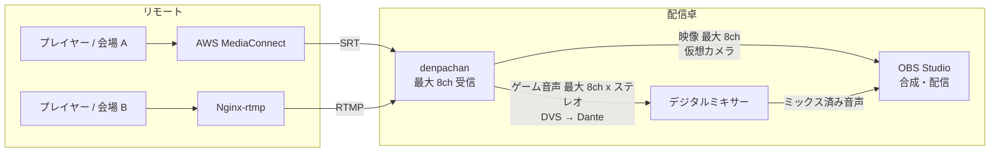
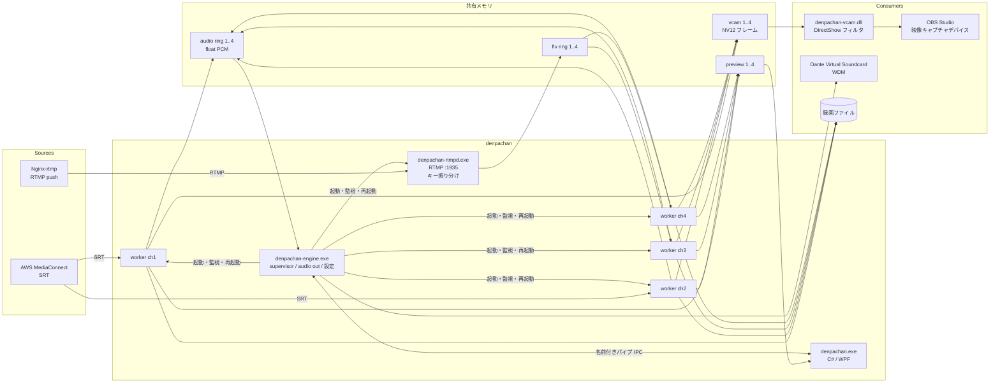
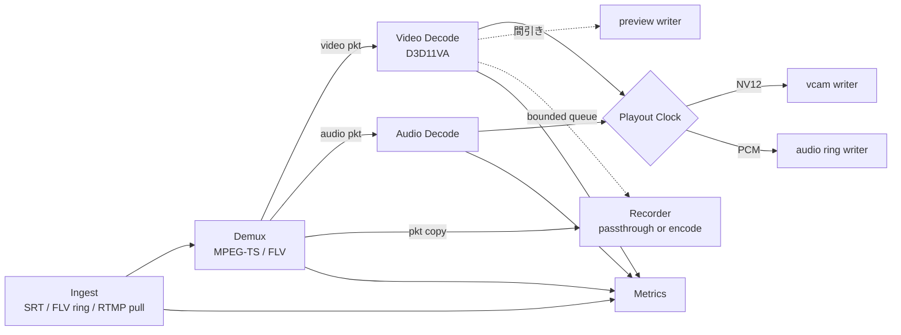
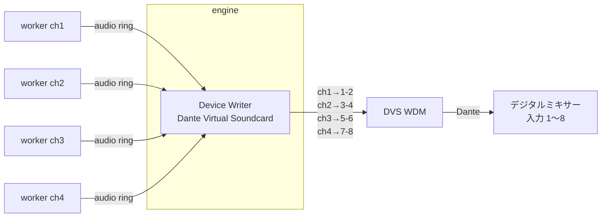
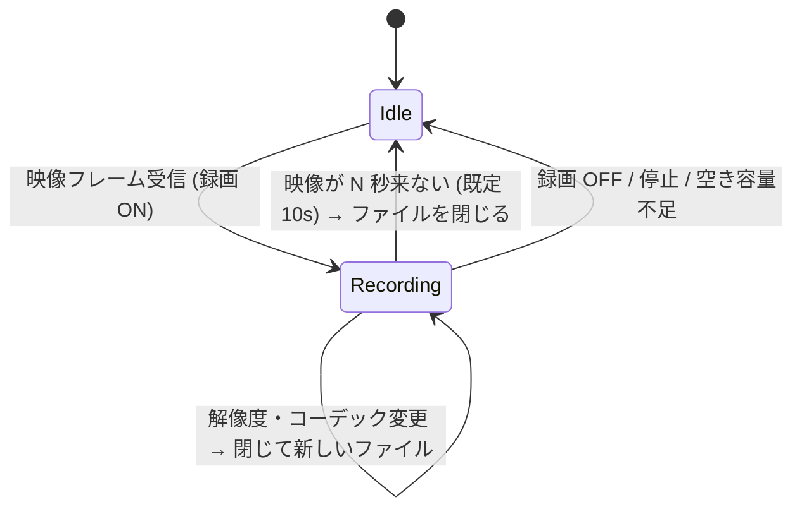

# denpachan 設計

SRT / RTMP で受けた映像・音声を、Windows の仮想カメラと音声デバイス (Dante Virtual Soundcard など) に出す受信アプリケーション。ゲーム配信イベントで使うことを前提に、**止まらないこと**を最優先にしている。

利用者向けの説明は [README](../README.md)、依存関係とライセンスは [dependencies.md](dependencies.md)、ビルド・試験・リリースの手順は [development.md](development.md)。

## 0. 位置づけ

スイッチングや合成はせず、**リモートの配信を受けて、ローカルの映像デバイスと音声デバイスに出すこと**だけを受け持つ。合成は OBS、音声のミックスはデジタルミキサーが担う。



この使い方から、次のことを重視する。

- **映像と音声のずれが変わらないこと。** 映像は仮想カメラで直接、音声はミキサーを経由して OBS に戻るので、両者のずれは OBS のオフセットやミキサーのディレイで一度合わせる。一度合わせたずれが、再接続や長時間の運用で変わってはいけない (§3.5)。
- **音声はミキサーへの素材送り。** 各チャンネルのゲーム音声を、決まった Dante チャンネルへ加工せずに低遅延で流す。音量や EQ はミキサーで扱う (§6)。
- **遅延を小さく。** RTA のイベントなので、アプリの中で足す遅延は既定 0 に近づけ、揺れの吸収は SRT 自身の latency に任せる (§3.5)。
- **少し途切れただけで NO SIGNAL を出さない。** 途絶中や worker の再起動中は最後のフレームを出し続ける。NO SIGNAL は、起動後一度も受信していないときと、利用者が明示的にリセットしたときだけ (§5.2)。
- 機能は必要なものに絞り、そのぶん安定性と低負荷に振る。

## 1. 機能

| 機能 | 内容 |
| --- | --- |
| 受信 | 最大 8 チャンネル (使う数は全体設定で 1〜8 から選ぶ。既定 4)。各チャンネルは SRT (listener / caller) または RTMP (内蔵サーバへの push 受け / こちらからの pull) |
| 仮想カメラ | DirectShow の仮想カメラ `denpachan Cam 1`〜`4`。OBS の「映像キャプチャデバイス」から選ぶ。チャンネルとの対応はプルダウンで選ぶ |
| 音声出力 | 任意の WASAPI デバイスまたは ASIO ドライバの、任意の 2ch (ステレオ) に出す。Dante Virtual Soundcard (WDM モード / ASIO モード) を主に想定 |
| プレビュー | チャンネルごとに縮小画像を画面に出す。オフにすると縮小の処理自体を止める |
| メトリクス | ビットレート、fps、遅延、SRT / TCP の統計、音声の状態などを 1 秒ごとに出し、直近 10 分をグラフにする |
| 録画 | チャンネルごとにオン・オフ。パススルー (既定) / GPU で再エンコード / CPU で再エンコード。映像の途切れでファイルを区切り、ファイル名はテンプレートで決める |
| 操作 | チャンネルごとの開始・停止、ミュート、録画、操作ロック。前回開始していたチャンネルは起動時に再開する |

対象とする入力は 4K60 まで。1080p60 を受けているときに、4K 対応のための負荷が増えないようにしている (§5.3)。音声は各チャンネルともステレオとして扱う。

対象外: 映像の合成・スイッチング、音声のミックス、Media Foundation の仮想カメラ (OBS は DirectShow で十分なため)、Windows 以外の OS。

## 2. 全体構成

### 2.1 プロセス構成



| プロセス | 言語 | 役割 | 落ちたときの影響 |
| --- | --- | --- | --- |
| `denpachan-engine.exe` | C++ | 常駐の本体。設定の保持、子プロセスの起動・監視・再起動、仮想カメラの共有メモリの保持、音声デバイスへの出力、IPC サーバ | 音声出力が止まる。worker は動き続け、映像は止まらない。engine は起動し直すと動いている worker を引き継ぐ (§4)。ネットワークから来たデータを解析する処理は持たない |
| `denpachan-worker.exe --ch N` | C++ | 1 チャンネル分の受信 (SRT / RTMP pull、または rtmpd からの FLV) → デマックス → デコード → 出力 (仮想カメラ / 音声 / プレビュー / 録画 / メトリクス) | そのチャンネルだけが止まり、engine がすぐ起動し直す。仮想カメラは最後のフレームを出し続ける |
| `denpachan-rtmpd.exe` | C++ | RTMP サーバ (1935 番)。ハンドシェイク・チャンク層・publish を扱い、ストリームキーに対応するチャンネルへ FLV タグを渡す。メディアのデコードはしない | RTMP push の全チャンネルが一時切断。engine が起動し直し、送出側の自動再接続で戻る。SRT のチャンネルには影響しない |
| `denpachan.exe` | C# | 操作画面、プレビュー、グラフ | 受信は止まらない。起動し直せば状態を取り直す |
| `denpachan-vcam.dll` | C++ | DirectShow ソースフィルタ。OBS のプロセスに読み込まれ、共有メモリからフレームを読む | 読むだけなので受信には影響しない |

**プロセスを分ける理由**: 壊れたストリームによる FFmpeg のクラッシュ、GPU ドライバのハング、エンコーダの暴走といった障害を 1 チャンネルに閉じ込めるため。1 チャンネルが落ちても他のチャンネルと音声出力は止まらず、落ちたチャンネルも数秒で戻る。画面を分けるのは、画面の不具合や描画の負荷を配信の経路に持ち込まないため。画面は IPC と共有メモリでしかつながらないので、C# の GC が受信を止めることはない。

### 2.2 技術

| 領域 | 採用 | 理由 |
| --- | --- | --- |
| engine / worker / rtmpd / vcam | C++20 | FFmpeg / libsrt / D3D11 / DirectShow / WASAPI / ASIO をそのまま扱える。GC で止まらない |
| ビルド (C++) | CMake + vcpkg (manifest mode) | 依存関係の再現性 |
| SRT | libsrt を直接使う | FFmpeg の `srt://` では `srt_bstats` (RTT、ロス、再送、受信バッファ量) が取れないため。受信したデータは独自の AVIOContext で libavformat に渡す |
| RTMP サーバ | 自前 (§3.3) | 1 ポートでストリームキーによる振り分けをするため。FFmpeg の listen は 1 ポート 1 接続 |
| デマックス / デコード / エンコード / Mux / RTMP pull | FFmpeg 9.x (libav\*)。**同梱せず、利用者が用意した shared 版の DLL を遅延ロードする** (§11) | 実績があり、Enhanced RTMP (HEVC / AV1) にも対応 |
| HW デコード | D3D11VA (FFmpeg の hwaccel)。使えなければソフトウェア | GPU のベンダーを選ばない |
| 映像の変換 | libswscale (NV12 へ、OBS が選んだ解像度へ) | |
| 録画のエンコード | GPU: NVENC / QSV / AMF (FFmpeg)。CPU: 外部の ffmpeg.exe (x264 / x265 / SVT-AV1、§8.4) | x264 / x265 (GPL) を denpachan に入れないため |
| 音声出力 | WASAPI (イベント駆動) と ASIO (別のリポジトリの DLL。ASIO SDK のインターフェースの定義だけを使い、ドライバは自分で読み込む) | DVS の WDM モードは普通の多チャンネルのデバイスとして、ASIO モードは ASIO のドライバとして見える。ASIO SDK が GPL-3.0 なので、本体 (MIT) から別のリポジトリの DLL に切り離す (§6.4) |
| リサンプル | libswresample (48 kHz 以外のデバイスのときだけ) | |
| 画面 | .NET 10 / WPF (Fluent のダークテーマ)。外部のライブラリは使わない | 依存を増やさない。グラフは 1 秒ごとの折れ線なので自前で足りる |
| IPC | 名前付きパイプ + 改行区切りの JSON (制御)、共有メモリ (映像・音声・プレビュー) | C++ と C# の両方で依存なしに扱える |
| ログ | spdlog (C++)。`%LOCALAPPDATA%\denpachan\logs` にローテーションして保存 | |
| クラッシュの解析 | `MiniDumpWriteDump` で自動的にダンプを書く | 本番で落ちた原因を後から追える |

## 3. チャンネルワーカーのパイプライン



### 3.1 スレッド構成 (1 つの worker の中)

| スレッド | 処理 | ブロックしてよいか |
| --- | --- | --- |
| ingest | SRT のソケットまたは FLV リングからの受信、トランスポートの統計 (RTMP pull では decoder が兼ねる) | 入力待ちのみ |
| decoder | デマックス、映像・音声のデコード、48 kHz / float32 / ステレオへの変換 | 入力待ちのみ |
| output (playout) | Playout Clock に従って仮想カメラと音声リングへ書く | **ブロックしない** |
| preview | プレビュー用の縮小 | |
| recorder | Mux、エンコード、ファイルへの書き込み。CPU エンコードでは外部 ffmpeg への書き込み | ライブ系とは別のキュー。詰まったら録画側で捨てる |
| main | 1 秒ごとのメトリクスの集計、録画の設定の受け取り | |

**原則: ライブの経路 (受信 → デコード → 仮想カメラ / 音声) は、プレビュー・録画・メトリクス・画面のどれが詰まっても止まらない。** 副次的な処理へは容量が決まったキューで渡し、溢れたら捨てて数を数える。

### 3.2 受信: SRT (MediaConnect 向け)

| 項目 | 内容 |
| --- | --- |
| モード | listener (MediaConnect の SRT caller 出力を受ける) / caller (MediaConnect の SRT listener 出力に接続する) |
| 設定 | ポート (チャンネルごとに別)、待ち受けアドレスまたは接続先、latency (ms)、パスフレーズと鍵長 (AES-128/192/256)、Stream ID |
| ペイロード | MPEG-TS |
| 再接続 | listener はすぐ待ち受けに戻る。caller は 0.5 秒から最大 5 秒の間隔で接続し直す |
| 繋がらない理由 | caller では「名前を引けない」「応答がない」「拒否された (理由付き)」を分けて画面に出す |

**latency の推奨値** (`src/worker/srt_advisor.h`): 受信状況から推奨値を出し、画面 (詳細、タイル、チャンネル設定の latency の欄。「推奨値にする」ボタン付き) に出す。目安は Haivision の SRT Deployment Guide の「latency ≥ RTT × 倍率」で、倍率はパケットロス率で決める (〜1%: 3、〜3%: 4、〜7%: 6、〜10%: 8、それ以上: 10)。

- 1 秒ごとの区間の統計 (`srt_bstats`) を直近 60 秒分溜め、RTT は窓の中の最大値、ロス率は「ロス ÷ (受信 + ロス)」で求める。接続直後の 5 秒は使わない (接続直後にロスがまとめて数えられることがあるため)。10 秒分溜まるまでは「計測中」。
- 窓の中に取りこぼし (再送が間に合わずに捨てたパケット) があれば、今の latency では足りないので、今の 1.5 倍以上を勧める。
- 下限 20 ms、10 ms 単位に切り上げる。
- 今の latency と比べた結果を添える (下げられる / 足りない可能性がある / 足りていない)。実際に使われる latency は送出側との大きい方なので、送出側の値が大きいときは「下げるには相手側も下げる」と出す。

### 3.3 受信: RTMP (Nginx 向け)

**3.3.1 push 受け: 内蔵の RTMP サーバ `denpachan-rtmpd`**

1935 番を 1 つだけ開き、`rtmp://<host>:1935/<app>/<key>` の `<app>/<key>` でチャンネルに振り分ける。Nginx 側の設定例:

```nginx
application live {
    live on;
    push rtmp://192.168.1.50:1935/live/ch1-xxxxxxxx;   # ch1 のキー
    push_reconnect 1s;
}
```

| 項目 | 内容 |
| --- | --- |
| 対応範囲 | RTMP ハンドシェイク (単純ハンドシェイク。S1 の版数の欄を 0 にして、complex ハンドシェイクを送ってくる FFmpeg / nginx-rtmp / OBS も受け入れる)、チャンク層 (拡張タイムスタンプ、Set Chunk Size、Abort、Ack、Ping)、AMF0 コマンド (`connect` / `releaseStream` / `FCPublish` / `createStream` / `publish` / `FCUnpublish` / `deleteStream`)。FLV タグはそのまま通す (Enhanced RTMP の HEVC / AV1 も FFmpeg が扱う) |
| 振り分け | チャンネルごとに `app` とストリームキーを設定する。一致しないキーの publish は `NetStream.Publish.BadName` で断る (キーが合言葉を兼ねる。キーはログに出さない)。振り分け表は engine が共有メモリ `Local\denpachan_rtmp_routes` に書き、rtmpd は publish のたびと 1 秒ごとに読む (チャンネルの追加・停止で rtmpd を起動し直さない) |
| 同じキーの二重 publish | **後から来た接続を優先し、古い接続を切る**。瞬断で古い TCP 接続が半開きのまま残っても、送出側の再接続ですぐ戻れるように |
| チャンネルの開始・停止 | 停止中のチャンネルのキーは断り、publish 中なら切る。rtmpd は RTMP push のチャンネルが 1 つでも開始していれば engine が起動する |
| worker への受け渡し | publish が確立したら、FLV ヘッダと FLV タグを `Local\denpachan_flv_{ch}` のリング (8 MB) に書く (`@setDataFrame` は外して onMetaData から始まるスクリプトタグにする)。worker はそれを libavformat の FLV デマクサに AVIO で渡す (SRT の TS と同じ形で扱える) |
| worker の再起動・追い越し | worker が publish の途中から読み始めるとき (再起動、追い越された、デコーダが読み始められなかった) は、リングに再同期を頼む。rtmpd は最新のメタデータと音声・映像のコーデック設定を持っておき、次のキーフレームで新しいセッションを始めてそれらを先に書く。**送出側の再接続を待たずに、キーフレーム間隔ほどで戻る** |
| 統計 | 受信バイト数、接続元、`SIO_TCP_INFO` による TCP の RTT と再送量 |
| 堅牢性 | メディアは解析しない。チャンク層と AMF のパーサは長さと入れ子の深さを確かめ、壊れていればそこで読むのをやめる (メッセージ 16 MB、接続 16 本、無通信 5 秒で切断) |

**3.3.2 pull: Nginx から取りに行く**

`rtmp://nginx/live/key` を worker が FFmpeg の RTMP クライアントで読む。5 秒届かなければ切って、0.5 秒から最大 5 秒の間隔で繋ぎ直す。ログやメトリクスでは URL の最後の部分 (キー) を伏せる。繋がらないときは「応答がない」「名前を引けない」「サーバーには繋がったが配信が届かない」などを分けて画面に出す。

- nginx-rtmp は音声をすぐ送るが、映像は次のキーフレームから送る。FLV は最初のパケットが来たときにストリームを作るので、ストリームの解析 (2 秒) の間に音声しか来ないことがある。そのときは切らずに読み続け、映像のストリームが現れた時点でデコーダを開く (10 秒来なければ「映像がない」として切る)。同じコンテキストで `avformat_find_stream_info` を 2 回呼ぶと落ちる (FFmpeg 9.0.2) ので、解析はやり直さない。
- nginx がキャッシュした GOP をまとめて送ってくるので、受信を始めた直後は古いフレームを捨てて追いつく。
- TCP には揺れを吸収する仕組みがないので、届き方の揺れで音声が途切れることがある。必要ならチャンネルの再生バッファを増やす。

### 3.4 デコード

- 映像は D3D11VA でデコードする。初期化に失敗したとき、または**キーフレームのデコードが 3 回続けて失敗したとき** (本当に HW で読めないとき) はソフトウェアに切り替え、画面に「SW デコード」と出す。
- 受信を始めたときとデコードエラーのあとは、**次のキーフレームまで映像をデコーダに渡さない** (10 秒来なければそのまま渡す)。SRT は GOP の途中から届くので、キーフレームまでのフレームは参照が欠けていて読めない。映るまでの時間は送出側のキーフレーム間隔で決まるので、送出側は 1〜2 秒にしておくとよい。
- 解像度・フォーマットの変更 (送出側のエンコーダの設定変更など) を見つけたらデコーダを作り直す。仮想カメラに出すフォーマットは別に決まっているので、そこで吸収する (§5.3)。
- タイムスタンプの不連続 (送出側の再起動、PTS のラップアラウンド) を見つけたら Playout Clock を再アンカーする。

### 3.5 Playout Clock (A/V 同期と揺れの吸収)

映像は仮想カメラ、音声は音声デバイスへ出るので、両者を同じ時間軸で送り出す仕組みをチャンネルごとに持つ。

- 最初のフレームが届いたときに「メディアの PTS ↔ ローカルの単調時刻 (QPC)」を対応付け、**再生バッファ**の分だけ遅らせて出す。
  - 既定は **0 ms** (デコードしたらすぐ出す)。SRT は自身の latency (TSBPD) でパケットを一定の間隔にそろえてから渡すので、ここで重ねて待つ必要はない。カクつくときだけ 1 フレーム分 (16 ms) ほどに上げる。
- 映像: 出す時刻が来たフレームを仮想カメラに書く。遅れたフレームは捨てる。
- 音声: **既定は A/V 同期**。映像を仮想カメラに出す瞬間に、同じ時刻の音がデバイスから鳴るようにする。engine は自分の出力遅延 (デバイスのバッファ + 余裕 + 音声オフセット) を共有メモリに書き、worker はそれを差し引いた時刻に音声を engine へ渡す (§6.3)。
  - 音声が映像より遅れて届く送出元では、届く前に鳴らせないので時計が遅らされ、その分映像が待つ。どれだけ待っているかはメトリクスに出る。送出側の多重化の設定 (音声をまとめずに多重化するか) で、この待ちが大きく変わる。
  - 低遅延モード (全体設定の「映像と音声の同期」をオフ): 映像・音声をそれぞれ最小の遅延で出す。両者のずれは送出側の多重化で決まる値になり、メトリクスに出る。
- 時間軸は映像・音声の両方の届き方を見て調整する: 1 秒ごとに、余裕のいちばん小さかった側が目標 (映像: 再生バッファ + 揺れの備え、音声: 揺れの備え) になるよう動かす。接続直後 0.5 秒のまとめ届きは無視し、音声は時計の最初の調整が済んでから鳴らし始める。
  - 時間軸が動くと engine は鳴らす位置を合わせ直す。大きく動くと音が途切れる (フェードして合わせ直す) ので、**鳴り始めてからは 1 秒に 1 ms までしか動かさず、目標とのずれが 2 ms 以下なら動かさない** (engine はサンプルの重複・間引きで追える。1 秒ごとの最小の揺れにまで反応すると、時間軸が行き来し続けて重複・間引きが絶えない)。一度に動かすのは、時間軸を作った直後の最初の調整 (3 フレームを超えるずれ) と、遅れて届いたとき (音声が遅れた、映像が 3 フレームを超えて遅れた)、遅延の余りが続いたときだけ。
  - **遅延の余り**: 途絶とみなすより短い途切れ (TCP の再送待ち、送出側がまとめて送るなど) のあとにまとめて届くと、途切れた長さの分だけ遅らされ、揺れの備えを超えた分が余る。1 秒に 1 ms では 1 秒の途切れで十数分戻らず、その間は映像がキュー (24 フレーム) に収まらずコマ送りになる。そこで、目標を 3 フレーム超えた余りが 2 回 (2 秒) 続いたら一度に戻す (音声は 1 回フェードして合わせ直す)。1 回で戻さないのは、遅れた直後の窓はまとめ届きの残りで余裕が大きく見えることがあるため。
    - 送出側の時計がこちらより 1000 ppm (1 秒に 1 ms) を超えて速いと、1 秒に 1 ms では追いつかず、余りが 3 フレームを超えるたびに一度に戻すことになる (数十秒〜数分ごとに音声のフェードが 1 回入る)。worker のログに `delay ... more than needed; caught up` が繰り返し出るときは、これを疑う。
  - **揺れの備え (headroom)**: 遅れて届くたびに、その遅れの分 (1 回に 50 ms まで、合計 200 ms まで) 増やし、同じ大きさの揺れが次は間に合うようにする。30 秒間遅れがなければ 1 ms 減らす (音声は 10 ms まで、映像は 0 まで。速く減らすと、減っては次の小さな遅れで増えるのを繰り返して時間軸が動き続け、engine がそれを追うサンプルの重複・間引きも増える)。余裕を 0 まで詰めると、次の揺れで遅れて時間軸が飛ぶ (音が途切れる) のを繰り返す (RTMP では約 1 分に 1 回起きていた)。
  - 遅れて届いた、または備えを増やしたことはログに出る (`playout: audio arrived … ms late`)。
- **チャンネルごとの音声オフセット (±ms)** で、OBS 側の映像処理の遅延などに音を合わせられる。

**遅延を一定に保つ (再接続しても A/V のずれが変わらない)**

ずれは本番前に一度合わせたら変わってほしくないので、遅延は「なるべく小さく」ではなく **「設定した値で一定」** を目標にする。

- 受信してから仮想カメラ・音声デバイスに出すまでの遅延を、`再生バッファ + 音声オフセット` で決まる値に保つ。ネットワークの揺れはこのバッファの中で吸収し、遅延の方は動かさない。
- 再接続やタイムスタンプの不連続で再アンカーするときも、同じ目標で再開する。切断の前と後で遅延が同じになる。
- 音声出力側 (デバイスのバッファと engine のリング) の遅延も決まった値として扱い、リングの残量を目標に保つ (§6.3)。
- 長時間の運用で遅延がじわじわ伸び縮みすることは、クロックずれの補正で防ぐ。実際の遅延と目標の差はメトリクスに出す。

### 3.6 遅延の内訳 (SRT で受けるとき)

| 区間 | 目安 | 備考 |
| --- | --- | --- |
| SRT latency | 送出側と受信側の設定の大きい方 | 受信側の既定は 120 ms (libsrt の既定)。最も大きな区間なので、回線に合わせて両側で詰める (推奨値 §3.2)。実際に使われている値はメトリクスに出る |
| TS のデマックス | 約 1 フレーム | 映像の PES は長さ未指定のことが多く、FFmpeg は次のフレームの先頭が来た時点で前のフレームを確定させる |
| デコード | 数 ms | D3D11VA。B フレームのない低遅延の送出を前提とする |
| 再生バッファ | 既定 0 ms | §3.5 |
| GPU → CPU の転送とスケーリング | 数 ms | |
| 仮想カメラ → OBS | 1 フレーム以内 | 読み手は書き込みの通知 (イベント) ですぐ起きる。OBS の映像キャプチャデバイスは「バッファリング: 無効」にして使う |

## 4. 止まらないための設計

| 障害 | 対策 |
| --- | --- |
| worker のクラッシュ (FFmpeg、ドライバ) | engine が子プロセスとして起動・監視し、終わったら起動し直す。続けて落ちるときは間隔を 0.5 → 1 → 2 → 5 秒と延ばす (60 秒動けば元に戻す)。落ちたときはミニダンプを `%LOCALAPPDATA%\denpachan\dumps` に書く (プロセスごとに新しい 10 個だけ残し、ディスクの空きが 2 GB を切ったら書かない)。worker は 0.5 秒で待ち受けに戻るが、映像が戻るまでの時間は、送出側 (SRT caller) が切断に気づくまでの時間 (SRT の既定で最大 5 秒) に左右される |
| rtmpd のクラッシュ | worker と同じ仕組みで engine が起動し直す。RTMP の publish はすべて切れるが、送出側 (Nginx の `push_reconnect`、OBS の自動再接続) で戻る。SRT のチャンネルには影響しない |
| worker のハング | 受信・出力のスレッドが共有メモリのハートビートを更新し、デコーダはデコードに入った時刻を置く (ネットワーク待ちと区別するため)。どれかが 5 秒止まったら engine が強制終了して起動し直す (起動直後の 5 秒は猶予)。長い待ち (再接続の間隔など) は 0.5 秒ごとに区切ってハートビートを出す |
| 途絶・再接続 | worker の中で自動的に繋ぎ直す。途絶中は仮想カメラに最後のフレームを出し続ける (時間が経っても NO SIGNAL にしない)。worker の再起動中も同じ |
| RTMP の半開きの接続 | 同じキーの新しい publish が来たら古い接続を切る。無通信が続いたとき (既定 5 秒) も切る |
| 壊れたデータ | デマックス・デコードのエラーは数えて読み飛ばす。キーフレームが読めなければ次のキーフレームを待つ (§3.4)。固まれば worker を起動し直す |
| 音声デバイスの消失 (DVS の再起動、デバイスの変更) | 開けない・消えたデバイスは 5 秒ごとに開き直しを試みる。その間はそのデバイスへの出力だけが止まり、映像は続く |
| 録画のディスクの遅れ・容量不足 | 録画のキューが溢れたら録画側だけで捨てる。空きが下限 (既定 5 GB) を切ったら録画を止めて画面に出す。ライブの経路には影響させない |
| 画面のクラッシュ | 受信には影響しない。起動し直せば engine から状態を取り直す |
| engine のクラッシュ | **worker は engine が落ちても動き続ける** (映像は止まらない。音声出力は engine の中なので止まる)。engine は起動すると、同じコマンドライン (= 同じ設定) で動いている worker がいればそのまま引き継ぎ (worker の pid と引数のハッシュを共有メモリに置く)、設定の違う worker が残っていれば止めてから起動し直す。開始していたチャンネルは設定ファイルから復元する。設定ファイルは一時ファイルに書いてから差し替える |
| OS | スリープの抑止 (`SetThreadExecutionState`)、電力スロットリング (EcoQoS) の無効化、音声のスレッドを MMCSS "Pro Audio" に登録、タイマー分解能 1 ms |

全チャンネルの出来事 (接続・切断・再起動・警告) は、画面のイベントログに時刻順に出る。

## 5. 仮想カメラ (vcam)

### 5.1 方式

**DirectShow ソースフィルタ (`denpachan-vcam.dll`) を 8 つの CLSID で登録**し (使うチャンネル数によらず全部)、`denpachan Cam 1`〜`denpachan Cam 8` として `CLSID_VideoInputDeviceCategory` に並べる。OBS の「映像キャプチャデバイス」は DirectShow でデバイスを列挙するので、そのまま選べる (OBS 自身の仮想カメラと同じ方式)。DirectShow に対応した他のアプリからも見える。

- 64bit の DLL のみ (32bit のアプリからは見えない)。
- **zip を展開するだけで使える。** 画面 (denpachan.exe) が起動時に登録を確かめ、登録されていない、またはフォルダを移して登録先がずれているときは、**このユーザーだけに登録する** (`DllInstall(TRUE, L"user")`、HKCU。管理者権限は要らない)。HKCU の登録は HKLM より優先されるので、他の場所の登録が残っていてもこのフォルダの DLL が使われる。
- フォルダを消す前に、画面のメニュー「仮想カメラの登録解除」でこのユーザーの登録を消す。
- マシン全体への登録 (`regsvr32 denpachan-vcam.dll`、管理者) もできる (全ユーザーで使う場合)。

### 5.2 共有メモリ

engine が `Local\denpachan_vcam_{1..4}` を**常に作って持っておく** (worker が起動し直しても、OBS から見たマッピングは途切れない)。そのカメラを割り当てられた worker が書き込む。

```
struct VcamHeader {
    uint32 magic, version;
    // 読み手 (フィルタ) → 書き手: OBS が選んだフォーマット
    atomic<uint32> req_width, req_height, req_fps_num, req_fps_den;
    atomic<uint64> req_seq;              // フォーマットが変わるたびに増える
    // 書き手 → 読み手
    uint32 width, height, fps_num, fps_den, pixel_format;   // 実際に書いているフォーマット
    atomic<uint64> write_seq;            // 書き終えたフレームの番号
    atomic<uint64> writer_heartbeat_qpc;
    uint32 state;                        // LIVE / HOLD / NO_SIGNAL (表示用。出す絵は write_seq で決まる)
    uint64 frame_pts_qpc[3];
};
// 続いて最大サイズ (3840x2160 NV12) のフレーム x3 (トリプルバッファ)
```

- 書き手はロックなしで次のスロットに書き、最後に `write_seq` を進める。読み手は最新の書き終えたスロットを読むだけで、書き手を待たせない。
- フィルタは選ばれた fps で `FillBuffer` を回し、新しいフレームがなければ直前のフレームを繰り返す。
- **表示の決まり**: 一度でもフレームが書かれていれば (`write_seq != 0`)、映像が途絶えても、書き手 (worker) が落ちていても、最後のフレームを出し続ける。NO SIGNAL を出すのは `write_seq == 0` のとき、つまり起動後一度も受信していないときと、利用者が「仮想カメラリセット」をしたとき (engine が `write_seq` を 0 に戻す) だけ。
- 書き手は誰も見ていない間は書き込みを省くので、最後のフレームを手元に持っておき、途絶中に読み手が現れたらそれを書き直す。読み手も開いた直後は書き手の書き直しを最大 200 ms 待ってから NO SIGNAL を出す (開いた瞬間に NO SIGNAL が一瞬映らないように)。
- 共有メモリは開いているプロセスがなくなると OS が破棄するので、engine が常に開いておく (最後のフレームが消えないように)。

### 5.3 出力フォーマットと 4K

**4K まで扱えるが、1080p で使うときの負荷は 1080p だけに対応した場合と同じにする。**

- フィルタが OBS に示すフォーマット: 3840x2160 / 2560x1440 / 1920x1080 / 1280x720 × 60 / 59.94 / 30 fps、NV12 (YUY2 も示す)。どれを使うかは OBS のデバイスの設定で選ぶ (既定は 1920x1080 60fps)。
- OBS がフォーマットを決めると、フィルタが `req_*` に書き、worker はその大きさに変換して書く。**コピー・変換の量は選ばれた解像度の分だけ**で、4K 用の領域は確保しているだけで触らない (4K の 3 枚分で約 37 MB / 台)。
- デコードの負荷は入力の解像度に比例する。1080p を受けている限り、4K 対応による負荷の増加はない。4K を受けて 1080p で出すときは、GPU から 4K のフレームを取り出してから CPU で縮小する。
- 目安: 1080p60 NV12 は 4ch で約 750 MB/s、4K60 は 1ch で約 750 MB/s のメモリコピー。4K を何チャンネル同時に出せるかは GPU のデコード能力 (NVDEC のセッション数・処理能力) による。
- 1 つのカメラを複数のアプリが同時に開いて別のフォーマットを求めた場合は、最後に求められたフォーマットで書き、それ以外の読み手はフィルタの中で縮小する。

### 5.4 チャンネルとの対応

- チャンネルごとのプルダウン: `なし / Cam 1 / Cam 2 / Cam 3 / Cam 4`。同じカメラを 2 つのチャンネルが選ぶと、後から選んだ側をエラーにする。
- 受信中でも切り替えられる。前のカメラは最後のフレームのままになるので、「仮想カメラリセット」で NO SIGNAL に戻せる。

## 6. 音声出力

### 6.1 構成

各チャンネルのゲーム音声を DVS の別々のチャンネルに出し、Dante 経由でデジタルミキサーの別々の入力に立ち上げる使い方を想定する。



- DVS は Windows からは 1 つの多チャンネルのデバイスに見えるので、全チャンネル分を 1 つのデバイスへまとめて書く。そのため **デバイスごとに 1 つの出力 (Device Writer。WASAPI のクライアントまたは ASIO のドライバ) を engine が持ち**、各チャンネルの音声を指定された出力チャンネルに置いて書き出す。
- チャンネルごとの設定: 出力デバイス、出力チャンネル (2ch 単位。例: 3-4)、共有 / 排他、ミュート、音声オフセット、フェード。音声はデコード時に 48 kHz / float32 / ステレオにそろえる (モノラルは両チャンネルに複製、5.1ch などはステレオにダウンミックス)。
- worker → engine の受け渡しは共有メモリの SPSC リングバッファ。worker が落ちてもリングが空になるだけで、デバイスは無音を出し続ける (デバイスを閉じない。他のチャンネルの音は途切れない)。

### 6.2 ミキサーへの素材送りとして

| 要件 | 設計 |
| --- | --- |
| 音を加工しない | 音量を変えない。リミッタ・ノーマライズ・EQ も入れない。デバイスが 48 kHz ならリサンプラも通さず、デコード結果のサンプルをそのまま書く (48 kHz 以外のデバイスのときだけ変換する) |
| ミュート | サンプルを置くときに 0 にするだけ (遅延は変わらない)。切り替えの瞬間だけフェードする |
| ポップノイズを出さない | 受信の開始・途絶・時間軸の合わせ直し・ミュートの切り替えの瞬間だけ、短いフェード (10 ms) をかける。通常の音には触れない。途絶で「ブツッ」という音が PA や配信に出ないように (チャンネルの設定でオフにできる) |
| 無信号のときは無音 | 途絶中はデジタル無音を出し続ける。直前の音の繰り返しやノイズは出さない |
| 他の音を混ぜない | 排他モードなら Windows の通知音や他のアプリの音が混ざらない (§6.4) |
| 遅延が変わらない | 再接続しても音声の遅延が前と同じ値に戻る (§6.3) |
| 信号が来ているか分かる | 画面に各チャンネルのレベルメーター (L/R のピーク、dBFS) と、直近 1 分の音切れ・合わせ直しの回数を出す |

### 6.3 音声の時間軸と遅延

**worker 側 (いつ engine に渡すか)**

- サンプルの番号と「engine に渡すべき時刻」の対応を音声リングに書く。engine はそこから自分の出力遅延の後にデバイスで鳴らす。
- A/V 同期 (既定): 渡すべき時刻 = 映像と共有の時計 C(pts) − engine の出力遅延。音声の余裕を時計に知らせ、足りなければ時計ごと遅らせる (§3.5)。
- 低遅延 (A/V 同期がオフ): 音声だけの時間軸で決める。接続直後のまとめ届きの後 1 秒の届き方を見て「いちばん遅く届くかたまりでも間に合う」時間軸にし、その後は遅れて届いたらすぐ遅延を増やし、10 秒間ずっと余裕があれば 0.5 ms ずつ詰める (50 ms を超える余裕は一度に)。
- どちらも、接続し直した直後の約 1.5 秒は鳴らさない。

**engine 側 (実際にいつ鳴るか)**

- デバイスから鳴る時刻が「鳴らすべき時刻 + 基本遅延 + 音声オフセット」になるように読む位置を合わせる。基本遅延 = デバイスのバッファ (共有モード: 1 つ分、排他モード: 2 つ分) + 余裕 (全体設定、既定 10 ms)。
- WASAPI でこれから書くバッファがいつ鳴るかは、`IAudioClock::GetPosition` (再生位置とその時刻) から「位置の時刻 + (書いた量 − 位置) / レート」で求める。「今 + バッファに溜まっている量 (GetCurrentPadding)」は、仮想デバイス (VB-Cable、VoiceMeeter など) では音をまとめて取るので数 ms 揺れ (ときどき 10 ms 近く外れる)、下のずれの補正が 1 秒に何十回も働いてしまう。平均の時刻 (= 遅延と A/V のずれ) は今までと変えないよう、開いた直後の 1 秒で両者の差 (中央値) を測って差し引く。位置が取れない、または差が 30 ms 以上外れた (位置のリセットなど) ときは padding に戻して測り直す。ASIO はドライバのコールバックの時刻を均して使う (§6.4)。
- 送出元とデバイスのクロックの差によるずれ (1 秒ほどで平滑化) は、48 kHz のデバイスなら **ずれが 2 ms を超えたときに 1 サンプルだけ重複・間引き**して詰める (最大で 10 ms に 1 回)。リサンプラを通さないので、それ以外のサンプルは生のまま。48 kHz 以外のデバイスはリサンプル比の微調整 (最大 ±0.5%) で詰める。
- ずれが 50 ms を超えたら (接続し直しなど)、フェードアウト → 読む位置を合わせ直す → フェードイン。

### 6.4 Dante Virtual Soundcard と出力の方式

DVS は **WDM モード** (WASAPI のデバイスとして見える) と **ASIO モード** (ASIO のドライバとして見える) のどちらかで動かす。どちらでも denpachan から出せる。サンプルレートは Dante ネットワークに合わせる (通常 48 kHz。このときはリサンプルしない)。DVS のクロックは Dante ネットワーク (PTP) に従うので、送出元とのクロックのずれは §6.3 の重複・間引きで吸収する。チャンネル数は DVS の設定による。デバイスから取得して、出力チャンネルの選択肢を作る。

**WASAPI (WDM モード)**

- **DVS を denpachan 専用にするなら排他モードを勧める。** Windows の音声エンジンを通らないので、通知音や他のアプリの音が混ざらず、Windows の音量やエフェクトの影響も受けず、遅延も小さい。その代わり、開いている間は他のアプリがその DVS を使えない。OBS などからも同じ DVS に出したいときは共有モードにする。
- 排他モードでは、デバイスが短い周期に追いつけないことがある (仮想デバイスに多い)。呼び出しが周期どおりに来ていなければ周期を 10 ms → 20 ms と延ばして試し、それでもだめなら共有モードに切り替える。
- 共有モードでは、IAudioClient3 で最小の周期を使えれば使う。

**ASIO (ASIO モード)** (別のリポジトリ [denpachan-asio-driver](https://github.com/RTAinJapan/denpachan-asio-driver) と `src/engine/asio_plugin.cpp` / `asio_output.cpp`)

- ASIO SDK (Steinberg) は GPL-3.0 なので、SDK に触れる部分は **別のリポジトリ denpachan-asio-driver の DLL `denpachan-asio-driver.dll`** (GPL-3.0) にして、本体 (MIT) から切り離す。本体の配布物にはこの DLL を入れず、利用者が向こうの Release から取って engine の横に置く。engine は SDK のヘッダを一切 include せず、DLL の C の関数 (`src/engine/denpachan_asio.h`。向こうの `include/denpachan_asio.h` と同じもの。受け渡す型は C のものだけ) を使う。DLL は engine と同じフォルダからだけ読み込み (PATH は探さない)、ABI の版 (`DENPACHAN_ASIO_ABI_VERSION`) を確かめる。**DLL が無ければ ASIO の出力先を出さないだけで、他はそのまま動く**。受け渡しを変えるときは ABI の版を上げ、両方のリポジトリを合わせる。
- DLL が行うこと: ドライバの列挙と読み込み、コールバック、サンプル形式の変換、時刻の均し、開き直し、診断のログ。engine が行うこと: ChannelSource (遅延を一定に保つ・クロックずれの補正・フェード・ミュート)、状態の表示。
- ドライバはレジストリ (`HKLM\SOFTWARE\ASIO`) で列挙し、出力先の一覧に `ASIO: ドライバ名` として WASAPI のデバイスと並べて出す。設定にはこの名前を書く。
- ドライバは COM で読み込み、専用のスレッド (STA) でメッセージを回す。ASIO SDK はインターフェースの定義 (ヘッダ) だけを使う。
- **同時に開く ASIO ドライバは 1 つだけ** (ASIO の作法。コールバックにどの出力かを渡す引数が無い)。別のチャンネルが別の ASIO ドライバを選んだら、そのチャンネルの音声は出さずに画面にエラーを出す。同じドライバを複数のチャンネルで使うのはよい (出力チャンネルで分ける)。
- サンプルレートは 48 kHz にできれば 48 kHz にする (できなければドライバのレートで出し、ChannelSource がリサンプルする)。バッファはドライバの推奨の大きさ。
- 音はドライバのコールバック (bufferSwitch) の中で engine の ChannelSource に作ってもらい (DLL → engine の render)、ドライバのサンプル形式 (int16 / int24 / int32 / float32 / float64 など) に変換して書く。基本遅延 = ドライバの出力の遅延 + バッファ 1 つ分 + 余裕。
- バッファの先頭が鳴る時刻は「前のバッファの時刻 + バッファ 1 つ分」で進め、コールバックが呼ばれた時刻へは少しずつ寄せる (コールバックの間隔の揺れを均し、デバイスと PC のクロックのずれには追いつく)。200 ms 以上ずれたら測り直す。
- ドライバがリセットを求めたとき (ドライバの設定やサンプルレートの変更) は開き直す。開けない・使えないときは 1 秒ごとに開き直す。
- コールバックの回数が実時間から 2% 以上ずれていたら (ドライバが実時間で音を出していない)、ログに警告を出す。コールバックが 2 秒来なければ (ドライバの先が動いていない。Voicemeeter なら出力 A1 のデバイスが無いなど) それも警告を出す。
- 「共有 / 排他」の設定は ASIO では使わない。

DVS 以外の WASAPI デバイス・ASIO ドライバ (オーディオインターフェース、HDMI、ヘッドホンなど) も同じ仕組みで選べる。

## 7. プレビューとメトリクス

### 7.1 プレビュー

- worker が縮小した画像 (640x360 BGRA、最大 15fps、ダブルバッファ) を `Local\denpachan_preview_{ch}` に書き、画面は `MemoryMappedFile` から読んで `WriteableBitmap` に移して表示する。WPF に D3D との連携を持ち込まずに済む。
- 縮小は出力スレッドとは別のスレッドで行う (出力スレッドはフレームの参照を渡すだけ)。仮想カメラへの出力の遅延に影響しない。
- 画面は表示している間だけハートビートを書く。プレビューをオフにする / 画面を閉じると、worker は縮小の処理自体を止める。途絶中に画面を開いた場合は、worker が持っている最後のフレームを書く。
- 音声のレベルメーター (L/R のピーク、dBFS) は、プレビューをオフにしても出し続ける。

### 7.2 メトリクス

worker が 1 秒ごとに集計して共有メモリに置き、engine が状態 (`state`、§10.2) として画面に送る。画面は直近 10 分を持ってグラフ (ビットレート、映像の遅延、RTT) にする。

| 分類 | 項目 |
| --- | --- |
| 接続 | 状態 (待ち受け中 / 接続中 / 受信中 / 途絶 / 接続できない / 再起動中 など)、接続元、接続回数、繋がらない理由 |
| 映像 | コーデック、解像度、HW / SW デコード、ビットレート、デコード fps、出力 fps、映像の遅延 (デコード後から仮想カメラまで)、捨てたフレーム (遅れ / 溢れ)、デコードエラー |
| SRT | 実際の latency と設定値、RTT、受信バッファ (ms)、受信の帯域、ロス / 再送 / 取りこぼし、latency の推奨値 (§3.2) |
| RTMP push | TCP の RTT、再送量 |
| 音声 (worker) | L/R のピーク、遅延、A/V のずれ、抜け |
| 音声 (出力) | デバイス、出力チャンネル、共有 / 排他、遅延、目標とのずれ、重複・間引き / 音切れ / 合わせ直しの回数、デバイスを開けないときの理由 |
| 録画 | 状態、ファイル、経過時間、サイズ、捨てた数、エラー |
| worker | 状態、pid、稼働時間、再起動回数、直近の異常 |
| PC (画面が自分で読む) | CPU 使用率、メモリの空き、録画先ドライブの空き |

画面では、劣化している項目を色で示す (§9)。

## 8. 録画

### 8.1 方式

| 方式 | 内容 | 負荷 |
| --- | --- | --- |
| **パススルー (既定)** | 受信したパケットをそのまま MKV / MPEG-TS に書く (再エンコードしない)。音声もそのまま | ほぼなし。画質の劣化なし |
| 再エンコード (GPU) | デコードしたフレームを NVENC / QSV / AMF でエンコードする (worker の中の FFmpeg)。音声は AAC ステレオ | 軽い |
| 再エンコード (CPU) | 受信したパケットを**外部の ffmpeg.exe** に流し、x264 / x265 / SVT-AV1 でエンコードさせる (§8.4)。音声は AAC ステレオ | 重い (CPU)。ffmpeg の優先度は「通常以下」 |

- 再エンコードの設定: コーデック (H.264 既定、HEVC、AV1)、レート制御 (CBR / VBR / 固定 QP)、ビットレート、QP、プリセット p1 (最速)〜p7 (高画質)、キーフレーム間隔 (秒)、音声のビットレート。プリセットは NVENC ではそのまま、QSV は veryfast〜veryslow、x264 / x265 は ultrafast〜slow、SVT-AV1 は 12〜6 に対応させる。
- GPU の「自動」は NVENC → QSV → AMF の順に試す (AMF は画面の選択肢には出さず、自動のときだけ使う)。CPU には自動で切り替えない (負荷が読めないので、CPU は明示的に選んだときだけ)。
- エンコーダやファイルを開けなかったら、録画をエラーにして、間を空けて開き直す (10 秒から倍々に、最長 5 分。設定や接続が変われば 10 秒から)。開けずに残った空のファイルは消す。受信・出力には影響しない。
- 録画の設定は共有メモリで worker に渡し、worker は 100 ms ごとに見る。**録画のオン・オフや設定の変更で worker は起動し直さない** (書いているファイルを閉じ、次のキーフレームから新しい設定で書く)。
- 録画は受信・出力とは別のスレッドで動く。キュー (256 MB) が溢れたら録画側で捨て、パススルーと CPU は次のキーフレームから書き直す。
- パススルーでは、ファイルはキーフレームから始める (区切った直後の最初のキーフレームまで待ってから書き始める)。

### 8.2 ファイルの区切り



- 映像が来ない時間の上限 (`gapTimeoutSec`、既定 10 秒) を過ぎたらファイルを閉じる。次の映像が来たら、その時刻で新しいファイル名を作る。
- **それより短い途切れ (再接続) は同じファイルに続けて書く**。新しい接続の最初のキーフレームを、前の映像の 1 フレーム後ろに置くようにタイムスタンプをずらす (途切れていた時間は詰める)。キーフレームより前の音声と、前の音声と重なる分は捨てる。パススルー / CPU でコーデック・解像度・コーデックの設定 (extradata) が変わったときは続けられないので区切る。
- 最大の長さで区切ることもできる (`maxSegmentMin`、0 = 無制限)。
- ディスクの空きが `minFreeGb` (既定 5 GB) を切ったら録画を止めてエラーにする。10 秒ごとに測り直し、空きができたら再開する。
- MKV は 1 秒ごとにクラスタを書き、パケットごとにフラッシュするので、途中でプロセスが落ちても書けたところまで再生できる。

### 8.3 ファイル名テンプレート

既定: `{ch} - {YYYY}{MM}/{DD} {hh}-{mm}-{ss}` (拡張子は形式で決まる)

| トークン | 意味 |
| --- | --- |
| `{ch}` | チャンネル番号 (1〜8) |
| `{name}` | チャンネル名 |
| `{YYYY}` `{YY}` `{MM}` `{DD}` | 年 / 月 / 日 (ファイルを始めた時刻) |
| `{hh}` `{mm}` `{ss}` | 時 / 分 / 秒 |
| `{seq}` | そのチャンネルの連番 |
| `{codec}` `{res}` | コーデック名 / 解像度 (例: `1920x1080`) |

- `/` と `\` はフォルダの区切りとして扱い、フォルダがなければ作る。
- Windows のファイル名に使えない文字 (`: * ? " < > |`) は置換文字 (既定 `-`) にする。チャンネル設定では展開した結果をその場で表示する。
- 同じ名前のファイルがあれば ` (2)` などの番号を付け、上書きしない。
- 保存先はチャンネルごと (空欄なら `%USERPROFILE%\Videos\denpachan`)。
- フォルダ名・ファイル名の末尾のピリオドと空白は取り除き、`CON` などの予約名は先頭に `_` を付ける。展開した結果が空なら `ch{ch}`。
- 展開の規則は worker (`filename.cpp`) と画面の表示 (`RecordFilename.cs`) で同じにしてある。

### 8.4 CPU エンコード (外部 ffmpeg)

x264 / x265 は GPL なので denpachan には入れない。代わりに、**利用者が用意した FFmpeg の ffmpeg.exe を子プロセスとして起動する**。別のプログラムを呼び出すだけなので、denpachan 自体は GPL の影響を受けない (GPL の DLL をプロセスの中に読み込む方式だと、配布物に GPL の条件がかかる余地があるので、x264 / x265 では採らない。ASIO 出力の DLL (§6.4) は自分たちのコードを GPL-3.0 で別のリポジトリから配り、本体の配布物には入れないことで、本体に GPL の条件がかからないようにしている)。外部のプロセスなので、エンコーダが落ちても受信を巻き込まない。

```
worker (録画スレッド)                              ffmpeg.exe (優先度: 通常以下)
  受信したパケット → 時刻を直す → NUT で書く ─標準入力→ デコード → x264 / x265 / SVT-AV1 → MKV / TS
                                                  エラー出力 → worker のログ (最後の 1 行を画面のエラー表示に)
```

- ffmpeg.exe は、受信に使っている FFmpeg の DLL (avcodec) と同じフォルダのものを使う (無ければ PATH から探す)。shared 版の `bin` には DLL と一緒に ffmpeg.exe も入っているので、利用者が別に用意・指定するものはない。受信と録画で同じ FFmpeg を使うことにもなる。x264 / x265 は gpl 版にしか入っていない。
- 生の映像ではなく圧縮されたままのパケットを流すので、4K でもパイプの負荷は小さい (ffmpeg の側でデコードし直す)。
- ファイルの区切り・再接続時の続き・ファイル名は §8.2 / §8.3 と同じ (区切るたびに ffmpeg を起動し直す)。
- ファイルを閉じるときは標準入力を閉じるだけで待たない。ffmpeg は残りをエンコードして書き終え、自分で終わる。worker が落ちたときも標準入力が閉じるので、同じように書き終える。
- ffmpeg が起動できない・途中で終わった・書き込めないときは、録画をエラーにして、間を空けて起動し直す (10 秒から倍々に、最長 5 分)。何も書けずに終わった空のファイルは消す。
- ffmpeg が入力を読まずに固まっても、キューが溢れて録画側で捨てるだけで、受信・出力は止まらない。worker を止めるときは、2 秒待っても録画スレッドが終わらなければ ffmpeg を強制終了する。
- CPU が追いつかない (4K を遅いプリセットで、など) と録画が欠ける (画面の「捨てた数」に出る)。4K では速いプリセットにする。

## 9. 画面 (C# / WPF)

```
┌───────────────────────────────────────────────────────────────────────┐
│ ファイル(F)                                                            │
├──────────────────────────────┬────────────────────────┬───────────────┤
│ CH1  Game A          ● 受信中 │ CH2  Game B   ● 受信中  │ CH1 詳細       │
│ ┌──────────────┐             │ ┌──────────────┐        │ 状態 / 入力   │
│ │  preview     │             │ │  preview     │        │ 映像 / SRT    │
│ └──────────────┘             │ └──────────────┘        │ 音声 / 録画   │
│ 12.3 Mbps 60 fps 遅延 48 ms   │ ...                     │               │
│ SRT latency 120 ms RTT 18 ms │                         │ グラフ        │
│ 音声 22 ms ▮▮▮▮▮▮▯▯          │                         │ (ビットレート │
│ [停止][●録画][プレビュー]...  │                         │  遅延 / RTT)  │
│ 映像 [Cam 1▼] 音声 [DVS▼][1-2▼]│                        │               │
├──────────────────────────────┼────────────────────────┤               │
│ CH3 ...                      │ CH4 ...                 │               │
├──────────────────────────────┴────────────────────────┴───────────────┤
│ イベント: 21:03:12 Game B: 接続されました (...)                          │
├───────────────────────────────────────────────────────────────────────┤
│ engine: 接続中        CPU 5%  メモリ 空き 14 GB  ディスク D: 1 TB        │
└───────────────────────────────────────────────────────────────────────┘
```

- 実行ファイルは `denpachan.exe` (engine と同じフォルダ)。engine とのやりとりは `EngineClient` にまとめ、切れたら 1 秒ごとに繋ぎ直して設定と状態を取り直す。**engine が動いていなければ画面が起動する。**
- **画面を閉じると受信も止める** (engine に `shutdown` を送り、worker ごと止める)。受信を開始しているチャンネルがあれば、閉じてよいかを確かめる (チャンネル名を出す。既定のボタンはキャンセル)。メニューの「終了」も同じ。Windows のシャットダウン・ログオフでは確かめない。画面が落ちたときは engine と受信は動き続け、画面を起動し直せば繋がる。
- メイン画面: チャンネルのタイル (全体設定のチャンネル数だけ。1 → 1x1、2 → 2x1、3〜4 → 2x2、5〜6 → 3x2、7〜8 → 4x2)。各タイルに、名前、入力の要約、状態、プレビュー (16:9)、主要なメトリクス、音声のレベルメーター、ビットレートの推移、操作 (開始 / 停止、録画、プレビュー、ミュート、仮想カメラリセット、設定)、操作ロック、出力先 (映像: カメラ、音声: デバイスと出力チャンネル)。
- 詳細パネル: 選んだチャンネルのすべてのメトリクスと、直近 10 分のグラフ。
- 劣化の表示 (映像も音も出ているが悪くなっているとき、人が見て気づけるように):
  - 受信中に HW デコードが使えずソフトウェアでデコードしているときは「SW デコード」のラベル。
  - 経路の行は、直近 1 分に取りこぼしがあれば赤、推奨 latency に足りない・TCP の再送があれば黄。
  - 音声の行は、直近 1 分に音切れ・合わせ直し・抜けがあれば黄 (回数も出す)、デバイスを開けなければ赤。
  - 状態バーの PC の様子は、録画先の空きが下限を切れば赤、下限の 2 倍未満なら黄。CPU 90% 以上、メモリの空き 2 GB 未満も黄 (1 GB 未満は赤)。
- FFmpeg (同梱しない) が見つからないときは、画面の上に赤い帯で案内を出し、開始しているチャンネルの状態は「FFmpeg がありません」にする。見つかれば自動で受信を始める。
- 設定画面 (チャンネル): 名前、入力 (SRT listener / SRT caller / RTMP push / RTMP pull)、SRT の各項目 (パスフレーズは空欄なら変更しない)、RTMP の app とキー (生成ボタン)、送出側に設定する URL (この PC の IPv4 で組み立て、コピーできる)、pull の URL、再生バッファ、音声の出力モード・オフセット・フェード、録画の設定。保存時に engine が検証し、エラーは画面の中に出す。
- 設定画面 (全体): 言語、A/V 同期、音声の余裕、映像途絶とみなす時間、RTMP サーバの待ち受けアドレス・ポート・無通信で切るまでの時間。
- 操作ロック: タイルの右上の鍵で、チャンネルごとに操作ボタンと出力先のプルダウンを使えなくする (運用中の誤操作を防ぐ)。クリックでロック、ロック中は 1 秒長押しで解除。
- イベントログ: 接続・切断、映像の途絶・復帰、繋がらない理由、worker / rtmpd の再起動、録画の開始・終了・エラー、操作の失敗。
- メニュー: 全体設定、設定ファイルの場所を開く、音声デバイスの再読込、仮想カメラの登録解除、終了。
- タイトルに版を出す (`denpachan X.Y.Z`)。
- プレビューのオン・オフと操作ロック (チャンネルごと)、言語は `%APPDATA%\denpachan\ui.json` に覚える。

**文言と言語**

- 画面に出る文は、すべて言語ファイル `src/ui/Denpachan.Ui/Lang/<言語コード>.json` (キーと文の組、exe に埋め込む) に置き、`Infrastructure/Loc.cs` が引く。XAML は `{l:Tr キー}`、C# は `Loc.T` / `Loc.F` (文の中の `{name}` を引数で置き換える)。文の作り方の決まりは development.md の「画面の文言」。
- 日本語 (`ja.json`、基準) と英語 (`en.json`) がある。全体設定の「言語」で選び (既定は「自動」= Windows の表示言語。言語ファイルが無ければ日本語)、変えるとその場で切り替わる (イベントログに出た行はそのまま)。訳していないキーは日本語で出る。
- worker / engine (C++) は文を作らず、画面に出すメッセージを ID と引数で送る (`src/common/include/denpachan/ui_message.h`)。状態の `video.lastError`、`record.error`、`worker.lastEvent`、`rtmpServer.lastEvent`、`ffmpeg.message`、`audioOut.error` は `{"id": "net.dns", "host": "..."}` の形 (無ければ null) で、画面が言語ファイルの `msg.<ID>` で文にする。worker の共有メモリにはこれを JSON の文字列で置く (引数の値は 96 バイトで切る)。ログには ID と引数のまま出る。

## 10. 設定と IPC

### 10.1 設定ファイル

`%APPDATA%\denpachan\config.json`。engine が読み書きする (一時ファイルに書いてから差し替える)。変更は IPC で受け、検証してから保存・反映する。

```json
{
  "version": 1,
  "general": {
    "channelCount": 4,
    "stallMs": 2000,
    "audioMarginMs": 10,
    "avSync": true,
    "rtmpServer": { "bind": "0.0.0.0", "port": 1935, "idleTimeoutMs": 5000 }
  },
  "channels": [
    {
      "id": 1,
      "name": "Game A",
      "enabled": true,
      "source": {
        "protocol": "srt", "mode": "listener", "host": "0.0.0.0", "port": 9001,
        "latencyMs": 120, "pbkeylen": 0, "streamId": "",
        "passphraseProtected": "", "app": "", "keyProtected": "", "urlProtected": ""
      },
      "playoutBufferMs": 0,
      "vcam": 1,
      "audio": { "device": "DVS Transmit 1-16 (Dante Virtual Soundcard)", "startChannel": 1,
                 "mode": "exclusive", "offsetMs": 0, "mute": false, "fade": true },
      "record": {
        "enabled": true, "dir": "D:\\rec", "template": "{ch} - {YYYY}{MM}/{DD} {hh}-{mm}-{ss}",
        "invalidCharReplacement": "-", "container": "mkv", "mode": "passthrough",
        "encode": {
          "video": { "codec": "h264", "encoder": "auto", "rc": "cbr", "bitrateKbps": 12000, "qp": 23, "preset": "p4", "gopSec": 2 },
          "audio": { "bitrateKbps": 192 }
        },
        "gapTimeoutSec": 10, "maxSegmentMin": 0, "minFreeGb": 5
      }
    }
  ]
}
```

- `enabled` は「開始しているか」。起動時に開始していたチャンネルを再開する。
- `channels` は常に上限の 8 つ分を書く。`general.channelCount` (1〜8、既定 4。0.1.x の設定には無いので 4) は画面に出して使う数で、それより後ろのチャンネルは設定を残したまま止めておく (数を減らすと engine が止める。画面は受信中のものがあれば止めてよいか聞く。開始はできない)。上限は `src/common/include/denpachan/channels.h` の `kMaxChannels`。
- RTMP のキー (`source.mode` が push のとき) や pull の URL (pull のとき) は `keyProtected` / `urlProtected` に入る。CPU エンコードのときは `encode.video.encoder` が `cpu`。
- SRT のパスフレーズ、RTMP のキー、pull の URL は DPAPI (`CryptProtectData`) で暗号化して保存する。
- 仮想カメラの解像度・fps は OBS で選ぶので、設定ファイルには持たない。
- 音声デバイスは表示名で持つ。

### 10.2 IPC

名前付きパイプの上の改行区切りの JSON (要求 / 応答と、engine からの通知)。

**画面 ⇔ engine** (`\\.\pipe\denpachan`。今のユーザーと SYSTEM だけ、リモートからの接続は断る)

```
要求: {"id": 1, "method": "patchChannel", "params": {"ch": 1, "patch": {"playoutBufferMs": 16}}}
応答: {"id": 1, "result": {...}}  /  {"id": 1, "error": "ch1: port 9001 is already used"}
通知: {"event": "state", "data": {...getState と同じ...}}   (1 秒ごと)
```

| 種別 | メソッド |
| --- | --- |
| 取得 | `getConfig`, `getState`, `listAudioDevices` |
| 操作 | `startChannel(ch)`, `stopChannel(ch)`, `setMute(ch, mute)`, `setRecording(ch, enabled)`, `resetCam(cam)`, `shutdown` |
| 設定 | `patchChannel(ch, patch)`, `patchGeneral(patch)` (JSON Merge Patch。検証してから保存・反映) |
| 通知 | `state` (1 秒ごと。全チャンネルの worker の状態、映像・SRT・音声・録画のメトリクス、音声デバイス、RTMP サーバ、FFmpeg の有無) |

- 設定の変更で worker に渡す内容が変われば、worker を起動し直す (繋ぎ直しになる)。ミュートと音声の出力先は worker を止めずに反映する (出力先の変わったデバイスだけ開き直す)。録画の設定も worker を止めずに反映する (§8.1)。
- コマンドラインのクライアント `denpachan-ctl` (状態の確認、開始・停止、設定の変更) で、画面なしでも操作できる。

**engine ⇔ worker**: 設定は起動時のコマンドライン引数で渡す。状態 (pid、引数のハッシュ、スレッドごとのハートビート、1 秒ごとのメトリクス、録画の設定) は共有メモリ `Local\denpachan_worker_{ch}`、停止の要求は名前付きイベント。映像・音声・プレビュー・FLV も共有メモリ。パイプを使わないので、engine が落ちても worker は影響を受けない。

## 11. 配布と依存

- **配布は zip** (`denpachan-X.Y.Z-win64.zip`)。展開すればそのまま使える。インストーラは作らない。仮想カメラは画面が起動時にこのユーザーに登録する (§5.1)。
- **FFmpeg は同梱しない。** 利用者が FFmpeg 9.x の shared 版 (CPU エンコードには gpl 版) を用意し、`bin` を PATH に通すか denpachan のフォルダに置く。worker と engine は DLL を遅延ロードし、使う前に有無と版 (同じ major、minor は同じか新しい) を確かめる。無ければ engine と画面は動き、「FFmpeg が見つかりません」を出して受信は起動しない (10 秒ごとに探し直し、見つかれば自動で始める)。読み込んだ DLL のフォルダはログに出す。
- denpachan は MIT。ASIO 出力は ASIO SDK (GPL-3.0) が要るので、別のリポジトリ denpachan-asio-driver (GPL-3.0) の DLL として配り、本体の配布物には入れない (§6.4)。同梱・組み込みしているライブラリ: SRT (MPL-2.0、ソースの入手先を示す)、OpenSSL (Apache-2.0)、spdlog / fmt / nlohmann-json (MIT)。ライセンス文を `licenses/` に入れる。
- 必要なランタイム (.NET 10 デスクトップ ランタイム、VC++ 再頒布可能パッケージ) は README に書く。
- 版は `CMakeLists.txt` の `project(... VERSION X.Y.Z)` の 1 か所に書き、exe / DLL の版の情報と画面のタイトルに入る。タグ `vX.Y.Z` で GitHub Release を作る (development.md の「リリース」)。

依存関係の一覧と入手先は [dependencies.md](dependencies.md)。

## 12. リポジトリ構成

```
denpachan/
├─ CMakeLists.txt            # C++ 全体。版 (project の VERSION) はここだけに書く
├─ CMakePresets.json
├─ vcpkg.json
├─ build.ps1                 # C++ と C# をまとめてビルド
├─ .github/workflows/        # GitHub Actions (build.yml: ビルド、試験、配布物の artifact、タグでリリース)
├─ .vscode/                  # 画面の文言を直しながら確かめるタスクなど
├─ assets/                   # アイコン (denpachan.svg が元、denpachan.ico を作る)
├─ cmake/                    # FFmpeg の取得・遅延ロード・DLL の除去、ライセンス文のコピー、版の情報 (VERSIONINFO)
├─ docs/
│  ├─ design.md
│  ├─ dependencies.md        # 利用者が用意するもの / 同梱するもの / ビルドに使うもの
│  ├─ development.md         # ビルド・試験・文言・リリース (開発者向け)
│  └─ third_party_notices.md # 配布物の licenses/README.md になる
├─ src/
│  ├─ common/                # 共有メモリの定義、FFmpeg の確認、画面に出すメッセージ、exe のアイコン (C++ ヘッダ)
│  ├─ engine/                # supervisor, audio (WASAPI / ASIO device mixer), IPC server, config store
│  │                         #   (ASIO の DLL 本体は別のリポジトリ denpachan-asio-driver。ここには受け渡しの denpachan_asio.h と読み込み)
│  ├─ worker/                # ingest (srt, flv ring, rtmp pull), decode, playout clock, outputs, recorder, metrics
│  ├─ rtmpd/                 # RTMP サーバ (handshake, chunk, amf0, publish の振り分け)
│  ├─ vcam/                  # DirectShow ソースフィルタ DLL
│  ├─ tools/                 # denpachan-ctl (コマンドラインの操作)、audio_probe (開発用)
│  └─ ui/Denpachan.Ui/       # C# / WPF。Lang/ に画面の文言 (言語ファイル)
└─ tools/
   ├─ testsrc/               # 受信の試験 (FFmpeg で送出して engine / worker を動かす)
   ├─ ui_screenshots/        # 画面の試験 (試験用の状態を流し込んでスクリーンショット)
   ├─ lang/                  # 文言のキーと言語ファイルの突き合わせ
   ├─ icon/                  # SVG からアイコン (ico) を作る
   └─ package.ps1            # 配布用の zip
```

## 13. 今後の課題

- **モニタ出力**: オペレーターが確認用に任意のチャンネルをヘッドホンで聞けるよう、選んだ 1 チャンネルをもう 1 つのデバイスへ複製する。
- **GPU でのスケーリング**: D3D11 Video Processor で GPU の上で縮小してから CPU に移す (4K を受けて 1080p で出すときの転送量を減らす)。
- **GPU リセット (TDR) への対応**: D3D11 のデバイスロストを見つけたらデバイスを作り直す。
- **メトリクスの追加と警告**: 到着間隔のジッタ、GOP 長、無音・クリップの検知、GPU の使用率、閾値による警告 (ロス率、受信バッファなど)。
- **ログオン時の自動起動**。
- **試験**: C++ の単体試験 (テンプレートの展開、リングバッファ、クロックの補正、AMF0 のパーサ)、RTMP のチャンク層と AMF0 のファジング、受信の試験の CI での実行、24 時間の連続試験と異常系の試験 (パケットロスの注入、送出側の再起動、DVS の再起動、ディスクフル)、4K を何チャンネル同時に受けられるかの確認。
- **IPC のメッセージの定義**: 今は C++ (engine) と C# (画面) の両方に書いてある。JSON Schema にまとめて突き合わせる。
