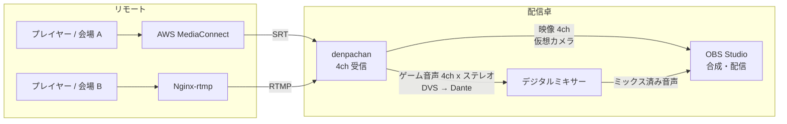
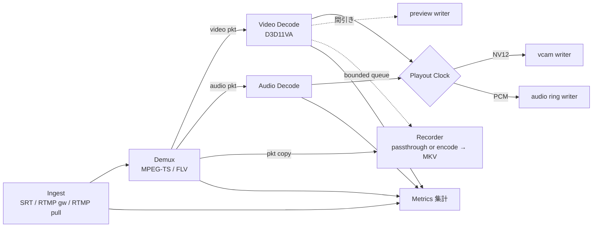
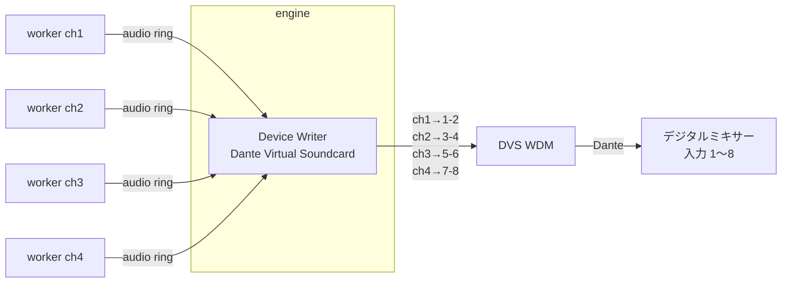
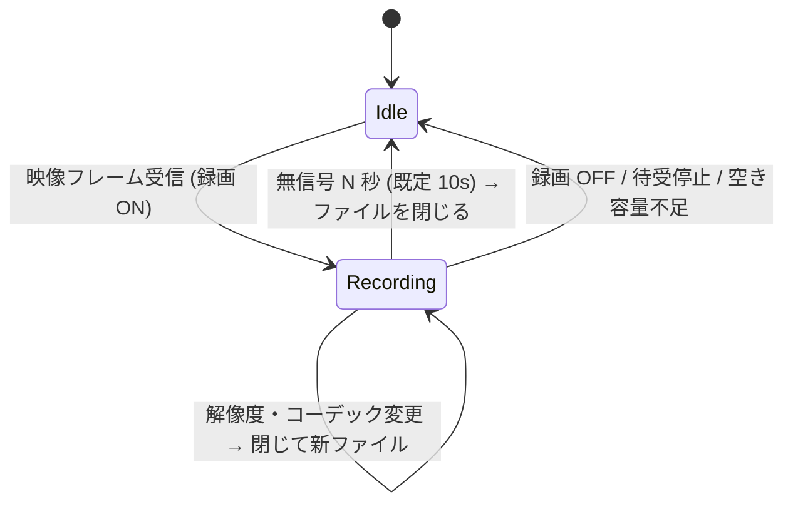

# denpachan 設計書 (v0.3 ドラフト)

SRT / RTMP で受けた映像・音声を、Windows 上の仮想カメラと任意の音声デバイス (Dante Virtual Soundcard 含む) に流し込む受信アプリケーション。ゲーム配信イベントでの運用を前提とし、**止まらないこと**を最優先の設計方針とする。

---

## 0. 位置づけと運用イメージ

vMix の「SRT / RTMP 入力を受けて外部出力する」部分だけを切り出したもの。スイッチングや合成はせず、**リモートの配信を受けて、ローカルの映像デバイスと音声デバイスに出すこと**だけに機能を絞る。合成は OBS、音声のミックスはデジタルミキサーが担う。



この使い方から、設計上次のことを重視する。

- **映像と音声は別経路で OBS に戻る**。映像は仮想カメラで直接、音声はミキサーを経由して戻るので、両者のずれは OBS 側のオフセットやミキサーのディレイで一度合わせることになる。**一度合わせたずれが、再接続や長時間運用で変わらないこと** が重要 (§3.5)。
- **音声はミキサーへの素材送り**。アプリ側で音を加工せず、各チャンネルのゲーム音声を決まった Dante チャンネルへそのまま (ユニティゲインで) 出す。音量や EQ はミキサーで扱う (§6)。
- 機能は最小限に絞り、そのぶん安定性と低負荷に振る。

---

## 1. 要件の整理

| # | 要件 | 設計上の扱い |
|---|------|-------------|
| R1 | 配信元: AWS Elemental MediaConnect, Nginx (nginx-rtmp) | MediaConnect → SRT (listener / caller 両対応)、Nginx → RTMP (1935 番への push 受け / pull) |
| R2 | 映像ソースを 4 つ登録、最大 4ch 同時受信 | チャンネルスロット固定 4 本。各スロットが独立したワーカープロセス |
| R3 | 内蔵の仮想映像デバイスに出力し OBS から参照 | DirectShow ソースフィルタを 4 台分登録 (`denpachan Cam 1..4`) |
| R4 | ソース → 仮想映像デバイスのルーティングをプルダウンで | チャンネル設定に `vcam: 1..4 / なし`。同一デバイスの重複割当は不可 |
| R5 | 音声を任意の音声デバイスへ。最低限 Dante Virtual Soundcard | WASAPI 出力 (DVS の WDM モード)。デバイス + 開始チャンネルを指定。ASIO は第 2 段階 |
| R6 | プレビュー、オンオフ切替 | 縮小フレームを共有メモリ経由で UI に渡す。オフ時はワーカー側で生成自体を止める |
| R7 | 受信状況・ビットレート・latency・jitter 等の計測、グラフ + 現在値、1 秒更新 | ワーカーが 1 秒ごとにメトリクスを集計 → エンジン → UI。直近 10 分をリングバッファで保持 |
| R8 | 待ち受け開始 / 停止をユーザーが操作 | チャンネル単位の Start / Stop。前回状態の自動復帰オプション |
| R9 | Windows のみ、高効率 | C++20 / FFmpeg / D3D11 ハードウェアデコード / GPU エンコーダ |
| R10 | なるべく止まらない | プロセス分離 + ウォッチドッグ + ライブ経路のノンブロッキング化 (§4) |
| R11 | 受信映像・音声のファイル保存 (設定でオンオフ) | ワーカー内の録画ブランチ。ライブ経路とは独立したキューで駆動 |
| R12 | 一定時間映像が来なければ区切り、次の受信で新ファイル | 無信号タイムアウト (既定 10 秒) でセグメントを閉じる |
| R13 | ファイル名テンプレート (`{ch}`, `{YYYY}` など) | テンプレートエンジン (§8.3)。`/` はサブフォルダとして扱う |
| R14 | ファイナライズ不要なコンテナを既定 (mkv 等) | 既定 MKV (クラスタ単位で書き出し、途中で落ちても再生可能)。MPEG-TS も選択可 |
| R15 | コーデック指定可、既定 H.264。ビットレート・量子化も変更可 | 既定は**パススルー** (再エンコードなし)。再エンコードを選ぶと既定 H.264、エンコーダ NVENC / QSV / AMF、CBR / VBR / CQP を設定可 |

### 1.1 決定事項 (v0.1 の未決事項への回答)

| 項目 | 決定 |
|------|------|
| 録画の既定モード | パススルー。再エンコードは設定で選択 |
| x264 の同梱 | しない。GPU エンコーダのみ。FFmpeg は LGPL ビルド |
| 入力の上限 | 4K60 まで。ただし 1080p60 を受けるときに 4K 対応ぶんの負荷が増えない作りにする (§5.3)。実機はハイスペック PC 想定 |
| 音声チャンネル | 各ソースはステレオのみ |
| RTMP の待受 | 1935 番 1 本 + ストリームキーでチャンネル振り分け。初期から対応 (§3.3) |
| 仮想カメラの取り込み先 | OBS (DirectShow) で十分。Media Foundation 仮想カメラは作らない |
| UI | C# / WPF |
| ASIO 出力 | 第 2 段階 |

---

## 2. 全体アーキテクチャ

### 2.1 プロセス構成


| プロセス | 言語 | 役割 | 落ちたときの影響 |
|---------|------|------|----------------|
| `denpachan-engine.exe` | C++ | 常駐の本体。設定保持、子プロセスの起動・監視・再起動、共有メモリ (vcam / audio) の所有、音声デバイスへの出力・ミキシング、IPC サーバ | 全チャンネル停止。ただしコードを小さく保ち、ネットワークから来たデータを解析する処理は一切持たない |
| `denpachan-worker.exe --ch N` | C++ | 1 チャンネル分の受信 (SRT / RTMP pull) またはゲートウェイからの FLV 受け取り → デマックス → デコード → 各出力 (vcam / audio / preview / 録画 / メトリクス) | そのチャンネルのみ停止。エンジンが即座に再起動 (OBS 側は直前フレーム / NO SIGNAL を表示し続ける) |
| `denpachan-rtmpd.exe` | C++ | RTMP サーバ (1935 番)。ハンドシェイク・チャンク層・publish 処理を行い、ストリームキーに対応するチャンネルへ FLV タグを渡す。メディアのデコードはしない | RTMP の全チャンネルが一時切断。即再起動し、Nginx 側の自動再 push (`push_reconnect`) で数秒以内に復帰。SRT チャンネルには影響なし |
| `denpachan-ui.exe` | C# | 操作画面、プレビュー、グラフ | 何も止まらない。再起動すれば現状を再取得 |
| `denpachan-vcam.dll` | C++ | DirectShow ソースフィルタ。OBS のプロセス内にロードされ、共有メモリからフレームを読む | 読み取り専用なので受信側には影響なし |

**なぜプロセス分離するか**: 壊れたストリームによる FFmpeg のクラッシュ、GPU ドライバのハング、エンコーダの暴走といった「受信データやドライバ起因の障害」を 1 チャンネルに閉じ込めるため。イベント中に 1ch が落ちても他 3ch と音声出力は無傷で、落ちた ch も 1〜2 秒で自動復帰する。UI を分けるのは、操作画面の不具合や描画負荷が配信経路に一切影響しないようにするため。UI を C# にしても、エンジンとは IPC と共有メモリでしかつながらないので、ライブ経路に GC 停止の影響は出ない。

### 2.2 技術スタック

| 領域 | 採用 | 理由 |
|------|------|------|
| エンジン / ワーカー / RTMP / vcam | C++20 | FFmpeg / libsrt / D3D11 / DirectShow / WASAPI をすべて素のまま扱える。GC 停止がない |
| ビルド (C++) | CMake + vcpkg (manifest mode) | 依存管理の再現性 |
| SRT | libsrt を直接使用 | FFmpeg の `srt://` プロトコルでは `srt_bstats` (RTT, ロス, 再送, 受信バッファ量) が取れないため。受信データは独自 AVIOContext で libavformat に渡す |
| RTMP サーバ | 自前実装 (§3.3) | 1 ポートでキー振り分けをするため。FFmpeg の listen モードは 1 接続 1 ポートでこれができない |
| デマックス / デコード / エンコード / Mux / RTMP pull | FFmpeg 7.x (libav*、LGPL ビルド) | 実績。Enhanced RTMP (HEVC/AV1) も対応 |
| HW デコード | D3D11VA (FFmpeg hwaccel)、失敗時はソフトウェアに自動フォールバック | GPU ベンダ非依存。4K HEVC も GPU で処理 |
| 映像変換 | D3D11 Video Processor (GPU 上でスケーリング / NV12 化してから CPU へ転送)、フォールバックで libswscale | CPU 負荷と GPU→CPU 転送量の削減 |
| 録画エンコード | NVENC / QSV / AMF (FFmpeg 経由) | x264 は同梱しない (GPL 回避) |
| 音声出力 | WASAPI (イベント駆動)。第 2 段階で ASIO | DVS の WDM モードは通常の多チャンネルエンドポイントとして見える |
| リサンプル | libswresample (ドリフト補正付き) | 長時間運用でのクロックずれ吸収 |
| UI | .NET 10 (LTS) / WPF、CommunityToolkit.Mvvm、ScottPlot (グラフ) | 開発効率。ScottPlot はリアルタイム更新でも軽い |
| IPC | 名前付きパイプ + 改行区切り JSON (制御) / 共有メモリ (大容量データ) | C++ と C# の両方で依存なしに扱える。UI 側は `System.IO.Pipes` + `System.Text.Json`、共有メモリは `MemoryMappedFile` |
| ログ | spdlog (C++) / Microsoft.Extensions.Logging (UI)、いずれもローテーション付き | |
| クラッシュ解析 | `MiniDumpWriteDump` による自動ダンプ | 本番で落ちた原因を後から追える |
| インストーラ | WiX v5 | DLL 登録、ファイアウォール規則、.NET ランタイム同梱 |

---

## 3. チャンネルワーカーのパイプライン



### 3.1 スレッド構成 (1 ワーカー内)

| スレッド | 処理 | ブロックしてよいか |
|---------|------|------------------|
| ingest | ソケット / FLV リングからの受信、トランスポート統計の取得 | 入力待ちのみ |
| demux | AVIO 経由でパケット化、タイムスタンプ補正 | ingest キュー待ちのみ |
| video-decode | デコード、GPU 上でスケーリング、CPU への転送 | |
| audio-decode | デコード、float32 / 48kHz / ステレオへの変換 | |
| output | Playout Clock に従い vcam / audio ring へ書き込み | **絶対にブロックしない** |
| recorder | (パススルー) Mux / (再エンコード) エンコード + Mux、ファイル I/O | ライブ系とは別キュー。詰まったら録画側で捨てる |
| metrics | 1 秒ごとの集計、ハートビート更新 | |

**原則: ライブ経路 (ingest → decode → vcam / audio) は、プレビュー・録画・メトリクス・UI のどれが詰まっても止まらない。** 副次ブランチへはすべて容量固定のキューで渡し、溢れたら古いものから捨ててカウンタに記録する。

### 3.2 Ingest: SRT (MediaConnect 向け)

共通インターフェース `IIngest` を定義し、プロトコル追加 (RIST, UDP/RTP-TS など) を差し替えで行えるようにする。

| 項目 | 内容 |
|------|------|
| モード | Listener (MediaConnect の SRT caller 出力を受ける) / Caller (MediaConnect の SRT listener 出力に接続) |
| 設定 | ポート (チャンネルごと)、待受 IP、latency (ms)、passphrase + 鍵長 (AES-128/192/256)、streamid、MTU 等 |
| ペイロード | MPEG-TS (MediaConnect 出力の標準) |
| 再接続 | 切断検知 → Listener は即再待受、Caller は指数バックオフ (0.5s → 最大 5s) で再接続 |

### 3.3 Ingest: RTMP (Nginx 向け)

**3.3.1 Push 受け: 内蔵 RTMP サーバ `denpachan-rtmpd`**

1935 番を 1 本だけ開き、`rtmp://<host>:1935/<app>/<key>` の `<app>/<key>` でチャンネルに振り分ける。Nginx 側の設定例:

```nginx
application live {
    live on;
    push rtmp://192.168.1.50:1935/denpa/ch1-xxxxxxxx;   # ch1 のキー
    push_reconnect 1s;
}
```

| 項目 | 内容 |
|------|------|
| 対応範囲 | RTMP ハンドシェイク (simple / complex)、チャンク層、AMF0 コマンド (`connect` / `releaseStream` / `FCPublish` / `createStream` / `publish` / `deleteStream`)、FLV タグ (Enhanced RTMP の HEVC / AV1 含む) |
| 振り分け | チャンネルごとに `app` とストリームキーを設定。一致しないキーの publish は拒否 (キーが合言葉の役割を兼ねる) |
| 同一キーの二重 publish | **後から来た接続を優先し、古い接続を切る**。ネットワーク瞬断で古い TCP 接続が半開きのまま残っても、送出側の再接続ですぐ復帰できるようにするため |
| チャンネルの Start / Stop | Stop 中のチャンネルのキーは拒否する。1935 番は RTMP の push 受けチャンネルが 1 つでも Start していれば開く |
| ワーカーへの受け渡し | publish が確立したら、FLV ヘッダ + FLV タグ (タイムスタンプ付き) を `Local\denpachan_flv_{ch}` の SPSC リングに書く。ワーカーはそれを libavformat の FLV デマクサに AVIO で渡す (SRT の TS と同じ形で扱える) |
| 統計 | 受信バイト数、接続元、`SIO_TCP_INFO` による TCP の RTT / 再送数、メッセージ間隔からのジッタ。チャンネル単位でワーカーへ渡す |
| 堅牢性 | メディアは解析しないのでクラッシュ要因は少ないが、チャンク層・AMF パーサは境界チェックを徹底し、ファジング (libFuzzer) の対象にする |

> 代替案として、ゲートウェイが publish を確認した時点でソケットを `WSADuplicateSocket` でワーカーに渡す方式もある (ゲートウェイを通るデータコピーがなくなる)。ただしチャンク層の状態の引き継ぎが必要で複雑になるため、第 1 段階はリング経由で実装し、負荷が問題になったら検討する。

**3.3.2 Pull: Nginx から取りに行く**

`rtmp://nginx/live/key` をワーカーが FFmpeg の RTMP クライアントで再生する。切断時は指数バックオフで再接続。

### 3.4 デコード

- 映像: D3D11VA でハードウェアデコード。初期化失敗やデコードエラーが続いた場合はソフトウェアデコードへ自動切替 (メトリクスに表示)。
- 解像度・フォーマット変更 (送出側のエンコーダ設定変更など) を検知したらデコーダを作り直す。仮想カメラ側の出力フォーマットは別に決まっているので、そこで吸収する (§5.3)。
- タイムスタンプの不連続 (送出側の再起動、PTS のラップアラウンド) を検知したら Playout Clock を再アンカーする。

### 3.5 Playout Clock (A/V 同期とジッタ吸収)

映像は仮想カメラ、音声は別の音声デバイスへ出るため、両者を同じ時間軸で送り出す仕組みがチャンネルごとに必要になる。

- 最初のフレーム到着時に `media PTS ↔ ローカル単調時刻 (QPC)` を対応付け、設定した **再生バッファ (既定 100 ms)** の分だけ遅らせて送出する。RTMP (TCP) はジッタが大きくなりやすいので、プロトコルごとに既定値を変える。
- 映像: 送出時刻が来たフレームを vcam リングへ書く。遅れたフレームは捨てる。
- 音声: 同じ時計に合わせて audio ring へ書く。音声出力側のリングの残量を見てリサンプル比を微調整し (±0.1% 程度)、送出元とデバイスのクロックずれを吸収する。長時間運用で遅延が伸び続けたり音が途切れたりするのを防ぐ。
- **チャンネルごとの音声オフセット (±ms)** を設定でき、OBS 側の映像処理遅延に音を合わせられる。稼働中に変更しても音が途切れないよう、変更はリサンプル比の調整で数百 ms かけて移行する。

**遅延を一定に保つ (再接続しても A/V のずれが変わらない)**

映像は仮想カメラ経由、音声はミキサー経由で OBS に戻るので、ずれはイベント前に一度合わせたら変わってほしくない。そのため遅延は「なるべく小さく」ではなく **「設定した値で一定」** を目標にする。

- 受信してから仮想カメラ / 音声デバイスに出すまでの遅延を `再生バッファ + 音声オフセット` で決まる固定値に保つ。ネットワークの揺れはこのバッファの中で吸収し、遅延のほうは動かさない。
- 再接続やタイムスタンプの不連続で Playout Clock を再アンカーするときも、同じ目標バッファ量で再開する。切断前と後で遅延が同じになる。
- 音声出力側 (WASAPI のバッファ + Device Writer のリング) の遅延も固定値として扱い、リングの残量を目標値に保つ制御をする。
- 長時間運用で遅延がじわじわ伸びる / 縮むことはドリフト補正で防ぐ。実際の遅延と目標値の差をメトリクスに出し、ずれが閾値 (例: 20 ms) を超えたら警告する。

---

## 4. 止まらないための設計

| 障害 | 対策 |
|------|------|
| ワーカーのクラッシュ (FFmpeg, ドライバ) | エンジンが Job Object 配下で子プロセスとして管理し、終了を検知したら即再起動。直近 1 分で 5 回以上落ちた場合はバックオフ (UI に警告表示) |
| RTMP ゲートウェイのクラッシュ | 同上。Nginx 側の `push_reconnect` で自動的に再 push される |
| ワーカーのハング | 各スレッドが共有メモリ上のハートビートを更新。3 秒止まったらエンジンが強制終了 → 再起動 |
| ストリーム途絶・再接続 | ワーカー内で自動再接続。仮想カメラには直前フレーム保持 → 規定時間後に NO SIGNAL スレートへ切り替え (挙動は設定可能) |
| RTMP の半開き接続 | 同一キーの新しい publish が来たら古い接続を切る。無通信 N 秒 (既定 5s) でも切断 |
| 不正データ | デマックス / デコードエラーはカウントして読み飛ばす。連続エラーが閾値を超えたらデコーダ再生成 → それでもダメならワーカー再起動 |
| 音声デバイスの消失 (DVS の再起動、デバイス変更) | `IMMNotificationClient` でデバイスの増減を監視し、復活したら自動で再オープン。その間は該当デバイスの出力だけ止まり、映像は継続 |
| 録画のディスク遅延・容量不足 | 録画キューが溢れたら録画側のみフレームを捨てる。空き容量が閾値 (既定 5 GB) を切ったら録画を停止して警告。ライブ経路には影響させない |
| UI のクラッシュ | 配信には影響なし。再起動後に現状をエンジンから取り直す |
| エンジンのクラッシュ | エンジンは最小限に保つ。万一に備え、ログオン時の自動起動 + 「前回の待受状態を復元」オプションを用意。設定ファイルは一時ファイルに書いてからリネーム (原子的保存) |
| OS 起因 | スリープ抑止 (`SetThreadExecutionState`)、EcoQoS / 電力スロットリングの無効化、音声スレッドを MMCSS "Pro Audio" に登録、プロセス優先度 `ABOVE_NORMAL`、タイマー分解能の確保 |
| GPU リセット (TDR) | D3D11 のデバイスロストを検知したらデバイスを作り直し、ソフトウェアデコードへ一時退避 |

運用補助:
- ログは `%LOCALAPPDATA%\denpachan\logs` にローテーション保存。クラッシュダンプも同じ場所へ。
- 全チャンネルのイベント (接続 / 切断 / 再起動 / 警告) を時系列で UI に表示するイベントログ。

---

## 5. 仮想映像デバイス (vcam)

### 5.1 方式

**DirectShow ソースフィルタ (`denpachan-vcam.dll`) を 4 つの CLSID で登録**し、`denpachan Cam 1`〜`denpachan Cam 4` として `CLSID_VideoInputDeviceCategory` に登録する。OBS の「映像キャプチャデバイス」は DirectShow でデバイスを列挙するため、そのまま選択できる (OBS 自身の仮想カメラと同じ方式)。vMix など DirectShow 対応の他アプリからも見える。

- 64bit DLL を必須、32bit DLL も同梱する (任意)。
- 登録はインストーラが管理者権限で行う。

### 5.2 共有メモリプロトコル

エンジンが `Local\denpachan_vcam_{1..4}` を**常時作成・保持**する (ワーカーが再起動しても OBS 側から見たマッピングは途切れない)。ルーティングで割り当てられたワーカーがそこへ書き込む。

```
struct VcamHeader {
    uint32 magic, version;
    // 読み手 (フィルタ) → 書き手: OBS が選んだフォーマット
    atomic<uint32> req_width, req_height, req_fps_num, req_fps_den;
    atomic<uint64> req_seq;              // フォーマット変更のたびに増える
    // 書き手 → 読み手
    uint32 width, height, fps_num, fps_den, pixel_format;   // 実際に書いているフォーマット
    atomic<uint64> write_seq;            // 書き込み完了したフレーム番号
    atomic<uint64> writer_heartbeat_qpc;
    uint32 state;                        // LIVE / HOLD_LAST / NO_SIGNAL
    uint64 frame_pts_qpc[3];
};
// 続いて最大サイズ (3840x2160 NV12) のフレーム x3 (トリプルバッファ)
```

- 書き手はロックなしで次のスロットに書き、最後に `write_seq` を進める。読み手は最新の完成スロットを読むだけで、書き手を待たせない。
- フィルタは選ばれた fps で `FillBuffer` を回し、新しいフレームがなければ直前フレームを繰り返す。書き手のハートビートが途絶えたら NO SIGNAL スレートを出す。

### 5.3 出力フォーマットと 4K 対応

**方針: 4K まで扱えるが、1080p で使うときの負荷は 1080p 専用に作った場合と同じにする。**

- フィルタが OBS に提示するフォーマット: 3840x2160 / 2560x1440 / 1920x1080 / 1280x720 × 60 / 59.94 / 30 fps、NV12 (YUY2 も提示)。どれを使うかは OBS のデバイス設定で選ぶ (既定は 1920x1080 60fps)。
- OBS がフォーマットを決めると、フィルタが `req_*` に書き、ワーカーはそのサイズにスケーリングして書く。**コピー量・変換量は選ばれた解像度ぶんだけ**で、4K 用の領域は確保されているだけで触らない。
- 共有メモリは 4K の 3 枚分 (約 37 MB/台) を確保するが、メモリ使用量としてはハイスペック PC にとって問題にならない。
- ソースの解像度・アスペクト比が違う場合は GPU (D3D11 Video Processor) でスケーリングしてから CPU へ転送する。4K を受けて 1080p で出すときも、転送は 1080p ぶんだけになる。
- デコード負荷は入力の解像度に比例する。1080p を受けている限り 4K 対応による負荷増はない。
- 目安: 1080p60 NV12 は 4ch で約 750 MB/s、4K60 は 1ch あたり約 750 MB/s のメモリコピー。4K を 4ch 同時に出すのは GPU デコード能力 (NVDEC のセッション数・スループット) 次第なので、実機で確認する。
- 1 台の Cam を複数のアプリが同時に開いて別のフォーマットを要求した場合は、最後に要求したフォーマットで書き、それ以外の読み手はフィルタ内で縮小する (想定外の使い方なので簡易対応)。

### 5.4 ルーティング

- チャンネル設定のプルダウン: `なし / Cam 1 / Cam 2 / Cam 3 / Cam 4`。
- 同じ Cam を 2 つのチャンネルが選んだ場合は UI で拒否 (後から選んだ側をエラー表示)。
- 切替は稼働中でも可能。エンジンがワーカーに書き込み先を通知し、旧 Cam は NO SIGNAL になる。

---

## 6. 音声出力

### 6.1 構成

想定する使い方は、各チャンネルのゲーム音声を DVS の別々のチャンネルに出し、Dante 経由でデジタルミキサーの別々の入力に立ち上げること。



- DVS は Windows からは 1 つの多チャンネルデバイスに見えるので、4ch 分を 1 つのデバイスへまとめて書く必要がある。そのため **デバイスごとに 1 つの WASAPI クライアント (Device Writer) をエンジンが持ち**、各チャンネルの音声を指定された出力チャンネルに配置して書き出す。
- 各チャンネルの設定: 出力デバイス (プルダウン) / 出力チャンネル (例: 3-4、ステレオ 2ch 単位) / ミュート / 音声オフセット。ソースがモノラルの場合は両チャンネルに複製する。
- 同じ出力チャンネルを 2 つのチャンネルが選んだ場合は UI で警告する (ミキサー送りでは通常ありえないので、設定ミスとして扱う)。
- ワーカー → エンジンの受け渡しは共有メモリ上の SPSC リングバッファ (float32 / ステレオ)。ワーカーが落ちてもリングが空になるだけで、デバイスは無音を出し続ける (デバイスを閉じない。他のチャンネルの音は途切れない)。

### 6.2 ミキサーへの素材送りとしての要件

| 要件 | 設計 |
|------|------|
| 音を加工しない | 既定はユニティゲイン (0 dB)。リミッタ・ノーマライズ・EQ などの処理は入れない。音量調整はミキサーで行う。トリム (±12 dB) だけは用意するが既定 0 |
| ポップノイズを出さない | 受信開始 / 途絶 / 再接続 / ミュート切替 / アンダーラン復帰の境目で短いフェード (10 ms) をかける。ミキサーのフェーダーが上がっていても、PA や配信に「ブツッ」という音が出ないようにする |
| 無信号時は無音 | 途絶時はデジタル無音を出し続ける。直前の音の繰り返しやノイズは出さない |
| 他の音を混ぜない | Windows の通知音や他アプリの音が DVS に流れ込まないようにする (§6.3) |
| 遅延が変わらない | 再接続後も音声の遅延が前と同じ値に戻る (§3.5)。ミキサーや OBS 側で合わせたずれが崩れない |
| 信号が来ているか分かる | UI に各チャンネルのレベルメーター (L/R ピーク、dBFS)、無音検知 (N 秒以上無音で警告)、クリップ検知を表示。音声担当と「来ていない」「割れている」の切り分けがしやすいようにする |

### 6.3 Dante Virtual Soundcard

- DVS を **WDM モード** で動かし、多チャンネルの通常オーディオエンドポイントとして WASAPI で開く。サンプルレートは Dante ネットワークに合わせる (通常 48 kHz、96 kHz にも対応)。受信音声はそのレートへ変換する。
- DVS のクロックは Dante ネットワーク (PTP) に従うので、送出元とのクロックずれは §3.5 のリサンプル補正で吸収する。
- チャンネル数は DVS 側の設定に依存するので、デバイスの形式を取得して出力チャンネルの選択肢を作る。
- **排他モードを推奨 (DVS を denpachan 専用にする場合の既定)**。
  - Windows の音声エンジンを通らないので、通知音や他アプリの音が混ざらない。Windows の音量スライダーやエフェクト (APO) の影響も受けない。遅延も小さい。
  - その代わり、排他モードで開いている間は他のアプリがその DVS を使えなくなる。OBS などからも同じ DVS に出したい場合は共有モードを選ぶ。
- 共有モードを使う場合、DVS が Windows の「既定のデバイス」や「既定の通信デバイス」になっていると通知音が混ざるので、UI で警告する。
- 第 2 段階: ASIO 出力 (DVS の ASIO モード対応、より低遅延)。

### 6.4 その他の出力デバイス

DVS 以外の任意の WASAPI デバイス (オーディオインターフェース、HDMI、ヘッドホンなど) も同じ仕組みで選べる。第 2 段階で、オペレーターが確認用に任意のチャンネルをヘッドホンで聞ける「モニタ出力」(メインの出力先とは別に、選んだ 1ch をもう 1 つのデバイスへ複製) を追加する。

---

## 7. プレビューとメトリクス

### 7.1 プレビュー

- ワーカーが縮小フレーム (既定 640x360 BGRA、15fps、最大 30fps) を `Local\denpachan_preview_{ch}` に書き、UI は `MemoryMappedFile` から読んで `WriteableBitmap` に転送して表示する。4ch・30fps でも約 110 MB/s のコピーで済み、WPF 側に D3D 連携を持ち込まずに済む。
- オフにするとワーカーは縮小・コピー処理自体を止める (負荷ゼロ)。UI のウィンドウが最小化されているときも自動で止める。
- 併せて音声レベルメーター (L/R のピーク / RMS、dBFS) を表示。プレビューをオフにしてもメーターは表示し続ける (負荷が小さく、音声確認に常に必要なため)。

### 7.2 メトリクス項目

| 分類 | 項目 | 取得元 |
|------|------|-------|
| 接続 | 状態 (待受中 / 接続中 / 受信中 / 無信号 / エラー)、接続元アドレス、接続時間、再接続回数 | ingest / rtmpd |
| 転送 | 受信ビットレート (全体 / 映像 / 音声) | ingest, demux |
| SRT | RTT、受信バッファ量 (ms)、設定 latency、ロス数 / ロス率、再送受信数、ドロップ (TLPKTDROP) 数、受信帯域推定 | `srt_bstats` |
| RTMP | TCP RTT、TCP 再送数、メッセージ到着間隔 | `SIO_TCP_INFO`, rtmpd |
| ジッタ | 到着間隔ジッタ (RFC 3550 方式: PCR / PTS の進みと到着時刻の差分) | demux |
| 遅延 | 送出元タイムスタンプ基準のエンドツーエンド遅延推定、再生バッファ量、SRT latency + バッファの合計 | Playout Clock |
| ストリーム | コーデック、解像度、fps (実測)、GOP 長、音声形式 | demux / decoder |
| デコード | デコード fps、デコード時間、HW / SW、ドロップフレーム数、エラー数 | decoder |
| 出力 | vcam の出力フォーマット (OBS が選んだもの)、書き込み fps、遅延で捨てたフレーム数、音声リング残量 (ms)、リサンプル補正率、アンダーラン数、**実遅延と目標遅延の差** | output, engine |
| 音声レベル | L/R ピーク / RMS (dBFS)、無音継続時間、クリップ回数 | audio-decode |
| 録画 | 状態、モード、現在のファイル、書き込みビットレート、エンコード fps、録画側で捨てたフレーム数、ディスク空き容量 | recorder |
| プロセス | CPU、メモリ、GPU デコード / エンコード使用率、子プロセス再起動回数 | engine |

- 1 秒ごとに集計し、エンジンが直近 10 分 (600 点) をリングバッファで保持。UI はグラフ (ビットレート、RTT / 遅延、ジッタ、ロス) と現在値を 1 秒ごとに更新する。
- 閾値設定による警告表示 (例: ロス率 > 1%、受信バッファ < 50ms) は第 2 段階。

---

## 8. 録画

### 8.1 モード

| モード | 内容 | 負荷 |
|-------|------|------|
| **パススルー (既定)** | 受信したパケットをそのまま MKV へ (再エンコードなし)。音声もそのまま | ほぼゼロ。画質劣化なし |
| 再エンコード | デコード済みフレームをエンコード。コーデック (既定 H.264、HEVC / AV1 も可)、エンコーダ (NVENC / QSV / AMF)、レート制御 (CBR / VBR / CQP)、ビットレート、QP、プリセット、GOP、プロファイルを設定可。音声は AAC (ビットレート指定可) | GPU エンコーダなので軽い |

- エンコーダはワーカー起動時に利用可否を調べ、使えるものだけをプルダウンに出す。GPU エンコーダが一つもない環境では再エンコードを選べない (x264 は同梱しないため)。
- パススルー時、セグメントはキーフレームから始める (区切り直後の最初のキーフレームまで待ってから書き始める)。

### 8.2 セグメント (ファイルの区切り)



- 無信号タイムアウトは設定可能。区切り後に次の映像が来たら、その時刻で新しいファイル名を作る。
- オプションで最大長による分割 (例: 60 分ごと)。
- MKV はクラスタ単位で書き出し、定期的にフラッシュするため、途中でプロセスが落ちても書けたところまで再生できる。Cues はファイルを閉じるときに付けるが、なくても再生可能。

### 8.3 ファイル名テンプレート

既定: `{ch} - {YYYY}{MM}/{DD} {hh}-{mm}-{ss}.mkv`

| トークン | 意味 |
|---------|------|
| `{ch}` | チャンネル番号 (1〜4) |
| `{name}` | チャンネル名 (ユーザーが付けた名前) |
| `{YYYY}` `{YY}` `{MM}` `{DD}` | 年 / 月 / 日 (セグメント開始時刻) |
| `{hh}` `{mm}` `{ss}` | 時 / 分 / 秒 |
| `{seq}` | そのチャンネルの通し番号 |
| `{codec}` `{res}` | コーデック名 / 解像度 (例: `1920x1080`) |

- `/` と `\` はフォルダの区切りとして扱い、フォルダがなければ作る。
- **Windows のファイル名には `:` が使えない**ため、例の `{hh}:{mm}:{ss}` はそのままでは保存できない。禁止文字 (`: * ? " < > |`) は置換文字 (既定 `-`、設定で `_` や全角 `：` も可) に変換し、UI 上でリアルタイムに展開結果をプレビュー表示する。
- 同名ファイルがある場合は ` (2)` などの連番を付けて上書きしない。
- 出力先ルートフォルダはチャンネルごとに設定可 (既定は共通)。

---

## 9. UI (C# / WPF)

```
┌───────────────────────────────────────────────────────────────────────┐
│ denpachan                        CPU 12%  GPU 8%  Disk 1.2TB free    │
├──────────────────────────────┬────────────────────────────────────────┤
│ CH1  Game A          ● 受信中 │ CH2  Game B          ● 受信中          │
│ ┌──────────────┐  SRT L:9001 │ ┌──────────────┐  RTMP denpa/ch2-…    │
│ │  preview     │  12.0 Mbps  │ │  preview     │   8.1 Mbps            │
│ │              │  RTT 18ms   │ │              │   RTT 22ms            │
│ └──────────────┘  loss 0.0%  │ └──────────────┘   jitter 4ms          │
│ [■停止] [👁プレビュー] [●録画] │ [■停止] [👁] [●録画]                   │
│ 映像 → [Cam 1 ▼]             │ 映像 → [Cam 2 ▼]                       │
│ 音声 → [DVS ▼] [1-2 ▼]       │ 音声 → [DVS ▼] [3-4 ▼]                 │
│ ~~~~ bitrate graph ~~~~      │ ~~~~ bitrate graph ~~~~                │
├──────────────────────────────┼────────────────────────────────────────┤
│ CH3 ...                      │ CH4 ...                                │
├──────────────────────────────┴────────────────────────────────────────┤
│ イベントログ: 21:03:12 CH2 再接続 (RTMP publish replaced) ...          │
└───────────────────────────────────────────────────────────────────────┘
```

- MVVM (CommunityToolkit.Mvvm)。エンジンとの通信は `EngineClient` クラスに閉じ込め、切断時は自動で再接続して状態を取り直す。
- メイン画面: 4ch のグリッド。各タイルに状態、プレビュー、主要メトリクス、Start/Stop、ルーティング用プルダウン。
- 詳細パネル: タイルを選ぶと全メトリクスとグラフ (直近 1 / 5 / 10 分、ScottPlot)。
- 設定画面: ソース設定 (プロトコル・モード・ポート / RTMP キー等)、録画設定、音声設定、全般 (自動起動、状態復元、NO SIGNAL の挙動)。RTMP キーは「生成」ボタンでランダム生成し、Nginx に貼る push URL をコピーできる。
- 設定変更は可能な限り稼働中に反映。ソース設定の変更など再接続が必要なものは確認ダイアログを出す。

---

## 10. 設定と IPC

### 10.1 設定ファイル

`%APPDATA%\denpachan\config.json` (原子的に保存、起動時にスキーマ検証、旧バージョン設定の移行処理あり)

```json
{
  "version": 1,
  "general": { "autostart": true, "restoreState": true, "noSignalHoldMs": 2000 },
  "rtmpServer": { "bind": "0.0.0.0", "port": 1935, "idleTimeoutSec": 5 },
  "audioDevices": [
    { "deviceId": "{0.0.0.00000000}.{...}", "name": "DVS Transmit 1-16 (Dante Virtual Soundcard)", "shareMode": "exclusive", "bufferMs": 10 }
  ],
  "channels": [
    {
      "id": 1,
      "name": "Game A",
      "enabled": true,
      "source": {
        "protocol": "srt",
        "mode": "listener",
        "bind": "0.0.0.0", "port": 9001,
        "latencyMs": 200, "passphrase": "", "streamId": ""
      },
      "playoutBufferMs": 100,
      "video": { "vcam": 1, "preview": true },
      "audio": {
        "deviceId": "{0.0.0.00000000}.{...}",
        "startChannel": 1,
        "trimDb": 0.0, "mute": false, "offsetMs": 0
      },
      "record": {
        "enabled": true,
        "dir": "D:\\rec",
        "template": "{ch} - {YYYY}{MM}/{DD} {hh}-{mm}-{ss}",
        "container": "mkv",
        "mode": "passthrough",
        "encode": {
          "video": { "codec": "h264", "encoder": "h264_nvenc", "rc": "cbr", "bitrateKbps": 12000, "qp": 23, "preset": "p5", "gopSec": 2 },
          "audio": { "codec": "aac", "bitrateKbps": 192 }
        },
        "gapTimeoutSec": 10,
        "maxSegmentMin": 0
      }
    },
    {
      "id": 2,
      "name": "Game B",
      "source": { "protocol": "rtmp", "mode": "push", "app": "denpa", "key": "ch2-8f3a1c..." },
      "playoutBufferMs": 250
    }
  ]
}
```

- vcam の解像度・fps は OBS 側で選ぶので設定ファイルには持たない。
- SRT のパスフレーズと RTMP キーは DPAPI (`CryptProtectData`) で暗号化して保存。
- 音声デバイスは WASAPI のエンドポイント ID で保持し、見つからない場合は表示名で再検索する。

### 10.2 IPC

名前付きパイプ上の改行区切り JSON (リクエスト / レスポンス + サーバからのイベント通知)。

**UI ⇔ エンジン** (`\\.\pipe\denpachan`)

| 種別 | 例 |
|------|----|
| 取得 | `getConfig`, `getState`, `listAudioDevices`, `listEncoders`, `getMetricsHistory(ch, seconds)` |
| 操作 | `startChannel(ch)`, `stopChannel(ch)`, `setRecording(ch, on)`, `setPreview(ch, on)` |
| 設定 | `updateChannel(ch, patch)`, `updateGeneral(patch)`, `updateRtmpServer(patch)` |
| 通知 | `metrics` (1 秒ごと)、`stateChanged`、`event` (ログ)、`devicesChanged` |

**エンジン ⇔ ワーカー / rtmpd**: 同じ形式の別パイプ (`\\.\pipe\denpachan-worker-{ch}`, `\\.\pipe\denpachan-rtmpd`)。映像 / 音声 / プレビュー / FLV / ハートビートは共有メモリ。

メッセージ定義は `schema/ipc.json` (JSON Schema) を正とし、C++ と C# の型をそこから生成またはテストで突き合わせて、両言語の食い違いを防ぐ。

---

## 11. リポジトリ構成 (案)

```
denpachan/
├─ CMakeLists.txt            # C++ 全体
├─ vcpkg.json
├─ Denpachan.sln             # C# UI
├─ build.ps1                 # C++ と C# をまとめてビルド
├─ docs/
│  └─ design.md
├─ schema/                   # IPC メッセージ・設定ファイルの JSON Schema
├─ src/
│  ├─ common/                # 共有メモリ定義, IPC, ログ, 設定, SPSC リングバッファ (C++)
│  ├─ engine/                # supervisor, audio (WASAPI device mixer), IPC server, config store
│  ├─ worker/                # ingest (srt, flv ring, rtmp pull), demux, decode, playout clock, outputs, recorder, metrics
│  ├─ rtmpd/                 # RTMP サーバ (handshake, chunk, amf0, publish 振り分け)
│  ├─ vcam/                  # DirectShow ソースフィルタ DLL
│  └─ ui/Denpachan.Ui/       # C# / WPF
├─ tools/
│  └─ testsrc/               # FFmpeg によるテスト送出スクリプト (SRT / RTMP)、nginx-rtmp 検証用設定
├─ tests/
│  ├─ native/                # GoogleTest (テンプレート展開, リングバッファ, クロック補正, AMF パーサ)
│  ├─ fuzz/                  # libFuzzer (RTMP チャンク層, AMF0)
│  └─ ui/                    # xUnit
└─ installer/                # WiX v5: DLL 登録, ファイアウォール規則 (1935 / SRT ポート), 自動起動
```

---

## 12. 開発ステップ

| 段階 | 内容 | 完了の目安 |
|------|------|-----------|
| M1 縦に 1 本通す | worker 単体: SRT listener 受信 → デコード → vcam 共有メモリ。vcam DLL (フォーマット選択含む)。OBS で映ること | OBS で 1ch 映る。1080p / 4K を切り替えられる |
| M2 音声 | WASAPI Device Writer (排他 / 共有)、DVS への 4ch 出力、Playout Clock、ドリフト補正、フェード | 1 時間流して音ズレ・途切れなし。送出側を止めて再開しても遅延が変わらず、ポップノイズが出ない |
| M3 エンジン化 | supervisor、4ch、ウォッチドッグ、IPC、設定保存 | ワーカーを kill しても 2 秒以内に自動復帰 |
| M4 RTMP | rtmpd (1935 番、キー振り分け、二重 publish 処理)、FLV リング、RTMP pull | nginx-rtmp から 2 本 push して別チャンネルで受かる。rtmpd を kill しても復帰 |
| M5 UI | WPF UI、プレビュー、メトリクスグラフ、ルーティングのプルダウン | 要件の操作がすべて UI からできる |
| M6 録画 | パススルー / 再エンコード、セグメント分割、ファイル名テンプレート | 途切れた送出で正しくファイルが分かれる |
| M7 耐久・仕上げ | 24 時間連続試験、異常系試験 (パケットロス注入、送出側の再起動、DVS 再起動、ディスクフル)、インストーラ | イベント本番相当の負荷 (4ch、うち 4K 含む) で 24 時間無停止 |
| 第 2 段階 | ASIO 出力、メトリクスの閾値警告、SRT の 1 ポート + streamid 振り分け (必要なら) | |

異常系試験は、ネットワーク品質を意図的に悪くするツール (clumsy 等) と、FFmpeg による送出の起動・停止を繰り返すスクリプトで自動化する。

---

## 13. 追加の決定事項 (v0.3)

| 項目 | 決定 |
|------|------|
| SRT の待受ポート | チャンネルごとに別ポート。streamid での振り分けはしない |
| RTMP の認証 | ストリームキーのみ (送信元 IP の許可リストは設けない) |
| 4K の同時受信数 | 実機で GPU のデコード能力を確認する (M7 の耐久試験で計測) |
