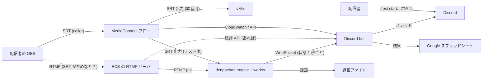

# 配信テストの自動化 (Discord bot とメトリクスの受信口) の設計

イベント前に各配信者と行う配信テストを、Discord bot で進める。**配信者が好きな時間にスラッシュコマンドで起動**し、
bot がスレッドで案内しながら、配信が届いたことの確認、**SRT の latency の調整**、RTMP への切り替え、音声とその他のチェックの指示までを行う。
運営はその場にいなくてよい。

テストも本番も、配信者 → **MediaConnect** → 運営の経路で行う。latency を決める区間は配信者 → MediaConnect なので、
その数字は **MediaConnect (CloudWatch と API) から**取る。運営側の denpachan は、フローの出力を受けて
デコードの良否・音声のレベルを見て、録画を残す。そのために engine に **メトリクスの受信口** (WebSocket、待ち受けポート 1 つ) を足す。
音声の最終的な判定 (ゲーム音だけが載っているか、ノイズ) は、bot がチェックの手順をさせた区間を録画で後日人が聞いて行う。

- [1. 今の運用と、自動化する範囲](#1-今の運用と自動化する範囲)
- [2. 全体の構成](#2-全体の構成)
- [3. bot の情報源](#3-bot-の情報源)
  - [3.1 MediaConnect (配信者 → MediaConnect の区間)](#31-mediaconnect-配信者--mediaconnect-の区間)
  - [3.2 denpachan のメトリクスの受信口 (MediaConnect → 運営の区間、デコード、音声、録画)](#32-denpachan-のメトリクスの受信口-mediaconnect--運営の区間デコード音声録画)
- [4. Discord bot](#4-discord-bot)
- [5. テストの流れ](#5-テストの流れ)
- [6. 配信の確認と latency の調整](#6-配信の確認と-latency-の調整)
- [7. 音声とその他のチェック](#7-音声とその他のチェック)
- [8. 記録 (シート)](#8-記録-シート)
- [9. 実装の順番と大きさ](#9-実装の順番と大きさ)
- [10. 決めていないこと・注意](#10-決めていないこと注意)

## 1. 今の運用と、自動化する範囲

| 今の手順 | 自動化 | 根拠 |
| --- | --- | --- |
| 配信者と運営が時間を合わせ、Discord で通話する | **配信者が好きな時間に `/test start` で起動する (イベント中も)。** 枠は SRT・RTMP とも 1 つなので、テストは同時に 1 人。空いていればすぐ始まり、bot が配信者ごとのスレッドで案内する。空いていなければ待ちの列に入り、順番が来たら知らせる。通話はしない | 時間を合わせる手間をなくす (§5.1) |
| 配信者が MediaConnect に SRT で送る、運営が vMix で受ける | **bot が MediaConnect の接続状態 (`SourceConnected`) と denpachan の受信状態を見て、配信が届いたことを確かめる** | §3 |
| 映像が乱れずに表示できること | **少しの間 (1〜2 分) 配信させ、bot が MediaConnect の取りこぼし (`SourceNotRecoveredPackets`)・CC エラーと、denpachan のデコードエラー・fps で判定し、結果を配信者に伝える** | 回復できなかったパケットとデコードエラーが 0 で fps が出ていれば、映像は乱れていない。静止画 (`DescribeFlowSourceThumbnail`) もスレッドに貼る |
| 乱れるときは latency を上げてもらう。上げても直らなければ RTMP にする | **bot が値を決めて配信者に伝え、配信者が OBS の設定を変えて始め直す (§6)。** 直ったかどうかは bot が見る。上げても直らなければ bot が RTMP (ECS の RTMP サーバ) の案内に切り替える | latency は配信者の OBS の設定に持たせる (本番でもその値で送ってもらう)。MediaConnect の `MinLatency` は低いまま固定し、実際の latency は OBS の値で決まるようにする (大きい方が使われる) |
| 音声が正しく来ていること、ノイズが無いこと | **bot がチェックの手順 (ゲーム音を鳴らす、静かにする) を順にさせ (§7)、その区間を録画の時刻とともに記録する。** 後日、人が録画のその区間を聞いて判定する | 判定は録画でできる。手順をそろえておけば、聞く側は決まった区間だけを聞けばよい |
| ゲーム音だけが載っていること (マイク音は別経路) | **同上。** しゃべる、デスクトップの音を鳴らす、の手順をさせる。その間に音が載ればマイク・デスクトップ音が混ざっている | denpachan の音声レベルで、その場の参考の判定もできる。明らかに混ざっていればその場で直してもらう |
| 結果をシートに記録する | **bot が書く (§8)。** 音声の判定の欄だけ、後日人が埋める | |

## 2. 全体の構成



- **テストの枠は SRT 1 つ、RTMP 1 つ。** どのフロー・どの denpachan のチャンネルを使うかは、**そのとき空いているものを運営が設定し直す** (`/test slot`。イベント中も。§5.6)。
- **MediaConnect**: SRT の枠には、そのとき空いているフロー (source は SRT listener、配信者が caller) を使う。そのフローには denpachan 向けの **SRT の出力**を足しておく (vMix 向けの出力はそのまま。1 つのフローの出力は複数持てる)。source の `MinLatency` は低い値 (120 ms など) で固定し、bot は変えない。
- **ECS の RTMP サーバ**: SRT で安定しないときの受け口 (すでに動いているもの)。配信者はそこへ RTMP で送り、denpachan はそこから RTMP pull で受ける (`source.protocol = rtmp`、`mode = pull`)。本番で RTMP の配信者をどう受けるか (vMix が pull する、など) はそのまま。
- **denpachan**: 本番の受信と同じ denpachan で、そのとき空いているチャンネルを SRT の枠 (MediaConnect のフローの出力を受ける) と RTMP の枠 (ECS の RTMP サーバから pull する) に 1 つずつ使う。録画 (passthrough) を残す。**bot が操作できるのは「配信テスト用」の印を付けたチャンネルだけ**にして、イベント中に本番のチャンネルを触らないようにする (§3.2)。
- **bot**: denpachan とは別のプログラム (別リポジトリ。Node.js + discord.js か Python + discord.py。§4)。AWS の権限 (MediaConnect と CloudWatch の読み取り、フローの開始・停止) を持つ。denpachan と同じ PC で動かすのが簡単 (受信口は loopback)。別の PC でもよい (LAN、トークン必須)。
- **区間ごとの役割**: 配信者 → MediaConnect の区間 (回線が悪くなりうる所) の数字は MediaConnect から、MediaConnect → 運営の区間 (安定している所) とデコード・音声は denpachan から。RTMP のときは、配信者 → ECS の区間は RTMP サーバの統計 (あれば) と denpachan の pull の受信状態から。
- **配信者の OBS の設定を変えるのは配信者**: bot は値を決めて伝え、変えたことの申告 (ボタン) と、変えたあとの数字で確かめる。

## 3. bot の情報源

### 3.1 MediaConnect (配信者 → MediaConnect の区間)

bot が使う API とメトリクス。すべて AWS SDK (boto3 / AWS SDK for JavaScript) から。

| 用途 | API / メトリクス | 使い方 |
| --- | --- | --- |
| フローの状態、source の設定 (ingest の IP とポート、`MinLatency`、ホワイトリスト) | `DescribeFlow` | テストの開始時 (配信者に案内する接続先) と、`MinLatency` が低いまま (OBS の値が効く状態) であることの確認 |
| フローの開始・停止 | `StartFlow` / `StopFlow` | テストの開始時にフローが止まっていれば開始し、終わったら止める (動いている間は課金されるので)。**止めるのは bot が開始したフローだけ** (もともと動いていたフローは止めない) |
| 接続しているか | CloudWatch `SourceConnected` (1 / 0)、`SourceDisconnections`、`SourceUpTime` | 繋がった・切れた・切れた回数 |
| RTT | `SourceRoundTripTime` (ms) | 推奨値の計算 (窓の最大) |
| ロス | `SourcePacketLossPercent` (%)、`SourceRecoveredPackets`、**`SourceNotRecoveredPackets`** | ロス率は倍率の決定、回復できなかったパケットは「今の latency では足りない」の判定 |
| 揺れ | `SourceJitter` (ms) | 記録 (AWS の目安: 40 ms 以下、できれば 10 ms 未満) |
| ビットレート | `SourceBitRate` (bps)、`SourceTotalPackets` | 記録と、送出側の設定との比較 |
| TS の壊れ | `SourceContinuityCounter`、`SourceTSSyncLoss` | 映像の乱れの判定に加える |
| 解像度・fps・コーデック | `DescribeFlowSourceMetadata` (`transportMediaInfo.programs[].streams[]` の `frameResolution`、`frameRate`、`codec`) | 案内した設定 (1080p60 など) と比べる。音声ストリームの有無もここで分かる |
| 静止画 | `DescribeFlowSourceThumbnail` (Base64 の JPEG。フローの `SourceMonitoringConfig.ThumbnailState` を ENABLED にしておく) | 繋がったときと `/test shot` でスレッドに貼る。運営が vMix を開かずに絵を見られる |

- CloudWatch は `GetMetricData` で、直近 60 秒を **1 秒の粒度**で 10 秒ごとに取る (AWS のトラブルシュートの記事は 1 秒の解像度で見ることを勧めている。高解像度のメトリクスは 3 時間残る)。ディメンションは Source ARN (と Flow ARN)。
- **推奨 latency の計算は bot が行う** (denpachan の `src/worker/srt_advisor.h` と同じ規則を bot に写す): 直近 60 秒の RTT の最大 × 倍率 (ロス率 〜1%: 3、〜3%: 4、〜7%: 6、〜10%: 8、それ以上: 10)。窓の中に `SourceNotRecoveredPackets` があれば今の 1.5 倍以上。下限 20 ms、10 ms 単位に切り上げ。接続直後の 5 秒は使わない。AWS の目安「latency は RTT のピークの 3 倍以上」と同じ考え方で、ロスが多いときに倍率を上げる分だけ厳しい。
- 余裕 (`headroomMs`) と `verdict` (§3.2 の表と同じ区分) もここから作る。実際の latency は「配信者の OBS の値」と「`MinLatency`」の大きい方で、`MinLatency` は低く固定するので OBS の値が効く。**OBS の値は bot からは見えない。** bot は「案内した値」を実際の latency とみなし、配信者が「設定した」と申告 (スレッドのボタン) したうえで `SourceUpTime` が戻った (繋ぎ直した) ことを確かめてから、次の計測に進む。上げたのに `SourceNotRecoveredPackets` がまったく減らないときは、設定が反映されていない可能性として配信者に URL の `latency=` を確かめてもらう。

#### RTMP (ECS の RTMP サーバ) の区間

- RTMP サーバに統計の API があれば (nginx-rtmp の `/stat`、SRS の HTTP API など)、接続しているか・ビットレートを取る。無ければ denpachan の pull の受信状態 (`status`、`fps`、`decodeErrors`、`tcp.retransBytes`) だけで判定する。
- 配信者に案内するのは RTMP の URL とキー (bot の設定に、枠ごとのキーを持つ)。denpachan のそのチャンネルの pull の URL も同じキーにしておく。

### 3.2 denpachan のメトリクスの受信口 (MediaConnect → 運営の区間、デコード、音声、録画)

今の IPC (`\\.\pipe\denpachan`、`docs/design.md` §10.2) は名前付きパイプで、同じ PC の同じユーザーからしか繋げない。bot のために、**同じ内容を TCP の WebSocket で出す口**を engine に足す。画面と `denpachan-ctl` は今までどおりパイプを使う。

bot がここから使うのは: 受信の状態 (繋がっている、映像が出ている、途絶)、デコードの良否 (デコードエラー、fps、解像度)、音声のレベルと無音、録画の状態とファイル名。SRT の数字 (`latency` の項目) は MediaConnect → denpachan の区間のもので、**配信者の latency の判断には使わない** (この区間が悪いときは運営側の問題として別に伝える)。

#### 設定

`general.metrics` を足す (全体設定の画面にも出す)。

```json
"metrics": { "enabled": false, "bind": "127.0.0.1", "port": 9100, "tokenProtected": "", "allowControl": false }
```

| 項目 | 内容 |
| --- | --- |
| `enabled` | 既定 off。テストをイベント中も受け付けるので、テストの期間中 (イベント中を含む) は on |
| `bind` / `port` | 既定は loopback の 9100 (SRT の 9001〜9008、RTMP の 1935 と離す)。別の PC の bot から繋ぐなら `0.0.0.0` |
| `token` | 共有の秘密。**loopback 以外に bind するときは必須** (空なら engine が起動を断ってログに出す)。パスフレーズと同じく DPAPI で保存する (`tokenProtected`)。画面に「作り直す」ボタン |
| `allowControl` | 操作のメソッド (下) を許すか。既定 off (読むだけ)。bot にチャンネルと録画の開始・停止をさせるなら on。on でも、操作できるのは「配信テスト用」のチャンネルだけ |

チャンネルの設定に **`testSlot`** (チャンネル設定の画面の「配信テスト用 (bot が操作してよい)」) を足す。運営がテストの枠を設定し直すとき (§5.6) に、そのチャンネルに印を付け、外したチャンネルの印を外す。イベント中は同じ denpachan で本番のチャンネルが動いているので、bot の不具合や枠の設定の間違いで本番のチャンネルを止めたり録画を切ったりしないよう、**engine の側で**操作の対象を印のあるチャンネルに限る。

TLS はしない (家庭内 LAN か同じ PC で使う。外から繋ぐなら VPN か ssh のトンネルを通す)。

#### プロトコル

WebSocket (RFC 6455)、テキストフレーム、1 フレームに JSON 1 つ。

- 接続: `GET /ws HTTP/1.1` + `Upgrade: websocket`。認証は `Authorization: Bearer <token>` ヘッダか `?token=<token>` (ブラウザから試すとき)。合わなければ `401` で切る。
- 繋がったら engine が `hello` を 1 つ送る。以後 1 秒ごとに `channels` を送る (engine の tick で `state` の通知と同時に作る)。
- 要求 / 応答はパイプと同じ形: `{"id": 1, "method": "getState", "params": {}}` → `{"id": 1, "result": ...}` / `{"id": 1, "error": "..."}`。
- ping / pong は WebSocket の制御フレームで。engine は 30 秒応答が無い相手を切る。
- 同時接続は 8 まで。書き込みが 1 秒待っても進まない相手 (受け取らない bot) は切る。**engine の tick を止めない** (パイプの `broadcast` と同じ作り: クライアントごとのスレッドとキュー、溢れたら古いものから捨てる)。

#### `channels` メッセージ

1 秒ごと。全チャンネル分 (止まっているチャンネルも `status: "stopped"` で入れる。bot が「どのチャンネルが空いているか」を知るため)。

```json
{
  "event": "channels",
  "time": "2026-11-01T12:34:56.789Z",
  "channels": [
    {
      "ch": 1, "name": "Runner A", "enabled": true, "testSlot": true,
      "status": "live",
      "source": { "protocol": "srt", "mode": "caller", "host": "203.0.113.5", "port": 5000, "peer": "203.0.113.5:5000", "connectedSec": 83 },
      "video": { "codec": "h264", "width": 1920, "height": 1080, "fps": 59.9, "outputFps": 60, "bitrateMbps": 6.1, "hwDecode": true,
                 "decodeErrors": 0, "droppedLate": 0, "droppedQueue": 0 },
      "latency": {
        "effectiveMs": 300, "receiverMs": 300,
        "rttMs": 12.0, "lossPct": 0.0, "drops": 0, "windowSec": 60,
        "recommendMs": 40, "multiplier": 3,
        "headroomMs": 260,
        "verdict": "generous"
      },
      "audio": { "peakDb": [-9.5, -9.8], "gaps": 0, "silentSec": 0 },
      "record": { "state": "recording", "file": "D:\\rec\\1 - 202611\\01 12-33-10.mkv", "seconds": 106 },
      "rejectedSenders": 0,
      "lastError": ""
    }
  ]
}
```

| 項目 | 元 (`state` の項目) | 意味 |
| --- | --- | --- |
| `status` | `worker.state`、`video.state`、`video.connected`、`lastError` | 画面のタイルと同じ区分: `stopped` / `listening` / `connecting` (caller・pull) / `waiting` (繋がったが映像がまだ) / `live` / `hold` (途絶、最後の絵を保持) / `unreachable` (繋がらない。`lastError` に理由) / `restarting` / `unavailable` (FFmpeg が無い) |
| `source.connectedSec` | `video.connected` が立ってからの秒数 (engine で数える) | 繋がってからの時間 |
| `video.fps` | `video.decodeFps` | 受信した映像の fps |
| `latency.*` | `srt.latencyMs`、`srt.configuredLatencyMs`、`srt.recommend.*` | **MediaConnect → denpachan の区間**の、実際の latency、受信側の設定値、RTT・ロス率・取りこぼし・窓の秒数、推奨値と倍率、余裕 (`effectiveMs − recommendMs`。計測中は null)、判定 |
| `latency.verdict` | 画面の経路の行の色と同じ規則 | `measuring` (推奨値がまだ無い) / `insufficient` (窓の中に取りこぼしがある = 画面の赤) / `tight` (推奨値 > 実際の latency = 画面の黄) / `ok` / `generous` (実際の latency が推奨値の 2 倍以上) |
| `audio.silentSec` | `audioIn.peakDb` が両チャンネルとも −60 dB 未満の連続秒数 (engine で数える) | 音が来ていない時間。bot は 10 秒を超えたら伝える |
| `rejectedSenders` | `video.rejectedSenders` | 同じ宛先に別の送出元がつないできて断った数 |

bot は MediaConnect 側の数字 (§3.1) も同じ項目名 (`latency.rttMs` など) に写して持つ。区間が違うだけで意味は同じなので、判定と記録の処理を共通にできる。

RTMP のチャンネルでは `latency` の代わりに `tcp: { rttMs, retransBytes }` を入れる。

`hello`:

```json
{ "event": "hello", "version": "0.2.0", "channelCount": 4, "allowControl": true, "intervalMs": 1000 }
```

#### メソッド (要求 / 応答)

パイプと同じメソッドを、allowlist で絞って通す。

| 種別 | メソッド | 条件 |
| --- | --- | --- |
| 読む | `getState`、`getConfig` (IPC 形。秘密は入らない)、`getChannels` (`channels` と同じ内容を 1 回) | いつでも |
| 操作 | `startChannel`、`stopChannel`、`setRecording`、`patchChannel` | `allowControl` が on で、**対象のチャンネルが `testSlot`** のとき (でなければ `error`) |

`patchChannel` は bot が壊せる範囲を狭める: **`source.latencyMs` と `name` だけ**を受け付ける (他の項目が入っていれば `error`)。MediaConnect 経由では bot が denpachan の latency を変える必要はほぼ無いが、MediaConnect → denpachan の区間が悪いときに運営が `/test latency receiver` で上げられるよう残す。SRT の枠と RTMP の枠は別のチャンネルにしておき、bot はプロトコルの切り替えでチャンネルの設定を変えない。

#### 実装 (engine)

- `src/engine/ws_server.cpp/h` (新規): TCP の待ち受け、HTTP の Upgrade、フレームの読み書き (テキスト、ping/pong、close。クライアントからのマスクを外す)、クライアントごとのスレッド。`IpcServer` と同じ `Handler` と `broadcast` の形にして、`Engine` からは 2 つのサーバに同じものを流す。
  - 握手の `Sec-WebSocket-Accept` は SHA-1 + Base64。SHA-1 は Windows の `BCryptHash` (新しい依存なし)。
  - 外部のライブラリは入れない (使うのはテキストフレームの送受信だけで、rtmpd と同じく自前で十分。300〜400 行)。
- `Engine::tick` で 1 秒ごとに `state_locked()` を作ったあと、`channels_view(state)` でまとめた形を作って `ws_.broadcast` する。`connectedSec` と `silentSec` は engine がチャンネルごとに数える (`state` の変化を見る)。
- `Engine::handle` の前に allowlist、`testSlot` の確認、`patchChannel` の絞り込みを置く (`ws_handle(method, params)` → `handle`)。`testSlot` はチャンネルの設定 (`config.json`) に足し、画面のチャンネル設定に印を出す (タイルにも小さく「テスト用」と出す)。
- `docs/design.md` §10.2 に「WebSocket の受信口」の項を足す。`denpachan-ctl` に `ws-watch` (動作確認用) を足してもよい。

## 4. Discord bot

### 4.1 構成

- 別リポジトリ。Node.js + discord.js (スラッシュコマンド、スレッド、ボタン、モーダル) + AWS SDK + `ws` + Google Sheets API。Python + discord.py + boto3 でも同じ。
- 設定:
  - Discord のトークン、サーバ、運営への通知のチャンネル、運営のロール。
  - **配信テストのチャンネル (チャンネル ID で 1 つ)**。`/test start` はこのチャンネルでだけ受け付け、配信者ごとのスレッドもここに作る。誰が使えるかは、このチャンネルを見られるロールで絞る (bot の側では人を絞らない)。
  - 配信者の名前の対応 (Discord のユーザー ID ↔ 配信者名。シートから読む。任意)。シートの記録に使い、無ければ Discord の表示名を使う。
  - AWS のリージョンと認証 (フローの一覧、CloudWatch の読み取り、`StartFlow` / `StopFlow` の権限だけの IAM ユーザー)。
  - **テストの枠**: SRT の枠 1 つ (フロー ↔ denpachan のチャンネル番号) と RTMP の枠 1 つ (ECS の RTMP サーバの URL とキー ↔ denpachan のチャンネル番号)。どのフロー・チャンネルを使うかは運営が `/test slot` で設定し直す (§5.6)。設定し直した値は SQLite に持ち、bot を起動し直しても残る。
  - 配信者に案内する内容: 接続先 (フローの ingest の IP とポートは `DescribeFlow` から取れる。パスフレーズは設定に持つ)、配布した OBS の設定の名前、期待する解像度・fps・ビットレート、latency の初期値と上限。
  - **チェックの手順** (§7。YAML で書き、運営が足したり変えたりできる)。
  - シートの ID、denpachan の受信口 (host、port、token)、RTMP サーバの統計 API (あれば)。
- 状態 (テストのセッション、各段階の時刻) は SQLite に持つ (bot を起動し直しても続きから)。

### 4.2 コマンドとボタン

配信者が使うのは `/test start` だけで、あとはスレッドの中のボタンで進める。

| コマンド | 誰が | すること |
| --- | --- | --- |
| `/test start` | 配信者 (配信テストのチャンネルでだけ) | テストを始める。枠が使われていれば待ちの列に入る (§5.1)。返事はその人にだけ見える (ephemeral) |
| `/test leave` | 配信者 | 待ちの列から抜ける |
| `/test slot` | 運営 | 今の枠の設定と状態 (使用中の配信者、待ちの列) を出す |
| `/test slot srt <フロー> <ch>` / `/test slot rtmp <ch>` | 運営 | 枠に使うフローと denpachan のチャンネルを設定し直す (§5.6) |
| `/test slot off <srt\|rtmp>` / `/test slot on <srt\|rtmp>` | 運営 | 枠を止める / 戻す (空いているフロー・チャンネルが無いとき)。止めている間も待ちの列は残す |
| `/test status [配信者]` | 運営 | 進行中のテストの段階と数字 (MediaConnect と denpachan の両方) を出す |
| `/test shot [配信者]` | 運営 | `DescribeFlowSourceThumbnail` の静止画を貼る |
| `/test latency <配信者> <ms>` | 運営 | 配信者に案内する latency を手で決める (自動の途中でも)。`/test latency receiver <ch> <ms>` は denpachan 側 (MediaConnect → 運営の区間) |
| `/test rtmp <配信者>` | 運営 | RTMP (ECS の RTMP サーバ) の案内に切り替える (自動の判定を待たずに) |
| `/test cancel <配信者>` | 運営 | 中止して枠を空ける (記録は「中断」) |
| `/test review <配信者> 音声:OK/NG [メモ]` | 運営 (後日) | 録画を聞いた結果をシートの音声の欄に書く |

スレッドの中のボタン (押せるのはその配信者と運営だけ):

| ボタン | 出る場面 |
| --- | --- |
| 「配信を始めた」 | 初回の案内。押さなくても bot は配信の開始を検出して進む (押されたのに届いていなければ、案内の見直しを促す) |
| 「設定した」 | latency の変更や RTMP への切り替えを頼んだとき (§6) |
| 「始める」「やり直す」 | 音声とその他のチェックの各手順 (§7) |
| 「はい」「いいえ」 | 静止画を見て答える手順など (§7) |
| 「完了」 | チェックが全部終わったとき (§5.5) |
| 「中断する」 | いつでも。理由を一言書くモーダルを出す |

スレッドには節目ごとに短く書く。1 秒ごとの数字は書かない。運営への通知のチャンネルには、始まった・確定した値・中断・完了・運営側の問題 (§5.3) を 1 行ずつ流す。

## 5. テストの流れ

```
/test start ──(枠が使用中・止めている)──> 待ちの列に入れる ──(順番が来たら知らせる、5 分以内に「始める」)
     │                                                                    │
     ▼ 空きあり  <─────────────────────────────────────────────────────────┘
5.1 受付: スレッドを作る、フローと denpachan のチャンネルを開始、録画開始
     ▼
5.2 初回の案内 ──> 配信の開始を待つ ──(10 分で催促、30 分で中断)
     ▼ SourceConnected = 1 かつ denpachan が live
5.3 配信の確認 (少しの間配信させる) ──(だめ)──> §6 latency の調整 / RTMP への案内 ──> 5.3 に戻る
     ▼ 正しく配信できている
5.4 音声とその他のチェック (§7)
     ▼ 配信者が「完了」
5.5 終わり: 録画とフローを止める、シートに書く、スレッドを閉じる
```

### 5.1 受付 (`/test start`)

1. 配信テストのチャンネル (設定したチャンネル ID) で実行されたかを確かめる。ほかのチャンネルなら「#配信テスト で実行してください」とだけ返す。すでに進行中のテストや待ちの列に入っていれば、そのスレッドへのリンクか今の順番を返す。
2. **SRT の枠が空いているか**を見る (ほかの人のテストに使われていない、運営が止めていない)。
   - 空いていなければ **待ちの列**に入れ、「今は別の方がテスト中です。順番が来たらお知らせします (N 番目)」と返す。順番が来たら (前の人のテストが終わった、または前の人が RTMP の枠に移って SRT の枠が空いた) 先頭の人にメンションと DM で知らせ、「始める」ボタンを出す。**5 分以内**に押されなければ列の最後に回し、次の人に知らせる (2 回続けて押されなければ列から外す)。
   - 運営が枠を止めているときも列に入れ、「今は受付を止めています。再開したらお知らせします」と返す。
3. 押さえる前に、枠の状態を確かめる: denpachan のチャンネルが `testSlot` で止まっていること、フローの source に誰も繋がっていないこと (`SourceConnected` が 0)。合わなければ始めずに運営に知らせ、配信者には「準備に問題があります。運営が確認します」と返す (列の先頭のまま待つ)。
4. 枠を押さえ、**配信者ごとのスレッド** (配信テストのチャンネルのプライベートスレッド。配信者と運営のロールを入れる。ほかの配信者のテストの通知が混ざらないように) を作る。返事でスレッドへのリンクを返す。
5. 裏で準備する: フローが止まっていれば `StartFlow` (動き出すまで 1 分ほどかかることがある。開始したことを覚えておく)、denpachan のチャンネルを開始し録画を始める (`startChannel`、`setRecording`)。準備が終わるまで、スレッドには「準備しています」と出す。

### 5.2 初回の案内

準備が終わったらスレッドに書く。

- 接続先: SRT の URL (`srt://<ingest IP>:<port>?mode=caller&latency=<初期値>000&passphrase=…&pbkeylen=16`)。OBS の「配信」の設定にそのまま貼れる形で。
- 配布した OBS の設定 (プロファイルとシーンコレクション) を使っていることの確認と、期待する出力 (解像度、fps、ビットレート、キーフレーム間隔)。
- 「OBS で配信を始めてください。このあと、映像の確認、音声の確認の順に進めます (全体で 10〜15 分)」。
- 「配信を始めた」「中断する」のボタン。

配信の開始は bot が検出する (`SourceConnected` が 1 になり、denpachan のチャンネルが `live`)。届かないまま 10 分経ったら一度だけ催促し (URL とパスフレーズ、ファイアウォールを確かめてもらう)、30 分で中断する。

- MediaConnect は繋がっているのに denpachan が `live` にならない (繋がらない、映像が無い) のは、MediaConnect → 運営の区間の問題なので、配信者には「運営側で確認しています」とだけ伝え、運営に知らせる。
- 解像度・fps・音声ストリームの有無 (`DescribeFlowSourceMetadata`) が期待と違えば、ここで伝える (OBS の設定の取り違え)。

### 5.3 配信の確認

配信が届いたら、**少しの間 (計測の 60 秒 + 確定の 60 秒。最短でおよそ 2 分) そのまま配信させて**判定する。手順と閾値は §6。

- 判定のあいだは「そのまま配信を続けてください (ゲーム画面を動かしていると確かめやすいです)」と出し、静止画を 1 枚貼る。
- **正しく配信できていそうなら**、その旨を伝える: 「映像は問題なく届いています。latency は **N ms** のままで本番もお願いします」。運営への通知にも流す。続けて音声とその他のチェック (5.4) に進む。
- **できていなさそうなら** §6 の手順に入る (latency を上げてもらう → だめなら RTMP の案内)。直ったら上と同じく伝えて 5.4 へ。最後までだめなら、運営に知らせて「運営から連絡します」と伝え、音声のチェックだけは進める (録画は残る)。

### 5.4 音声とその他のチェック

§7 の手順を 1 つずつ出し、配信者がボタンで進める。全部終わったら「完了」ボタンを出す。

### 5.5 終わり

配信者が「完了」を押したら:

1. 「気になったことがあれば書いてください (任意)」のモーダルを出す。
2. 録画を止め (`setRecording`)、denpachan のチャンネルを止め、フローは bot が開始したときだけ `StopFlow`。枠を空け、待ちの列の先頭の人に知らせる (§5.1)。
3. シートに 1 行書く (§8)。スレッドにまとめ (確定した latency、プロトコル、映像の数字、チェックの結果と録画の区間) を貼り、「OBS の配信を止めてください。おつかれさまでした」で締める。スレッドはロックしてアーカイブする。

途中で配信者が「中断する」を押したとき、運営が `/test cancel` したとき、催促しても進まないとき (配信の開始は 30 分、各チェックは 20 分) も、同じ手順で終わる (記録は「中断」と理由)。枠が 1 つなので、待っている人がいるときは催促の時間を半分にする。

### 5.6 枠の設定し直し (イベント中)

テストはイベント中も受け付ける。枠に使うフローとチャンネルは、そのとき空いているものを運営が設定し直す。

1. 運営は denpachan で、空いているチャンネルの受信の設定を枠に合わせる (SRT の枠: そのフローの denpachan 向けの出力を受ける。RTMP の枠: ECS の RTMP サーバから pull する)。そのチャンネルに「配信テスト用」の印を付け、前に枠だったチャンネルの印を外す。
2. bot で `/test slot srt <フロー> <ch>` (または `/test slot rtmp <ch>`) を実行する。bot は次を確かめてから受け入れる。合わなければ理由を返して、前の設定のままにする。
   - denpachan のチャンネルがあり、`testSlot` の印が付いていて、止まっている。
   - チャンネルの受信の設定が枠と合う (SRT の枠なら `protocol = srt`、RTMP の枠なら `protocol = rtmp` の pull)。
   - SRT の枠なら、フローがあり、source が SRT listener で、`MinLatency` が案内の初期値以下。
3. **テストの途中で設定し直したとき**は、進行中のテストは前の枠のまま最後まで続け、新しい枠は次のテストから使う (運営への返事にそう出す)。急いで空けたいときは `/test cancel` してから設定し直す。
4. 空いているフロー・チャンネルが無い間は `/test slot off srt` で止める。待ちの列は残り、`/test slot on srt` で再開したら先頭の人から知らせる。

## 6. 配信の確認と latency の調整

1. **初期値**: 配信者には OBS の URL に案内値 (たとえば `latency=120000`、µs。bot の設定) を入れてもらう。フローの `MinLatency` はそれ以下に固定してあるので、実際の latency は OBS の値になる。bot は「今の latency = 案内した値」として持つ。
2. **計測**: `SourceConnected` が 1 になって 15 秒後から (接続直後の 5 秒を除外し、10 秒分溜まってから) 推奨値を出す。窓が 60 秒になってから判定する (§3.1 の規則で `verdict` と `headroomMs` を作る)。
3. **上げる**: `tight` か `insufficient` なら、次の値 N = `max(推奨値, 今の値 × 1.5)` を 10 ms 単位に切り上げたもの (上限 2000 ms) を決め、スレッドで「映像が乱れる可能性があります。OBS の配信を止め、URL の `latency=` を **N000** にして、始め直してください」と頼む (「設定した」ボタン付き)。ボタンが押され、`SourceUpTime` が戻った (繋ぎ直した) のを見たら、「今の latency = N」としてまた計測 (2 へ)。最大 4 回。
   - 配信者が始め直さないまま 10 分経ったら、一度だけ催促する。
   - 上げたのに `SourceNotRecoveredPackets` が前の窓とまったく変わらないときは、設定が反映されていない可能性として URL を確かめてもらう (OBS は URL を変えても配信を止めないと反映しない)。
4. **安定の確定**: `ok` か `generous` が出たら、さらに 60 秒見て `SourceNotRecoveredPackets` が 0、`SourceContinuityCounter` と `SourceTSSyncLoss` が増えない、denpachan の `decodeErrors` が増えない、`fps` が 60 秒の平均で期待の 90% 以上であれば **確定** (§5.3 の「正しく配信できていそう」)。`generous` なら推奨値まで下げられることを添える (下げるのは任意。下げるなら同じ手順で始め直す)。
5. **RTMP への案内**: 上限まで上げても `insufficient`、または `SourceJitter` が 500 ms を超え続ける (AWS の目安では切断の原因)、または denpachan の `decodeErrors` が増え続ける・`fps` が出ない (回線でなく送出側の問題の可能性) なら、**RTMP の枠** (ECS の RTMP サーバ + denpachan の pull のチャンネル) に移す。
   - RTMP の枠 (1 つ) が空いていれば押さえ、スレッドに RTMP の URL とキーを貼り、「OBS の配信の設定をこの URL に変えて、始め直してください」と頼む (「設定した」ボタン付き)。RTMP で繋がったら SRT の枠は空け、待ちの列の先頭の人に知らせる (§5.1)。
   - RTMP の枠がほかの人に使われている・止めているときは、運営に知らせて「運営から連絡します」と伝え、音声のチェック (§7) は SRT のまま進める。
   - RTMP サーバの統計 (あれば) と denpachan で `live` になり、60 秒安定 (`decodeErrors` が増えない、`fps` が出る、`tcp.retransBytes` が増え続けない) で確定。結果は「RTMP」。
6. **無音**: どの段階でも denpachan の `audio.silentSec > 10` なら「音が届いていません (OBS の音声の設定を確認)」を一度だけ伝える。`DescribeFlowSourceMetadata` に音声ストリームが無いときも同じ。音が来たら解除。§7 の「静かにする」手順のあいだは伝えない。

判定に使う数字はすべて bot の中の共通の形 (§3.2 の `channels` の項目名) にそろえるので、区間が MediaConnect でも denpachan でも同じ処理で判定できる。閾値 (倍率の表) は bot の設定に置く。

## 7. 音声とその他のチェック

映像の確認が済んだら、チェックの手順を 1 つずつ出す。各手順で配信者が「始める」を押すと、bot が決まった秒数だけ待ってから次へ進む。

- **bot は手順ごとに、録画の中の区間 (録画の開始からの時刻) を記録する。** 後日の判定は、人がその区間を録画で聞いて行う。
- 音のレベルは denpachan の受信口 (`audio.peakDb`、1 秒ごと) で見て、**その場の参考の判定**もする。明らかにおかしいとき (ゲーム音が来ない、しゃべった声が載った) はその場で伝え、OBS の設定を直して「やり直す」を押してもらう。参考の判定は記録に残すが、最終的な判定は人の耳で行う。
- 「静かにする」手順のあいだは、§6 の無音の通知を出さない。

### 7.1 手順 (既定)

| # | 配信者への指示 | 秒数 | 期待 (参考の判定) | おかしいときに伝えること |
| --- | --- | --- | --- | --- |
| 1 | ゲーム (ゲーム機・エミュレータ) の音を鳴らしてください。BGM や効果音が出る場面で | 15 | 音が載る (ピーク −40 dBFS 以上の秒が 8 割以上) | ゲーム音が届いていません。OBS のゲーム音の入力 (キャプチャボード・アプリの音声キャプチャ) とミュートを確認 |
| 2 | ゲームの音を止めて (ミュートして)、静かにしてください | 10 | ほぼ無音 (ピーク −60 dBFS 未満)。このときのレベルを**ノイズの大きさ**として記録 | 何も鳴らしていないのに音が載っています (ノイズの可能性)。キャプチャボードの音量、ゲーム機の設定を確認 |
| 3 | ゲームの音を止めたまま、マイクに向かって普段の声で話してください | 10 | 無音のまま (手順 2 のレベル + 6 dB を超えない) | マイクの音が配信に入っています。OBS のマイクの入力を配信の音声から外してください (マイクは別の経路で送ります) |
| 4 | ゲームの音を止めたまま、PC の音 (ブラウザの動画、Discord の通知音など) を鳴らしてください | 10 | 無音のまま (同上) | PC の音が配信に入っています。OBS のデスクトップ音声を配信の音声から外してください |
| 5 | (静止画を貼って) 配信に映っている画面は正しいですか (ゲーム画面が全体に映っている、余計なウィンドウが無い) | — | 配信者が「はい」 | 「いいえ」なら OBS のシーンを直して「やり直す」 |
| 6 | OBS の配信を一度止めて、もう一度始めてください (本番で切れたときの戻し方の練習) | 最大 60 | 繋ぎ直して `live` に戻る (`SourceUpTime` が戻り、30 秒以内に `live`) | 戻らなければ、URL の設定が保存されているかを確認 |

- 手順は bot の設定 (YAML) に書く。運営は文言・秒数・閾値を変えたり、手順を足したりできる。手順の種類は「音を鳴らす (音が載ることを期待)」「静かにする (載らないことを期待)」「はい / いいえで答える」「繋ぎ直す」の 4 つ。
- 手順 3・4 は「載らない」ことを見る手順なので、比べる基準は手順 2 で測ったノイズの大きさ。ゲーム音を止め忘れていると手順 2 で分かる (無音にならない) ので、そこで止めてもらう。
- OBS のノイズゲートや音声のフィルタが入っていても、配信に載る音を見ているので判定は同じ。

### 7.2 終わったら

全部終わったら、手順ごとの参考の判定と録画の区間をスレッドにまとめて貼り、「完了」ボタンを出す (§5.5)。参考の判定で「おかしい」が残ったまま配信者が先に進めた手順は、まとめに印を付け、運営への通知にも流す。

## 8. 記録 (シート)

1 テスト 1 行。テストが終わったとき (§5.5) に bot が書き、`/test review` で音声の判定の欄を埋める。

| 列 | 内容 |
| --- | --- |
| 日時、配信者 (配信者名と Discord の ID)、枠 (フロー名、denpachan のチャンネル) | |
| 結果 | 完了 / 中断 (理由) |
| プロトコル | srt / rtmp |
| 確定した latency (ms)、推奨値、RTT (最大)、ロス率、回復できなかったパケット、ジッタ (最大) | MediaConnect の source の数字 |
| 解像度、fps (平均)、コーデック、ビットレート (平均) | `DescribeFlowSourceMetadata` と `SourceBitRate` |
| 切れた回数、デコードエラー、latency を上げた回数 | |
| MediaConnect → 運営の区間の RTT・取りこぼし | denpachan の数字 (運営側の健全性) |
| ノイズの大きさ (手順 2 のピーク) | denpachan |
| チェックの手順ごとの参考の判定と、録画の区間 (`03:12〜03:27` の形) | §7。聞く人はこの区間だけを聞けばよい |
| 録画ファイル | |
| 映像の判定 | bot: OK / RTMP / NG |
| 音声の判定、メモ | 人 (`/test review`) |
| 配信者のメモ (§5.5 のモーダル)、スレッドのリンク | |

録画は passthrough (再エンコードしない) で、容器は mkv。録画先と空き容量の下限は denpachan の設定のまま。

## 9. 実装の順番と大きさ

| 段 | 内容 | 大きさの目安 |
| --- | --- | --- |
| 1 | bot: `/test start` (配信テストのチャンネルで絞る) と待ちの列、`/test slot` (枠の設定し直し)、スレッド、初回の案内、MediaConnect の読み取り (`DescribeFlow`、CloudWatch、`DescribeFlowSourceMetadata`、サムネイル)、配信の開始の検出、`StartFlow` / `StopFlow`、終わりとシートへの記録 | bot の骨格。denpachan の変更なし (チャンネルと録画は運営が画面で始める) |
| 2 | bot: §6 の判定と latency の調整 (値を決めて伝える、「設定した」ボタン、繋ぎ直しの検出) | |
| 3 | engine: `general.metrics` の設定、WebSocket サーバ、`hello` / `channels` の配信、`getState` / `getChannels`、チャンネルの `testSlot` の印 (設定・画面・操作の制限)、`allowControl` と `startChannel` / `stopChannel` / `setRecording`。bot: denpachan の受信状態・デコード・録画を取り込み、チャンネルと録画を自動で始める・止める、`/test slot` での確認 | C++ 600 行前後 + 画面 (全体設定、チャンネル設定の印、タイルの表示) |
| 4 | bot: §7 の音声とその他のチェック (手順の YAML、録画の区間の記録、レベルによる参考の判定) | 段 3 の音声レベルを使う |
| 5 | bot: RTMP への案内、`/test review` | |

- **段 1〜2 で「配信者が起動して、映像の確認と latency の調整まで自動」になる。** 音声のチェックは、段 3 が無くても手順の指示と区間の記録 (時刻は bot の時計で、録画の開始時刻から計算) まではできる。レベルによる参考の判定には段 3 が要る。

## 10. 決めていないこと・注意

- **同時に 1 人**: SRT の枠が 1 つなので、テストは 1 人ずつ。1 人 10〜15 分なので、1 時間に 4〜5 人。RTMP に移った人がいる間は、SRT の枠で次の人が始められる。待ちの列の長さは `/test slot` で見える。
- **イベント中のテスト**: 本番のチャンネルと同じ denpachan で受けるので、本番を触らない仕組みを二重にする (bot は設定された枠のチャンネルしか操作しない。engine は `testSlot` の印の無いチャンネルへの操作を断る)。フローも、bot が止めるのは自分が開始したものだけ。テストのチャンネルのデコードの分だけ PC の負荷が増えるので、状態バーの CPU・GPU を見ておく。
- **フローの課金**: 動いている間は課金される。bot はテストの間だけ `StartFlow` / `StopFlow` する (止まっていたフローを使うときだけ)。
- **配信者のホワイトリスト**: フローの source の `WhitelistCidr` に配信者の IP が要る。`0.0.0.0/0` にしてパスフレーズで守るか、配信者に IP を申告してもらって運営が入れるか。前者が簡単 (パスフレーズは必ず付ける)。bot はフローの設定を変えない。
- **パスフレーズ**: 案内 (スレッド) が見えるのはロールで絞ったメンバーだけなので、スレッドに残ってよい。テストのあとに変える必要はない。
- **RTMP の統計**: ECS の RTMP サーバに統計の API があるかで、RTMP の判定の細かさが変わる。無くても denpachan の pull の受信状態で「映るか・安定か」は判定できる。
- **OBS 側の latency**: bot からは見えない。SRT の latency は配信者 ↔ MediaConnect の握手で決まり、denpachan は別の接続 (MediaConnect ↔ denpachan) の値しか持たない。MediaConnect の `DescribeFlow` も設定値 (`MinLatency`) を返すだけ。CloudWatch の `SourceLatency` が握手の結果を出している可能性はあるが、ドキュメントでは確定できないので、**OBS の `latency=` を 500 と 1000 にして `SourceLatency` が追随するかを一度確かめる**。追随するなら、申告と合わないときに確かめてもらう材料にする。追随しなければ、案内した値と「設定した」の申告、繋ぎ直しの検出、取りこぼしの減り方で判定する。配信者が別の値を入れていても bot には分からないので、確定した値はシートとスレッドに残し、本番前に配信者に見てもらう。bot が値を確実に知る必要があるなら、`MinLatency` を bot が上げる方式 (大きい方が効く) に戻す。
- **フローの `MinLatency`**: OBS の値が効くように低い値 (案内の初期値以下) に固定しておく。これより大きいと、配信者がいくら下げても効かない。
- **CloudWatch の粒度と遅れ**: 1 秒の粒度で取れるが、CloudWatch に反映されるまで数十秒遅れることがある。判定の窓を 60 秒にしてあるので、遅れは「判定が少し遅くなる」だけ。配信の開始の検出は、denpachan の `live` の方が早い (受信口があれば、そちらを先に見る)。
- **音声の参考の判定の限界**: 1 秒ごとのピークしか見ないので、小さい声や短い通知音は見逃すことがある。最終的な判定は録画を聞いて行う前提。閾値は最初のイベントの結果を見て調整する。
- **配信者の OBS の設定の確認** (解像度・fps・ビットレート・音声の経路) は、bot が「案内した値」と `DescribeFlowSourceMetadata` の値を比べて違いを伝えるところまで。設定そのものは配信者が直す。
- **bot が落ちたとき**: MediaConnect も engine も影響を受けない。bot は起動し直したら SQLite のセッションを読み、続きから進める (チェックの手順の途中なら、その手順をやり直してもらう)。
- **engine の受信口をイベント中も開けておく**: テストをイベント中も受け付けるので、受信口はイベント中も on になる。`bind: 127.0.0.1` のまま bot を同じ PC で動かすのが安全 (外から繋がらない)。別の PC で動かすならトークンを必ず付ける。受信口と bot が落ちても、本番の受信には影響しない (受信口は engine の tick を止めない作り。§3.2)。
