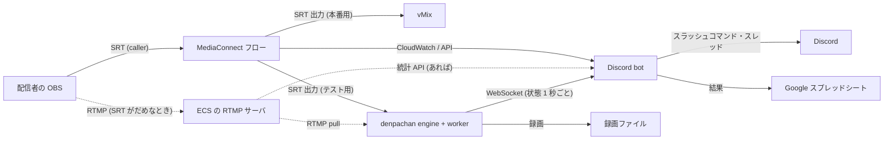

# 配信テストの自動化 (Discord bot とメトリクスの受信口) の設計

イベント前に各配信者と行う配信テストのうち、**SRT の latency の調整**を Discord bot で自動化する。
テストも本番も、配信者 → **MediaConnect** → 運営の経路で行う。latency を決める区間は配信者 → MediaConnect なので、
その数字は **MediaConnect (CloudWatch と API) から**取る。運営側の denpachan は、フローの出力を受けて
デコードの良否・音声のレベルを見て、録画を残す。そのために engine に **メトリクスの受信口** (WebSocket、待ち受けポート 1 つ) を足す。
音声の確認 (ゲーム音だけが載っているか、ノイズ) は録画を後で見れば済むので、bot は録画を残して記録するだけにする。

- [1. 今の運用と、自動化する範囲](#1-今の運用と自動化する範囲)
- [2. 全体の構成](#2-全体の構成)
- [3. bot の情報源](#3-bot-の情報源)
  - [3.1 MediaConnect (配信者 → MediaConnect の区間)](#31-mediaconnect-配信者--mediaconnect-の区間)
  - [3.2 denpachan のメトリクスの受信口 (MediaConnect → 運営の区間、デコード、音声、録画)](#32-denpachan-のメトリクスの受信口-mediaconnect--運営の区間デコード音声録画)
- [4. Discord bot](#4-discord-bot)
- [5. latency の調整の手順 (bot の中身)](#5-latency-の調整の手順-bot-の中身)
- [6. 記録 (シート)](#6-記録-シート)
- [7. 実装の順番と大きさ](#7-実装の順番と大きさ)
- [8. 決めていないこと・注意](#8-決めていないこと注意)

## 1. 今の運用と、自動化する範囲

| 今の手順 | 自動化 | 根拠 |
| --- | --- | --- |
| 配信者と運営が時間を合わせ、Discord で通話する | bot が日時の候補を出して予約する (後回しでよい) | 人の都合の調整は bot でなくてもよい。まずは「配信者が好きな時間に送って、bot が受ける」を目指す |
| 配信者が MediaConnect に SRT で送る、運営が vMix で受ける | **bot が MediaConnect の接続状態 (`SourceConnected`) と denpachan の受信状態を見て、繋がった・繋がらない・途絶を配信者に伝える** | §3 |
| 映像が乱れずに表示できること | **bot が MediaConnect の取りこぼし (`SourceNotRecoveredPackets`)・CC エラーと、denpachan のデコードエラー・fps で判定する** | 回復できなかったパケットとデコードエラーが 0 で fps が出ていれば、映像は乱れていない。人の目は要らない。静止画 (`DescribeFlowSourceThumbnail`) をスレッドに貼って、人がちらっと見ることもできる |
| 音声が正しく来ていること、ノイズが無いこと | **録画を残し、後で人が聞く。** 音が来ていない (無音) だけは bot がその場で伝える | ノイズや混ざり方の判定は録画でできる。無音は denpachan の数字で分かるので、その場で直してもらう方が早い |
| ゲーム音だけが載っていること (マイク音は別経路) | 録画を後で人が聞く | 同上 |
| 乱れるときは latency を上げてもらう。上げても直らなければ RTMP にする | **bot が値を決めて配信者に伝え、配信者が OBS の設定を変えて始め直す (§5)。** 直ったかどうかは bot が見る。上げても直らなければ bot が RTMP (ECS の RTMP サーバ) の案内に切り替える | latency は配信者の OBS の設定に持たせる (本番でもその値で送ってもらう)。MediaConnect の `MinLatency` は低いまま固定し、実際の latency は OBS の値で決まるようにする (大きい方が使われる) |
| 結果をシートに記録する | **bot が書く (§6)** | |

人がその場にいなくても回るのが目標。運営は後日、録画をまとめて聞いて、シートの音声の欄を埋める。

## 2. 全体の構成



- **MediaConnect**: 本番と同じフロー (配信者の枠ごとに 1 つ。source は SRT listener、配信者が caller)。テスト用に **SRT の出力を 1 つ足す** (denpachan 向け)。vMix 向けの出力はそのまま。1 つのフローの出力は複数持てるので、本番の設定は触らない。source の `MinLatency` は低い値 (120 ms など) で固定し、bot は変えない。
- **ECS の RTMP サーバ**: SRT で安定しないときの受け口 (すでに動いているもの)。配信者はそこへ RTMP で送り、denpachan はそこから RTMP pull で受ける (`source.protocol = rtmp`、`mode = pull`)。本番で RTMP の配信者をどう受けるか (vMix が pull する、など) はそのまま。
- **denpachan**: テスト用の受信機。枠ごとにチャンネルを 1 つ割り当てる (最大 8 枠同時)。録画 (passthrough) を残す。本番でも運営 PC で動いていてよい (受信口は本番では切っておける)。
- **bot**: denpachan とは別のプログラム (別リポジトリ。Node.js + discord.js か Python + discord.py。§4)。AWS の権限 (MediaConnect と CloudWatch の読み取り、フローの開始・停止) を持つ。denpachan と同じ PC で動かすのが簡単 (受信口は loopback)。別の PC でもよい (LAN、トークン必須)。
- **区間ごとの役割**: 配信者 → MediaConnect の区間 (回線が悪くなりうる所) の数字は MediaConnect から、MediaConnect → 運営の区間 (安定している所) とデコード・音声は denpachan から。RTMP のときは、配信者 → ECS の区間は RTMP サーバの統計 (あれば) と denpachan の pull の受信状態から。
- **配信者の OBS の設定を変えるのは配信者**: bot は値を決めて伝え、変えたことの申告 (ボタン) と、変えたあとの数字で確かめる。

## 3. bot の情報源

### 3.1 MediaConnect (配信者 → MediaConnect の区間)

bot が使う API とメトリクス。すべて AWS SDK (boto3 / AWS SDK for JavaScript) から。

| 用途 | API / メトリクス | 使い方 |
| --- | --- | --- |
| フローの状態、source の設定 (ingest の IP とポート、`MinLatency`、ホワイトリスト) | `DescribeFlow` | テストの開始時 (配信者に案内する接続先) と、`MinLatency` が低いまま (OBS の値が効く状態) であることの確認 |
| フローの開始・停止 | `StartFlow` / `StopFlow` | テストの開始・終了 (動いている間は課金されるので、使わないときは止める) |
| 接続しているか | CloudWatch `SourceConnected` (1 / 0)、`SourceDisconnections`、`SourceUpTime` | 繋がった・切れた・切れた回数 |
| RTT | `SourceRoundTripTime` (ms) | 推奨値の計算 (窓の最大) |
| ロス | `SourcePacketLossPercent` (%)、`SourceRecoveredPackets`、**`SourceNotRecoveredPackets`** | ロス率は倍率の決定、回復できなかったパケットは「今の latency では足りない」の判定 |
| 揺れ | `SourceJitter` (ms) | 記録 (AWS の目安: 40 ms 以下、できれば 10 ms 未満) |
| ビットレート | `SourceBitRate` (bps)、`SourceTotalPackets` | 記録と、送出側の設定との比較 |
| TS の壊れ | `SourceContinuityCounter`、`SourceTSSyncLoss` | 映像の乱れの判定に加える |
| 解像度・fps・コーデック | `DescribeFlowSourceMetadata` (`transportMediaInfo.programs[].streams[]` の `frameResolution`、`frameRate`、`codec`) | 案内した設定 (1080p60 など) と比べる。音声ストリームの有無もここで分かる |
| 静止画 | `DescribeFlowSourceThumbnail` (Base64 の JPEG。フローの `SourceMonitoringConfig.ThumbnailState` を ENABLED にしておく) | 繋がったときと `/test shot` でスレッドに貼る。運営が vMix を開かずに絵を見られる |

- CloudWatch は `GetMetricData` で、直近 60 秒を **1 秒の粒度**で 10 秒ごとに取る (AWS のトラブルシュートの記事は 1 秒の解像度で見ることを勧めている。高解像度のメトリクスは 3 時間残る)。ディメンションは Source ARN (と Flow ARN)。
- **推奨 latency の計算は bot が行う** (denpachan の `src/worker/srt_advisor.h` と同じ規則を bot に写す): 直近 60 秒の RTT の最大 × 倍率 (ロス率 〜1%: 3、〜3%: 4、〜7%: 6、〜10%: 8、それ以上: 10)。窓の中に `SourceNotRecoveredPackets` があれば今の 1.5 倍以上。下限 20 ms、10 ms 単位に切り上げ。接続直後の 5 秒は使わない。AWS の目安「latency は RTT のピークの 3 倍以上」と同じ考え方で、ロスが多いときに倍率を上げる分だけ厳しい。
- 余裕 (`headroomMs`) と `verdict` (§3.2 の表と同じ区分) もここから作る。実際の latency は「配信者の OBS の値」と「`MinLatency`」の大きい方で、`MinLatency` は低く固定するので OBS の値が効く。**OBS の値は bot からは見えない。** bot は「案内した値」を実際の latency とみなし、配信者が「設定した」と申告 (スレッドのボタン) したうえで `SourceUpTime` が戻った (繋ぎ直した) ことを確かめてから、次の計測に進む。上げたのに `SourceNotRecoveredPackets` がまったく減らないときは、設定が反映されていない可能性として配信者に URL の `latency=` を確かめてもらう。

#### RTMP (ECS の RTMP サーバ) の区間

- RTMP サーバに統計の API があれば (nginx-rtmp の `/stat`、SRS の HTTP API など)、接続しているか・ビットレートを取る。無ければ denpachan の pull の受信状態 (`status`、`fps`、`decodeErrors`、`tcp.retransBytes`) だけで判定する。
- 配信者に案内するのは RTMP の URL とキー (bot の設定に、枠ごとのキーを持つ)。denpachan のそのチャンネルの pull の URL も同じキーにしておく。

### 3.2 denpachan のメトリクスの受信口 (MediaConnect → 運営の区間、デコード、音声、録画)

今の IPC (`\\.\pipe\denpachan`、`docs/design.md` §10.2) は名前付きパイプで、同じ PC の同じユーザーからしか繋げない。bot のために、**同じ内容を TCP の WebSocket で出す口**を engine に足す。画面と `denpachan-ctl` は今までどおりパイプを使う。

bot がここから使うのは: 受信の状態 (繋がっている、映像が出ている、途絶)、デコードの良否 (デコードエラー、fps、解像度)、音声のレベルと無音、録画の状態とファイル名。SRT の数字 (`latency` の項目) は MediaConnect → denpachan の区間のもので、**配信者の latency の判断には使わない** (この区間が悪いときは運営側の問題として別に伝える)。

#### 設定

`general.metrics` を足す (全体設定の画面にも出す)。

```json
"metrics": { "enabled": false, "bind": "127.0.0.1", "port": 9100, "tokenProtected": "", "allowControl": false }
```

| 項目 | 内容 |
| --- | --- |
| `enabled` | 既定 off。イベント本番では切っておける |
| `bind` / `port` | 既定は loopback の 9100 (SRT の 9001〜9008、RTMP の 1935 と離す)。別の PC の bot から繋ぐなら `0.0.0.0` |
| `token` | 共有の秘密。**loopback 以外に bind するときは必須** (空なら engine が起動を断ってログに出す)。パスフレーズと同じく DPAPI で保存する (`tokenProtected`)。画面に「作り直す」ボタン |
| `allowControl` | 操作のメソッド (下) を許すか。既定 off (読むだけ)。bot に録画の開始・停止をさせるなら on |

TLS はしない (家庭内 LAN か同じ PC で使う。外から繋ぐなら VPN か ssh のトンネルを通す)。

#### プロトコル

WebSocket (RFC 6455)、テキストフレーム、1 フレームに JSON 1 つ。

- 接続: `GET /ws HTTP/1.1` + `Upgrade: websocket`。認証は `Authorization: Bearer <token>` ヘッダか `?token=<token>` (ブラウザから試すとき)。合わなければ `401` で切る。
- 繋がったら engine が `hello` を 1 つ送る。以後 1 秒ごとに `channels` を送る (engine の tick で `state` の通知と同時に作る)。
- 要求 / 応答はパイプと同じ形: `{"id": 1, "method": "getState", "params": {}}` → `{"id": 1, "result": ...}` / `{"id": 1, "error": "..."}`。
- ping / pong は WebSocket の制御フレームで。engine は 30 秒応答が無い相手を切る。
- 同時接続は 8 まで。書き込みが 1 秒待っても進まない相手 (受け取らない bot) は切る。**engine の tick を止めない** (パイプの `broadcast` と同じ作り: クライアントごとのスレッドとキュー、溢れたら古いものから捨てる)。

#### `channels` メッセージ

1 秒ごと。全チャンネル分 (止まっているチャンネルも `status: "stopped"` で入れる。bot が「どのチャンネルが空いているか」を知るため)。

```json
{
  "event": "channels",
  "time": "2026-11-01T12:34:56.789Z",
  "channels": [
    {
      "ch": 1, "name": "Runner A", "enabled": true,
      "status": "live",
      "source": { "protocol": "srt", "mode": "caller", "host": "203.0.113.5", "port": 5000, "peer": "203.0.113.5:5000", "connectedSec": 83 },
      "video": { "codec": "h264", "width": 1920, "height": 1080, "fps": 59.9, "outputFps": 60, "bitrateMbps": 6.1, "hwDecode": true,
                 "decodeErrors": 0, "droppedLate": 0, "droppedQueue": 0 },
      "latency": {
        "effectiveMs": 300, "receiverMs": 300,
        "rttMs": 12.0, "lossPct": 0.0, "drops": 0, "windowSec": 60,
        "recommendMs": 40, "multiplier": 3,
        "headroomMs": 260,
        "verdict": "generous"
      },
      "audio": { "peakDb": [-9.5, -9.8], "gaps": 0, "silentSec": 0 },
      "record": { "state": "recording", "file": "D:\\rec\\1 - 202611\\01 12-33-10.mkv", "seconds": 106 },
      "rejectedSenders": 0,
      "lastError": ""
    }
  ]
}
```

| 項目 | 元 (`state` の項目) | 意味 |
| --- | --- | --- |
| `status` | `worker.state`、`video.state`、`video.connected`、`lastError` | 画面のタイルと同じ区分: `stopped` / `listening` / `connecting` (caller・pull) / `waiting` (繋がったが映像がまだ) / `live` / `hold` (途絶、最後の絵を保持) / `unreachable` (繋がらない。`lastError` に理由) / `restarting` / `unavailable` (FFmpeg が無い) |
| `source.connectedSec` | `video.connected` が立ってからの秒数 (engine で数える) | 繋がってからの時間 |
| `video.fps` | `video.decodeFps` | 受信した映像の fps |
| `latency.*` | `srt.latencyMs`、`srt.configuredLatencyMs`、`srt.recommend.*` | **MediaConnect → denpachan の区間**の、実際の latency、受信側の設定値、RTT・ロス率・取りこぼし・窓の秒数、推奨値と倍率、余裕 (`effectiveMs − recommendMs`。計測中は null)、判定 |
| `latency.verdict` | 画面の経路の行の色と同じ規則 | `measuring` (推奨値がまだ無い) / `insufficient` (窓の中に取りこぼしがある = 画面の赤) / `tight` (推奨値 > 実際の latency = 画面の黄) / `ok` / `generous` (実際の latency が推奨値の 2 倍以上) |
| `audio.silentSec` | `audioIn.peakDb` が両チャンネルとも −60 dB 未満の連続秒数 (engine で数える) | 音が来ていない時間。bot は 10 秒を超えたら伝える |
| `rejectedSenders` | `video.rejectedSenders` | 同じ宛先に別の送出元がつないできて断った数 |

bot は MediaConnect 側の数字 (§3.1) も同じ項目名 (`latency.rttMs` など) に写して持つ。区間が違うだけで意味は同じなので、判定と記録の処理を共通にできる。

RTMP のチャンネルでは `latency` の代わりに `tcp: { rttMs, retransBytes }` を入れる。

`hello`:

```json
{ "event": "hello", "version": "0.2.0", "channelCount": 4, "allowControl": true, "intervalMs": 1000 }
```

#### メソッド (要求 / 応答)

パイプと同じメソッドを、allowlist で絞って通す。

| 種別 | メソッド | 条件 |
| --- | --- | --- |
| 読む | `getState`、`getConfig` (IPC 形。秘密は入らない)、`getChannels` (`channels` と同じ内容を 1 回) | いつでも |
| 操作 | `startChannel`、`stopChannel`、`setRecording`、`patchChannel` | `allowControl` が on のとき |

`patchChannel` は bot が壊せる範囲を狭める: **`source.latencyMs` と `name` だけ**を受け付ける (他の項目が入っていれば `error`)。MediaConnect 経由では bot が denpachan の latency を変える必要はほぼ無いが、MediaConnect → denpachan の区間が悪いときに運営が `/test latency receiver` で上げられるよう残す。SRT の枠と RTMP の枠は別のチャンネルにしておき、bot はプロトコルの切り替えでチャンネルの設定を変えない。

#### 実装 (engine)

- `src/engine/ws_server.cpp/h` (新規): TCP の待ち受け、HTTP の Upgrade、フレームの読み書き (テキスト、ping/pong、close。クライアントからのマスクを外す)、クライアントごとのスレッド。`IpcServer` と同じ `Handler` と `broadcast` の形にして、`Engine` からは 2 つのサーバに同じものを流す。
  - 握手の `Sec-WebSocket-Accept` は SHA-1 + Base64。SHA-1 は Windows の `BCryptHash` (新しい依存なし)。
  - 外部のライブラリは入れない (使うのはテキストフレームの送受信だけで、rtmpd と同じく自前で十分。300〜400 行)。
- `Engine::tick` で 1 秒ごとに `state_locked()` を作ったあと、`channels_view(state)` でまとめた形を作って `ws_.broadcast` する。`connectedSec` と `silentSec` は engine がチャンネルごとに数える (`state` の変化を見る)。
- `Engine::handle` の前に allowlist と `patchChannel` の絞り込みを置く (`ws_handle(method, params)` → `handle`)。
- `docs/design.md` §10.2 に「WebSocket の受信口」の項を足す。`denpachan-ctl` に `ws-watch` (動作確認用) を足してもよい。

## 4. Discord bot

### 4.1 構成

- 別リポジトリ。Node.js + discord.js (スラッシュコマンド、スレッド、ボタン) + AWS SDK + `ws` + Google Sheets API。Python + discord.py + boto3 でも同じ。
- 設定: Discord のトークン、サーバとチャンネル、AWS のリージョンと認証 (フローの一覧、CloudWatch の読み取り、`StartFlow` / `StopFlow` の権限だけの IAM ユーザー)、**テストの枠** (SRT の枠: フロー ARN ↔ denpachan のチャンネル番号、RTMP の枠: ECS の RTMP サーバの URL とキー ↔ denpachan のチャンネル番号)、配信者に案内する接続先 (フローの ingest の IP とポートは `DescribeFlow` から取れる。パスフレーズは設定に持つ)、latency の初期値と上限、シートの ID、denpachan の受信口 (host、port、token)、RTMP サーバの統計 API (あれば)。
- 状態 (テストのセッション) は SQLite に持つ (bot を起動し直しても続きから)。

### 4.2 コマンド

| コマンド | 誰が | すること |
| --- | --- | --- |
| `/test start @配信者 [枠]` | 運営 (または配信者本人) | 空いている枠 (フロー + denpachan のチャンネル) を割り当て、フローを `StartFlow`、denpachan のチャンネルを開始し録画を始める。**スレッド**を作って配信者を呼び、接続先 (SRT の URL `srt://<ingest IP>:<port>?latency=<ms>000&passphrase=…`、OBS の設定) を貼る。監視を始める |
| `/test status [枠]` | 誰でも | 今の数字 (MediaConnect と denpachan の両方) を人が読める形で出す |
| `/test shot` | 誰でも | `DescribeFlowSourceThumbnail` の静止画を貼る |
| `/test latency <ms>` | 運営 | 配信者に案内する latency を手で決める (自動の途中でも。bot が配信者に伝え、申告を待つ)。`/test latency receiver <ms>` は denpachan 側 (MediaConnect → 運営の区間) |
| `/test rtmp` | 運営 | RTMP (ECS の RTMP サーバ) の案内に切り替える (自動の判定を待たずに) |
| `/test finish [結果メモ]` | 運営・配信者 | 録画を止め、フローを止め (他で使っていなければ)、結果をシートに書き、スレッドにまとめを貼る |
| `/test review @配信者 音声:OK/NG メモ` | 運営 (後日) | 録画を聞いた結果をシートの音声の欄に書く |
| `/test cancel` | 運営 | 中止 (枠を空ける) |

スレッドの中では、bot が節目ごとに短く書く (繋がった、計測中、latency を N ms にして始め直してほしい、安定した、RTMP に切り替える、無音、終了)。配信者への頼みには **「設定した」ボタン**を付け、押されるまで待つ (押されずに繋ぎ直しだけ観測したときは、押したものとみなして進めてよい)。1 秒ごとの数字は書かない (`/test status` で見る)。

### 4.3 監視の状態機械

```
WAITING ──(SourceConnected = 1)──> CONNECTED ──(15 秒)──> MEASURING ──(窓が 30 秒以上)──> JUDGE
   │ 10 分で一度だけ「まだ届いていません」と伝える           │
   │                                                     ├─ ok / generous ──> STABLE (さらに 60 秒見て確定) ──> DONE
   │                                                     ├─ tight / insufficient ──> RAISE (値を伝え、OBS を直して始め直すのを待つ) ──> WAITING
   │                                                     └─ 上限まで上げても insufficient ──> RTMP (ECS の RTMP サーバへ案内) ──> CONNECTED (RTMP の枠で再判定) ──> DONE
   └─(denpachan が unreachable / 繋がるのに映像が無い)──> 運営側の問題として運営に伝える (配信者の問題ではない)
```

途中で切れた (`SourceDisconnections` が増えた、`SourceConnected` が 0 になった) ら CONNECTED からやり直す (切れた回数を数えて記録する)。denpachan 側の `hold` (途絶) は、MediaConnect が繋がったままなら MediaConnect → 運営の区間の問題なので、配信者には言わず運営に伝える。

## 5. latency の調整の手順 (bot の中身)

1. **初期値**: 配信者には OBS の URL に案内値 (たとえば `latency=120000`、µs。bot の設定) を入れてもらう。フローの `MinLatency` はそれ以下に固定してあるので、実際の latency は OBS の値になる。bot は「今の latency = 案内した値」として持つ。
2. **計測**: `SourceConnected` が 1 になって 15 秒後から (接続直後の 5 秒を除外し、10 秒分溜まってから) 推奨値を出す。窓が 30 秒以上になってから判定する (§3.1 の規則で `verdict` と `headroomMs` を作る)。
3. **上げる**: `tight` か `insufficient` なら、次の値 N = `max(推奨値, 今の値 × 1.5)` を 10 ms 単位に切り上げたもの (上限 2000 ms) を決め、スレッドで「OBS の配信を止め、URL の `latency=` を **N000** にして、始め直してください」と頼む (「設定した」ボタン付き)。ボタンが押され、`SourceUpTime` が戻った (繋ぎ直した) のを見たら、「今の latency = N」としてまた計測 (2 へ)。最大 4 回。
   - 配信者が始め直さないまま 10 分経ったら、一度だけ催促する。
   - 上げたのに `SourceNotRecoveredPackets` が前の窓とまったく変わらないときは、設定が反映されていない可能性として URL を確かめてもらう (OBS は URL を変えても配信を止めないと反映しない)。
4. **安定の確定**: `ok` か `generous` が出たら、さらに 60 秒見て `SourceNotRecoveredPackets` が 0、`SourceContinuityCounter` と `SourceTSSyncLoss` が増えない、denpachan の `decodeErrors` が増えない、`fps` が 60 秒の平均で期待の 90% 以上 (期待は案内値、たとえば 1080p60) であれば **確定**。`generous` なら推奨値まで下げられることを添える (下げるのは任意。下げるなら同じ手順で始め直す)。
5. **確定したら配信者に伝える**: 「本番も latency **N ms** のままにしてください」。N = 確定した値 (テストが本番と同じ経路なので、余裕を足し直す必要はない)。シートにも書く。
6. **RTMP への切り替え**: 上限まで上げても `insufficient`、または `SourceJitter` が 500 ms を超え続ける (AWS の目安では切断の原因)、または denpachan の `decodeErrors` が増え続ける・`fps` が出ない (回線でなく送出側の問題の可能性) なら、**RTMP の枠** (ECS の RTMP サーバ + denpachan の pull のチャンネル) に配信者を移す。bot が RTMP の URL とキーを貼り、SRT の枠を空け、監視する枠を変える。RTMP サーバの統計 (あれば) と denpachan で `live` になり 60 秒安定 (`decodeErrors` が増えない、`fps` が出る、`tcp.retransBytes` が増え続けない) で確定。結果は「RTMP」。
7. **無音**: どの段階でも denpachan の `audio.silentSec > 10` なら「音が届いていません (OBS の音声の設定を確認)」を一度だけ伝える。`DescribeFlowSourceMetadata` に音声ストリームが無いときも同じ。音が来たら解除。

判定に使う数字はすべて bot の中の共通の形 (§3.2 の `channels` の項目名) にそろえるので、区間が MediaConnect でも denpachan でも同じ処理で判定できる。閾値 (倍率の表) は bot の設定に置く。

## 6. 記録 (シート)

1 テスト 1 行。`/test finish` で書き、`/test review` で音声の欄を埋める。

| 列 | 内容 |
| --- | --- |
| 日時、配信者 (Discord の名前と ID)、枠 (フロー名、denpachan のチャンネル) | |
| プロトコル | srt / rtmp |
| 確定した latency (ms)、推奨値、RTT (最大)、ロス率、回復できなかったパケット、ジッタ (最大) | MediaConnect の source の数字 |
| 解像度、fps (平均)、コーデック、ビットレート (平均) | `DescribeFlowSourceMetadata` と `SourceBitRate` |
| 切れた回数、デコードエラー、latency を上げた回数 | |
| MediaConnect → 運営の区間の RTT・取りこぼし | denpachan の数字 (運営側の健全性) |
| 音声のピーク (平均)、無音の秒数 | denpachan |
| 録画ファイル | 後で聞く |
| 映像の判定 | bot: OK / RTMP / NG |
| 音声の判定、メモ | 人 (`/test review`) |
| スレッドのリンク | |

録画は passthrough (再エンコードしない) で、容器は mkv。録画先と空き容量の下限は denpachan の設定のまま。

## 7. 実装の順番と大きさ

| 段 | 内容 | 大きさの目安 |
| --- | --- | --- |
| 1 | bot: MediaConnect の読み取り (`DescribeFlow`、CloudWatch、`DescribeFlowSourceMetadata`、サムネイル)、`/test start` / `status` / `shot` / `finish`、スレッドでの通知、シートへの記録。denpachan は人が画面で見る | bot の骨格。denpachan の変更なし |
| 2 | bot: §5 の自動調整 (値を決めて伝える、「設定した」ボタン、繋ぎ直しの検出、`StartFlow` / `StopFlow`) | |
| 3 | engine: `general.metrics` の設定、WebSocket サーバ、`hello` / `channels` の配信、`getState` / `getChannels` (読むだけ)。bot: デコード・無音・録画の状態を取り込む | C++ 500 行前後 + 画面の全体設定 |
| 4 | engine: `allowControl` と `setRecording` / `patchChannel` の絞り込み。bot: 録画の自動開始・停止、`/test latency receiver` | |
| 5 | bot: RTMP への切り替え、`/test review`。(任意) 予約 | |

**段 1〜2 だけで latency の調整は自動になる** (MediaConnect の数字だけで足りる)。denpachan の受信口 (段 3〜4) は、デコードの良否・無音・録画を bot から扱うためのもので、後からでよい。

## 8. 決めていないこと・注意

- **フローの数と課金**: 配信者の枠の数だけフローが要り、動いている間は課金される。テストの時間だけ `StartFlow` / `StopFlow` する (bot が行う)。本番用のフローをそのまま使うか、テスト用のフローを別に作るかは運用で決める (同じ経路で測るには本番用を使うのが確実)。
- **配信者のホワイトリスト**: フローの source の `WhitelistCidr` に配信者の IP が要る。`0.0.0.0/0` にしてパスフレーズで守るか、配信者に IP を申告してもらって運営が入れるか。前者が簡単 (パスフレーズは必ず付ける)。bot はフローの設定を変えない。
- **RTMP の統計**: ECS の RTMP サーバに統計の API があるかで、RTMP の判定の細かさが変わる。無くても denpachan の pull の受信状態で「映るか・安定か」は判定できる。
- **OBS 側の latency**: bot からは見えない。案内した値と「設定した」の申告で判定する。配信者が別の値を入れていても bot には分からないので、確定した値はシートとスレッドに残し、本番前に配信者に見てもらう。
- **フローの `MinLatency`**: OBS の値が効くように低い値 (案内の初期値以下) に固定しておく。これより大きいと、配信者がいくら下げても効かない。
- **CloudWatch の粒度と遅れ**: 1 秒の粒度で取れるが、CloudWatch に反映されるまで数十秒遅れることがある。判定の窓を 30 秒以上にしてあるので、遅れは「判定が少し遅くなる」だけ。
- **同時に何人まで**: 枠の数 (フローと denpachan のチャンネル。最大 8)。
- **配信者の OBS の設定の確認** (解像度・fps・ビットレート・音声の経路) は、bot が「案内した値」と `DescribeFlowSourceMetadata` の値を比べて違いを伝えるところまで。設定そのものは配信者が直す。
- **bot が落ちたとき**: MediaConnect も engine も影響を受けない。bot は起動し直したら SQLite のセッションを読み、続きから監視する。
- **engine の受信口を本番で使うか**: 本番は `enabled: false` でよい。使うなら `bind: 127.0.0.1` のまま、bot を同じ PC で動かす。
