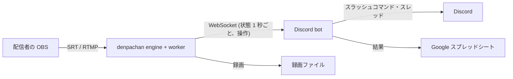

# 配信テストの自動化 (Discord bot とメトリクスの受信口) の設計

イベント前に各配信者と行う配信テストのうち、**SRT の latency の調整**を Discord bot で自動化する。
そのために engine に **メトリクスの受信口** (WebSocket、待ち受けポート 1 つ) を足す。
音声の確認 (ゲーム音だけが載っているか、ノイズ) は録画を後で見れば済むので、bot は録画を残して記録するだけにする。

- [1. 今の運用と、自動化する範囲](#1-今の運用と自動化する範囲)
- [2. 全体の構成](#2-全体の構成)
- [3. engine のメトリクスの受信口](#3-engine-のメトリクスの受信口)
- [4. Discord bot](#4-discord-bot)
- [5. latency の調整の手順 (bot の中身)](#5-latency-の調整の手順-bot-の中身)
- [6. 記録 (シート)](#6-記録-シート)
- [7. 実装の順番と大きさ](#7-実装の順番と大きさ)
- [8. 決めていないこと・注意](#8-決めていないこと注意)

## 1. 今の運用と、自動化する範囲

| 今の手順 | 自動化 | 根拠 |
| --- | --- | --- |
| 配信者と運営が時間を合わせ、Discord で通話する | bot が日時の候補を出して予約する (後回しでよい) | 人の都合の調整は bot でなくてもよい。まずは「配信者が好きな時間に送って、bot が受ける」を目指す |
| 配信者が SRT で送る、運営が受ける | **bot が受信の状態を見て、繋がった・繋がらない・途絶を配信者に伝える** | engine の状態 (§3) で分かる |
| 映像が乱れずに表示できること | **bot が取りこぼし・デコードエラー・fps で判定する** | 取りこぼし (SRT の drop) とデコードエラーが 0 で fps が出ていれば、映像は乱れていない。人の目は要らない |
| 音声が正しく来ていること、ノイズが無いこと | **録画を残し、後で人が聞く。** 音が来ていない (無音) だけは bot がその場で伝える | ノイズや混ざり方の判定は録画でできる。無音は数字で分かるので、その場で直してもらう方が早い |
| ゲーム音だけが載っていること (マイク音は別経路) | 録画を後で人が聞く | 同上 |
| 乱れるときは latency を上げる。上げても直らなければ RTMP にする | **bot が自動で行う (§5)** | 受信側の latency は engine から変えられ、実際の latency は送出側と受信側の大きい方になる (`docs/design.md` §3.2)。**送出側の設定を変えてもらわずに、受信側だけ上げて試せる** |
| 結果をシートに記録する | **bot が書く (§6)** | |

人がその場にいなくても回るのが目標。運営は後日、録画をまとめて聞いて、シートの音声の欄を埋める。

## 2. 全体の構成



- **denpachan**: テスト用の受信機。配信者ごとにチャンネルを 1 つ割り当てる (最大 8 人同時)。録画 (passthrough) を残す。
- **bot**: denpachan とは別のプログラム (別リポジトリ。Node.js + discord.js か Python + discord.py。§4)。denpachan と同じ PC で動かすのが簡単 (受信口は loopback)。別の PC でもよい (LAN、トークン必須)。
- **受信の経路**: テストでは配信者が **運営の denpachan に直接**送る (MediaConnect を通さない)。latency の調整に要るのは配信者の回線の RTT とロスで、MediaConnect の後ろで受けてもそれは見えないため。本番 (MediaConnect) との違いは §8。

## 3. engine のメトリクスの受信口

### 3.1 位置づけ

今の IPC (`\\.\pipe\denpachan`、`docs/design.md` §10.2) は名前付きパイプで、同じ PC の同じユーザーからしか繋げない。bot のために、**同じ内容を TCP の WebSocket で出す口**を engine に足す。画面と `denpachan-ctl` は今までどおりパイプを使う。

- engine に足すのは「もう 1 つの IPC サーバ」。1 秒ごとの `state` の通知と、要求 / 応答のメソッドは、パイプと同じ `Engine::handle` に流す (allowlist で絞る。§3.5)。
- それに加えて、bot が使いやすい **まとめた形** (`channels`。§3.4) を 1 秒ごとに出す。生の `state` は大きく、項目の意味が worker の内部に寄っているので、bot には安定した小さな契約を用意する。

### 3.2 設定

`general.metrics` を足す (全体設定の画面にも出す)。

```json
"metrics": { "enabled": false, "bind": "127.0.0.1", "port": 9100, "tokenProtected": "", "allowControl": false }
```

| 項目 | 内容 |
| --- | --- |
| `enabled` | 既定 off。イベント本番では切っておける |
| `bind` / `port` | 既定は loopback の 9100 (SRT の 9001〜9008、RTMP の 1935 と離す)。別の PC の bot から繋ぐなら `0.0.0.0` |
| `token` | 共有の秘密。**loopback 以外に bind するときは必須** (空なら engine が起動を断ってログに出す)。パスフレーズと同じく DPAPI で保存する (`tokenProtected`)。画面に「作り直す」ボタン |
| `allowControl` | 操作のメソッド (§3.5) を許すか。既定 off (読むだけ)。bot に latency を変えさせるなら on |

TLS はしない (家庭内 LAN か同じ PC で使う。外から繋ぐなら VPN か ssh のトンネルを通す)。

### 3.3 プロトコル

WebSocket (RFC 6455)、テキストフレーム、1 フレームに JSON 1 つ。

- 接続: `GET /ws HTTP/1.1` + `Upgrade: websocket`。認証は `Authorization: Bearer <token>` ヘッダか `?token=<token>` (ブラウザから試すとき)。合わなければ `401` で切る。
- 繋がったら engine が `hello` を 1 つ送る。以後 1 秒ごとに `channels` を送る (engine の tick で `state` の通知と同時に作る)。
- 要求 / 応答はパイプと同じ形: `{"id": 1, "method": "getState", "params": {}}` → `{"id": 1, "result": ...}` / `{"id": 1, "error": "..."}`。
- ping / pong は WebSocket の制御フレームで。engine は 30 秒応答が無い相手を切る。
- 同時接続は 8 まで。書き込みが 1 秒待っても進まない相手 (受け取らない bot) は切る。**engine の tick を止めない** (パイプの `broadcast` と同じ作り: クライアントごとのスレッドとキュー、溢れたら古いものから捨てる)。

### 3.4 `channels` メッセージ (bot 向けのまとめ)

1 秒ごと。全チャンネル分 (止まっているチャンネルも `status: "stopped"` で入れる。bot が「どのチャンネルが空いているか」を知るため)。

```json
{
  "event": "channels",
  "time": "2026-11-01T12:34:56.789Z",
  "channels": [
    {
      "ch": 1, "name": "Runner A", "enabled": true,
      "status": "live",
      "source": { "protocol": "srt", "mode": "listener", "port": 9001, "peer": "203.0.113.5:51234", "connectedSec": 83 },
      "video": { "codec": "h264", "width": 1920, "height": 1080, "fps": 59.9, "outputFps": 60, "bitrateMbps": 6.1, "hwDecode": true,
                 "decodeErrors": 0, "droppedLate": 0, "droppedQueue": 0 },
      "latency": {
        "effectiveMs": 120, "receiverMs": 120,
        "rttMs": 46.0, "lossPct": 0.8, "drops": 0, "windowSec": 60,
        "recommendMs": 280, "multiplier": 6,
        "headroomMs": -160,
        "verdict": "tight"
      },
      "audio": { "peakDb": [-9.5, -9.8], "gaps": 0, "silentSec": 0 },
      "record": { "state": "recording", "file": "D:\\rec\\1 - 202611\\01 12-33-10.mkv", "seconds": 106 },
      "rejectedSenders": 0,
      "lastError": ""
    }
  ]
}
```

| 項目 | 元 (`state` の項目) | 意味 |
| --- | --- | --- |
| `status` | `worker.state`、`video.state`、`video.connected`、`lastError` | 画面のタイルと同じ区分: `stopped` / `listening` / `connecting` (caller・pull) / `waiting` (繋がったが映像がまだ) / `live` / `hold` (途絶、最後の絵を保持) / `unreachable` (繋がらない。`lastError` に理由) / `restarting` / `unavailable` (FFmpeg が無い) |
| `source.connectedSec` | `video.connected` が立ってからの秒数 (engine で数える) | 繋がってからの時間。推奨値は接続後 15 秒 (5 秒の除外 + 10 秒分) から出る |
| `video.fps` | `video.decodeFps` | 受信した映像の fps (送出側の設定が出ているか) |
| `latency.effectiveMs` | `srt.latencyMs` | **実際に使われている latency** (送出側と受信側の大きい方) |
| `latency.receiverMs` | `srt.configuredLatencyMs` | 受信側 (denpachan) の設定値 |
| `latency.rttMs` / `lossPct` / `drops` / `windowSec` | `srt.recommend.*` | 直近 60 秒の窓での RTT の最大、ロス率、取りこぼし (再送が間に合わず捨てたパケット) の数、溜まっている秒数 |
| `latency.recommendMs` / `multiplier` | `srt.recommend.latencyMs` / `multiplier` | 推奨値 (`src/worker/srt_advisor.h`)。0 = 計測中 |
| `latency.headroomMs` | `effectiveMs − recommendMs` | **今の latency の余裕。** 正なら余っている、負なら足りない。計測中は null |
| `latency.verdict` | 画面の経路の行の色と同じ規則 | `measuring` (推奨値がまだ無い) / `insufficient` (窓の中に取りこぼしがある = 画面の赤) / `tight` (推奨値 > 実際の latency = 画面の黄) / `ok` / `generous` (実際の latency が推奨値の 2 倍以上。下げられる) |
| `audio.silentSec` | `audioIn.peakDb` が両チャンネルとも −60 dB 未満の連続秒数 (engine で数える) | 音が来ていない時間。bot は 10 秒を超えたら伝える |
| `rejectedSenders` | `video.rejectedSenders` | 同じ宛先に別の送出元がつないできて断った数 (宛先の間違いに気づくため) |

RTMP のチャンネルでは `latency` の代わりに `tcp: { rttMs, retransBytes }` を入れる (`verdict` は `ok` / `tight` (直近 1 分に再送あり) だけ)。

`hello`:

```json
{ "event": "hello", "version": "0.2.0", "channelCount": 4, "allowControl": true, "intervalMs": 1000 }
```

### 3.5 メソッド (要求 / 応答)

パイプと同じメソッドを、allowlist で絞って通す。

| 種別 | メソッド | 条件 |
| --- | --- | --- |
| 読む | `getState`、`getConfig` (IPC 形。秘密は入らない)、`getChannels` (`channels` と同じ内容を 1 回) | いつでも |
| 操作 | `startChannel`、`stopChannel`、`setRecording`、`patchChannel` | `allowControl` が on のとき |

`patchChannel` は bot が壊せる範囲を狭める: **`source.latencyMs` と `name` だけ**を受け付ける (他の項目が入っていれば `error`)。ポートやパスフレーズ、録画先は画面から決める。

bot が latency を変えると worker が起動し直し (繋ぎ直し)、送出側 (OBS) は自動で繋ぎ直す。bot は変える前に配信者へ「数秒切れますが自動で繋ぎ直します」と伝える (§5)。

### 3.6 実装 (engine)

- `src/engine/ws_server.cpp/h` (新規): TCP の待ち受け、HTTP の Upgrade、フレームの読み書き (テキスト、ping/pong、close。クライアントからのマスクを外す)、クライアントごとのスレッド。`IpcServer` と同じ `Handler` と `broadcast` の形にして、`Engine` からは 2 つのサーバに同じものを流す。
  - 握手の `Sec-WebSocket-Accept` は SHA-1 + Base64。SHA-1 は Windows の `BCryptHash` (新しい依存なし)。
  - 外部のライブラリは入れない (使うのはテキストフレームの送受信だけで、rtmpd と同じく自前で十分。300〜400 行)。
- `Engine::tick` で 1 秒ごとに `state_locked()` を作ったあと、`channels_view(state)` でまとめた形を作って `ws_.broadcast` する。`connectedSec` と `silentSec` は engine がチャンネルごとに数える (`state` の変化を見る)。
- `Engine::handle` の前に allowlist と `patchChannel` の絞り込みを置く (`ws_handle(method, params)` → `handle`)。
- `docs/design.md` §10.2 に「WebSocket の受信口」の項を足す。`denpachan-ctl` に `ws-watch` (動作確認用) を足してもよい。

## 4. Discord bot

### 4.1 構成

- 別リポジトリ。Node.js + discord.js (スラッシュコマンド、スレッド、ボタン) + `ws` + Google Sheets API。Python + discord.py でも同じ。
- 設定: Discord のトークン、サーバとチャンネル、denpachan の受信口 (host、port、token)、公開する接続先 (配信者に案内する SRT の host と port、RTMP の URL)、シートの ID。
- 状態 (テストのセッション) は SQLite に持つ (bot を起動し直しても続きから)。

### 4.2 コマンド

| コマンド | 誰が | すること |
| --- | --- | --- |
| `/test start @配信者 [ch]` | 運営 (または配信者本人) | 空いているチャンネルを割り当て、**スレッド**を作って配信者を呼ぶ。接続先 (SRT の URL、パスフレーズ、推奨の OBS 設定) を貼る。録画を始める (`setRecording`)。監視を始める |
| `/test status [ch]` | 誰でも | 今の `channels` を人が読める形で出す |
| `/test latency <ms>` | 運営 | 手で受信側の latency を変える (自動の途中でも) |
| `/test rtmp` | 運営 | RTMP に切り替える (自動の判定を待たずに) |
| `/test finish [結果メモ]` | 運営・配信者 | 録画を止め、結果をシートに書き、スレッドにまとめを貼る |
| `/test review @配信者 音声:OK/NG メモ` | 運営 (後日) | 録画を聞いた結果をシートの音声の欄に書く |
| `/test cancel` | 運営 | 中止 (チャンネルを空ける) |

スレッドの中では、bot が節目ごとに短く書く (繋がった、計測中、latency を上げる、安定した、RTMP に切り替える、無音、終了)。1 秒ごとの数字は書かない (`/test status` で見る)。

### 4.3 監視の状態機械

```
WAITING ──(status が waiting/live)──> CONNECTED ──(15 秒)──> MEASURING ──(windowSec ≥ 30)──> JUDGE
   │ 10 分で一度だけ「まだ届いていません」と伝える          │
   │                                                   ├─ ok / generous ──> STABLE (さらに 60 秒見て確定) ──> DONE
   │                                                   ├─ tight / insufficient ──> RAISE (latency を上げる) ──> CONNECTED
   │                                                   └─ 上限まで上げても insufficient ──> RTMP (切り替え) ──> CONNECTED (RTMP で再判定) ──> DONE
   └─(unreachable / rejectedSenders が増える)──> 配信者に理由を伝える (パスフレーズ、ポート、宛先違い)
```

途中で `hold` (途絶) や `listening` に戻ったら CONNECTED からやり直す (切れた回数を数えて記録する)。

## 5. latency の調整の手順 (bot の中身)

1. **初期値**: 受信側 120 ms (既定)。配信者には OBS の URL に `latency=120000` (µs) を入れてもらう。実際の latency は両側の大きい方なので、受信側だけ上げれば効く。
2. **計測**: 繋がって 15 秒後から推奨値が出る。`windowSec` が 30 以上になってから判定する (`verdict` と `headroomMs` をそのまま使う。閾値は engine と画面に合わせてあるので bot で決め直さない)。
3. **上げる**: `tight` か `insufficient` なら、受信側の latency を `max(recommendMs, effectiveMs × 1.5)` を 10 ms 単位に切り上げた値にする (`patchChannel`)。上限 2000 ms。切り替えの前にスレッドで伝える (数秒切れて自動で繋ぎ直す)。繋ぎ直したらまた計測 (2 へ)。最大 4 回。
4. **安定の確定**: `ok` か `generous` が出たら、さらに 60 秒見て `drops == 0`、`decodeErrors` が増えない、`fps` が 60 秒の平均で期待の 90% 以上 (期待は解像度・fps の案内値、たとえば 1080p60) であれば **確定**。`generous` なら推奨値まで下げる提案を添える (下げるのは任意)。
5. **確定したら配信者に伝える**: 「latency は **N ms** にしてください」。N = 確定した `effectiveMs` に余裕を足した値 (本番は MediaConnect が受けるので経路が変わる。§8)。本番の MediaConnect の入力 (SRT listener) の latency もこの値にする。
6. **RTMP への切り替え**: 上限まで上げても `insufficient`、または `decodeErrors` が増え続ける・`fps` が出ない (回線でなく送出側の問題の可能性) なら、`patchChannel` で `source.protocol = "rtmp"` にはせず (§3.5 の絞り込みの外)、**あらかじめ RTMP 用に用意したチャンネル**に配信者を移す (bot が RTMP の URL とキーを貼り、監視するチャンネルを変える)。RTMP で `live` になり 60 秒 `tcp.verdict == ok` で確定。結果は「RTMP」。
7. **無音**: どの段階でも `audio.silentSec > 10` なら「音が届いていません (OBS の音声の設定を確認)」を一度だけ伝える。音が来たら解除。

判定に使う数字はすべて `channels` にあるので、bot は engine の内部を知らなくてよい。閾値を変えたくなったら engine 側 (`srt_advisor.h`) を変える。

## 6. 記録 (シート)

1 テスト 1 行。`/test finish` で書き、`/test review` で音声の欄を埋める。

| 列 | 内容 |
| --- | --- |
| 日時、配信者 (Discord の名前と ID)、チャンネル | |
| プロトコル | srt / rtmp |
| 確定した latency (ms)、推奨値、RTT (最大)、ロス率、取りこぼし | SRT のとき |
| 解像度、fps (平均)、コーデック、ビットレート (平均) | |
| 切れた回数、デコードエラー、latency を上げた回数 | |
| 音声のピーク (平均)、無音の秒数 | |
| 録画ファイル | 後で聞く |
| 映像の判定 | bot: OK / RTMP / NG |
| 音声の判定、メモ | 人 (`/test review`) |
| スレッドのリンク | |

録画は passthrough (再エンコードしない) で、容器は mkv。録画先と空き容量の下限は denpachan の設定のまま。

## 7. 実装の順番と大きさ

| 段 | 内容 | 大きさの目安 |
| --- | --- | --- |
| 1 | engine: `general.metrics` の設定、WebSocket サーバ、`hello` / `channels` の配信、`getState` / `getChannels` (読むだけ) | C++ 500 行前後 + 画面の全体設定 |
| 2 | bot: 接続、`/test start` / `status` / `finish`、スレッドでの通知、シートへの記録 | bot の骨格 |
| 3 | engine: `allowControl` と `patchChannel` の絞り込み、`setRecording`。bot: §5 の自動調整 | |
| 4 | bot: RTMP への切り替え、無音の通知、`/test review` | |
| 5 | (任意) 予約、MediaConnect の CloudWatch からの `channels` (§8) | |

段 1 と 2 で「配信者が好きな時間に送り、bot が受けて記録する」までできる。段 3 で latency の調整が自動になる。

## 8. 決めていないこと・注意

- **本番の経路との違い**: テストは配信者 → 運営の denpachan (直接)、本番は配信者 → MediaConnect (AWS) → 運営。RTT とロスは経路で変わるので、テストで決めた latency は目安で、本番の値には余裕を足す (たとえば 1.5 倍、下限 +100 ms)。本番の経路で測りたいときは、bot に **MediaConnect の CloudWatch メトリクス** (source の RTT、パケットロス率、回復できなかったパケット、ビットレート。1 分粒度) から同じ `channels` の形を作るアダプタを足す。`channels` の形を engine の内部から切り離してあるのはこのため。
- **運営 PC の公開**: 配信者が直接送るには、運営 PC の SRT のポート (9001〜9008) と RTMP (1935) を外から届くようにする (ルータのポート転送か、固定 IP のある会場の回線)。パスフレーズは必ず付ける (`pbkeylen` 16 以上)。
- **同時に何人まで**: チャンネル数 (最大 8)。1 人 1 チャンネル。bot は空いているチャンネルを `status == stopped` から選ぶ。
- **配信者の OBS の設定の確認** (解像度・fps・ビットレート・音声の経路) は、bot が「案内した値」と `video` の値を比べて違いを伝えるところまで。設定そのものは配信者が直す。
- **bot が落ちたとき**: engine は影響を受けない (受信口は engine の tick から切り離してある)。bot は起動し直したら SQLite のセッションを読み、`channels` を見て続きから監視する。
- **engine の受信口を本番で使うか**: 本番は `enabled: false` でよい。使うなら `bind: 127.0.0.1` のまま、bot を同じ PC で動かす。
